# Lyapunov-Based LSTM Adaptive Observers for an Underactuated Cart–Pendulum

[](https://www.python.org/downloads/)
[](https://opensource.org/licenses/MIT)
[](#)
[](#)
[](#run-the-tests)

This repository estimates the unmeasured velocities of the Feedback Instruments 33-936S
cart–pendulum from its encoders alone. It also learns a model of the rig's dynamics while it
does so. It contains five learning observers (Approaches A–E), the classical baselines they are
compared with, a shared benchmark that runs all of them under identical conditions, and a tool
that replays recordings from the real rig through every model.

Everything lives on this one branch. The original per-approach branches are kept unchanged as
history (§14.3).

---

## Index

**Start here**

- [simulation_instructions](#simulation_instructions): every terminal command in one place
  - [Setup](#setup) · [Run the tests](#run-the-tests) · [Classical baselines](#classical-baselines) · [Approach A](#approach-a-commands) · [Approach B](#approach-b-commands) · [Approach C](#approach-c-commands) · [A vs C comparison](#a-vs-c-comparison-command) · [Approach D](#approach-d-commands) · [Approach E](#approach-e-commands) · [Shared benchmark](#shared-benchmark-commands) · [Real-rig data](#real-rig-data-commands) · [Diagrams](#diagram-commands) · [Everything, in order](#everything-in-order)
- [1. Overview: what was built and which approach is best](#1-overview-what-was-built-and-which-approach-is-best)

**Background**

- [2. Problem statement and the testbed](#2-problem-statement-and-the-testbed)
  - [2.1 Sensor constraints](#21-sensor-constraints) · [2.2 Equations of motion](#22-equations-of-motion) · [2.3 Plant parameters](#23-plant-parameters) · [2.4 Analytic Jacobians](#24-analytic-jacobians)
- [3. Research lineage](#3-research-lineage)
- [4. Classical baselines and the architectural comparison matrix](#4-classical-baselines-and-the-architectural-comparison-matrix)
  - [4.1 Comparison matrix](#41-comparison-matrix) · [4.2 Baseline benchmark](#42-baseline-benchmark)
- [5. The common observer skeleton and its stability proof](#5-the-common-observer-skeleton-and-its-stability-proof)
  - [5.1 Problem setting](#51-problem-setting) · [5.2 Filter and observer](#52-filter-and-observer) · [5.3 Filter algebra and exact cancellation](#53-filter-algebra-and-exact-cancellation) · [5.4 An implementable adaptation law](#54-an-implementable-adaptation-law) · [5.5 Robustness: the RISE integral lemma](#55-robustness-the-rise-integral-lemma)

**The five approaches**

- [6. Approach A: black-box Lb-LSTM observer](#6-approach-a-black-box-lb-lstm-observer)
  - [6.1 Continuous-time LSTM](#61-continuous-time-lstm) · [6.2 Analytical Jacobians](#62-analytical-jacobians) · [6.3 Adaptation law and smooth projection](#63-adaptation-law-and-smooth-projection) · [6.4 Euler discretization](#64-euler-discretization) · [6.5 System identification stage](#65-system-identification-stage) · [6.6 Tuning guidelines](#66-tuning-guidelines) · [6.7 Results](#67-results)
- [7. Approach B: physics-informed PI-LSTM observer](#7-approach-b-physics-informed-pi-lstm-observer)
  - [7.1 Problem setting and Euler–Lagrange invariants](#71-problem-setting-and-eulerlagrange-invariants) · [7.2 Inertia sub-network](#72-inertia-sub-network-modified-cholesky-parametrization) · [7.3 Coriolis, gravity and friction](#73-coriolis-gravity-and-friction-sub-networks) · [7.4 Observer](#74-observer) · [7.5 Jacobian engine](#75-jacobian-engine-and-blockwise-adaptation) · [7.6 Discretization](#76-discretization) · [7.7 Design decisions](#77-design-decisions) · [7.8 Results](#78-results) · [7.9 Structure versus black box](#79-structure-versus-black-box) · [7.10 Limitations](#710-limitations)
- [8. Approach C: concurrent-learning Lb-LSTM observer](#8-approach-c-concurrent-learning-lb-lstm-observer)
  - [8.1 The PE bottleneck](#81-the-persistence-of-excitation-bottleneck) · [8.2 Rank condition](#82-concurrent-learning-and-the-rank-condition) · [8.3 Architecture](#83-architecture) · [8.4 History stack](#84-history-stack-singular-value-maximizing-recording) · [8.5 Acceleration proxy](#85-acceleration-proxy-causal-savitzkygolay-differentiation) · [8.6 Adaptation laws](#86-adaptation-laws) · [8.7 Stability](#87-stability-and-convergence-under-concurrent-learning) · [8.8 Non-PE validation](#88-validation-under-non-pe-excitation) · [8.9 C's predictor benchmark](#89-open-loop-predictor-benchmark) · [**8.10 Approach A vs Approach C**](#810-approach-a-vs-approach-c-on-the-shared-benchmark) · [8.11 Configuration](#811-configuration) · [8.12 Limitations](#812-limitations)
- [9. Approach D: physics-structured observer with integral concurrent learning](#9-approach-d-physics-structured-observer-with-integral-concurrent-learning)
  - [9.1 Results at a glance](#91-results-at-a-glance) · [9.2 Model](#92-model-linear-in-parameters-eulerlagrange-structure) · [9.3 Integral concurrent learning](#93-integral-concurrent-learning-no-acceleration-needed) · [9.4 The pendulum row](#94-why-the-pendulum-row-needs-a-different-regression) · [9.5 Adaptation law](#95-adaptation-law) · [9.6 Model order](#96-model-order-why-k--1) · [9.7 Validation](#97-validation) · [9.8 What D does not do better](#98-what-d-does-not-do-better) · [9.9 Configuration](#99-configuration) · [9.10 What D resolves](#910-what-d-resolves)
- [10. Approach E: hybrid of B and D](#10-approach-e-hybrid-of-b-and-d)
  - [10.1 Parents](#101-what-comes-from-each-parent) · [10.2 Own-coordinate inertia freeze](#102-why-d-fails-on-small-swings-and-the-own-coordinate-inertia-freeze) · [10.3 Information-weighted blend](#103-information-weighted-blend-of-the-two-adaptation-laws) · [10.4 Optional residual](#104-optional-residual-bs-dissipative-friction-lstm) · [10.5 Stability](#105-stability-and-convergence-sketch) · [10.6 Validation](#106-validation) · [10.7 What E does not do better](#107-what-e-does-not-do-better) · [10.8 Configuration](#108-configuration)

**Comparing them**

- [11. Shared benchmark: all approaches side by side](#11-shared-benchmark-all-approaches-side-by-side)
  - [11.1 Protocol](#111-protocol) · [11.2 Velocity reconstruction](#112-velocity-reconstruction-cold-start) · [11.3 Transients and plant change](#113-transient-behaviour-and-recovery-from-the-plant-change) · [11.4 Held-out prediction](#114-held-out-prediction) · [11.5 Removing the cart position](#115-improvement-2-remove-the-cart-position-from-the-black-box-inputs) · [11.6 Warm start](#116-improvement-3-model-free-warm-start) · [11.7 Caveats](#117-caveats)
- [12. Evaluating on recorded rig data](#12-evaluating-on-recorded-rig-data)
  - [12.1 Recording folder](#121-recording-folder) · [12.2 Running it](#122-running-it) · [12.3 What is reported](#123-what-is-reported-and-what-it-can-show)
- [13. Literature review and result cross-verification](#13-literature-review-and-result-cross-verification)

**Reference**

- [14. Repository layout](#14-repository-layout)
  - [14.1 Directory tree](#141-directory-tree) · [14.2 File map](#142-file-map) · [14.3 Branch history](#143-branch-history)
- [15. References](#15-references)

**How to read the figures.** Every plot is followed by a short box that says what it shows and
what the result means. In the plots, RMSE is a root-mean-square error (lower is better). NMSE is
the mean-squared error divided by the variance of the truth: 1 means "no better than predicting
the average", and 0.01 means the error is 1 % of the signal's variance.

---

## simulation_instructions

Every command below is run from the repository root, inside the virtual environment of
[Setup](#setup). All simulations are seeded, so each command reproduces the numbers in this
README. Runtimes were measured on an 8-core laptop.

Figures (`figures/`) are stored in the repository. Numerical outputs (`results/`) are not: each
experiment writes its own CSVs there when it runs.

### Setup

```bash
# 1. Get the code
git clone https://github.com/sidharthaxy/LSTM-RNN-observer-design.git
cd LSTM-RNN-observer-design

# 2. Create and activate a virtual environment (Python >= 3.10)
python3 -m venv .venv
source .venv/bin/activate            # Windows: .venv\Scripts\activate

# 3. Install the dependencies: numpy, scipy, matplotlib, pandas, numba, pytest
pip install -r requirements.txt
```

The observers do **not** use PyTorch or TensorFlow. Every learning law is an analytical
differential equation, integrated with NumPy at 1 kHz.

**Thread setting.** The scripts that run many simulations in parallel (Approaches C, D, E and
the shared benchmark) set `OMP_NUM_THREADS=1` for their worker processes themselves. If you call
a module directly and it runs slowly, prefix the command with `OMP_NUM_THREADS=1`, as shown below
for Approach C. Without it, parallel runs fight over BLAS threads and can be many times slower.

### Run the tests

```bash
pytest -q                                   # all 126 tests, about 2 min
pytest -v                                   # the same, one line per test
```

Run the tests of one part only:

| Part | Command | Tests |
|:---|:---|---:|
| Testbed: plant, sensor noise, baselines, metrics | `pytest -q tests/test_plant.py tests/test_sensor_noise.py tests/test_baselines.py tests/test_metrics.py` | 19 |
| Approach A | `pytest -q tests/test_blackbox_lstm.py tests/test_jacobian_engine.py tests/test_extract_model.py` | 18 |
| Approach B | `pytest -q tests/test_pilstm.py tests/test_physics_informed_lstm.py` | 22 |
| Approach C | `pytest -q tests/test_cl_lstm_observer.py tests/test_point_history_stack.py` | 23 |
| Approach D | `pytest -q tests/test_pi_icl.py tests/test_history_stack.py` | 23 |
| Approach E | `pytest -q tests/test_hybrid.py` | 7 |
| Shared benchmark | `pytest -q tests/test_shared_benchmark.py` | 8 |
| Rig-data tool | `pytest -q tests/test_rig_data.py` | 6 |

### Classical baselines

Dirty derivative, Butterworth differentiator, continuous–discrete EKF and the shallow dynamic RNN
on the testbed (§4.2).

```bash
python scripts/run_benchmarks.py            # prints the RMSE / chattering table of §4.2
python scripts/visualize_baselines.py       # writes figures/baseline_estimation_comparison.png (Figure 1)
```

### Approach A commands

Black-box Lb-LSTM observer (§6).

```bash
# Validation: velocity estimation, digital twin, 5 initialization seeds.
# About 70 s. Writes figures/approach_a/*.png and results/approach_a/lblstm_frozen.npz
python experiments/run_blackbox_validation.py --seeds 5

# Same, with the actuator dead-zone and stiction switched on
python experiments/run_blackbox_validation.py --actuator-effects

# Score the frozen model saved by the validation run above as an open-loop digital twin
# on unseen inputs (§6.5)
python -m src.identification.extract_model --weights results/approach_a/lblstm_frozen.npz

# Dirty derivative vs shallow RNN vs Lb-LSTM on all three benchmark scenarios
# Writes figures/approach_a/estimation_error_norm.png (Figure 3)
python scripts/generate_three_scenario_comparison.py
```

Other options of `run_blackbox_validation.py`: `--t-final`, `--t-freeze` (≥ 20 s), `--seed`,
`--noise-seed`, `--no-plots`, `--fig-dir`, `--results-dir`.

### Approach B commands

Physics-informed PI-LSTM observer (§7).

```bash
# Extreme-condition benchmark against A, 5 seeds, plus all ablations of §7.8.6
# About 2.5 min. Writes figures/approach_b/*.png
python experiments/run_pilstm_validation.py --seeds 5 --ablations

# Stress run with the PCI-1711 dead-zone and 0.35 N Coulomb friction
python experiments/run_pilstm_validation.py --actuator-effects

# Mass step that leaves the pendulum inertia unchanged
python experiments/run_pilstm_validation.py --mass-only
```

Other options: `--t-final`, `--noise-seed`, `--no-plots`, `--fig-dir`, `--results-dir`.

### Approach C commands

Concurrent-learning Lb-LSTM observer (§8).

```bash
# Full validation: non-PE convergence study and the A-vs-C predictor benchmark.
# 14 training runs in parallel, about 80 s. Writes figures/approach_c/*.png and
# results/approach_c/predictor_benchmark.csv, predictor_summary.csv
python experiments/run_cl_validation.py --seeds 3

# Predictor benchmark only (per-seed CSV and median table)
OMP_NUM_THREADS=1 python -m src.identification.benchmark_predictor --seeds 3

# Benchmark trained on the single-frequency command instead of the decaying one
OMP_NUM_THREADS=1 python -m src.identification.benchmark_predictor --seeds 3 --scenario single_freq
```

Other options: `run_cl_validation.py --workers N --no-plots`;
`benchmark_predictor --t-final T --out FILE.csv`.

### A vs C comparison command

Approach A against Approach C on the shared benchmark (§8.10). It runs no simulation: it reads
the shared benchmark's CSVs in `results/shared_benchmark/`. The `results/` folder is not stored in
the repository, so on a fresh clone run the shared benchmark once first.

```bash
# Only needed once, if results/shared_benchmark/*.csv do not exist yet (about 20 min)
python experiments/run_shared_benchmark.py --seeds 5

# Prints the median table of §8.10 and writes figures/comparisons/a_vs_c.png (Figure 16)
python scripts/compare_a_c.py
```

### Approach D commands

Physics-structured observer with integral concurrent learning (§9).

```bash
# 5-seed benchmark against A and B on B's scenario: identification, free swing, figures.
# About 1 min. Writes figures/approach_d/*.png and results/approach_d/*.csv
python experiments/run_d_validation.py --seeds 5
```

Other options: `--workers N`, `--no-plots`.

### Approach E commands

Hybrid of B and D (§10).

```bash
# Three scenarios, B / D / E and the ablations, 5 seeds.
# About 20 min. Writes figures/approach_e/*.png and results/approach_e/*.csv
python experiments/run_e_validation.py --seeds 5

# One-minute smoke test of the pipeline (every scenario cut to 10 s; not for results)
RUN_E_QUICK=1 python experiments/run_e_validation.py --seeds 1
```

Other options: `--workers N`, `--no-plots`.

### Shared benchmark commands

All seven models (A, A-x, B, C, C-x, D, E) on all three scenarios, cold and warm start (§11).

```bash
# Full benchmark: 210 runs, about 20 min.
# Writes results/shared_benchmark/*.csv and figures/shared_benchmark/*.png
python experiments/run_shared_benchmark.py --seeds 5

# Run only some models and merge them into the saved CSVs (here: only E)
python experiments/run_shared_benchmark.py --only E

# Rerun only the warm-start runs and merge them (about 9 min)
python experiments/run_shared_benchmark.py --warm-only --workers 2

# Redraw the figures from the saved CSVs, without simulating
python experiments/run_shared_benchmark.py --plots-only
```

Other options: `--workers N`, `--no-plots`.

### Real-rig data commands

Replays recordings from the physical rig through the observers (§12).

```bash
# 1. Write the metadata template, then edit it to match your DAQ setup
python experiments/run_rig_evaluation.py --template > data/rig/metadata.txt

# 2. Optional rehearsal: write simulated runs in the rig file format, then evaluate them
python experiments/run_rig_evaluation.py --make-demo data/rig_demo
python experiments/run_rig_evaluation.py --data data/rig_demo

# 3. Evaluate the real recordings (default models: B, D and E)
python experiments/run_rig_evaluation.py --data data/rig

# Every approach, with 3 initialization seeds per (model, run)
python experiments/run_rig_evaluation.py --data data/rig --models A B C D E --seeds 3
```

Outputs go to `results/rig/<folder>/` (`run_report.csv`, `velocity.csv`, `prediction.csv`,
`parameters.csv`) and `figures/rig/<folder>/summary.png`. Other options: `--workers N`,
`--no-plots`, `--demo-repeats N` (trials per run type in the rehearsal data). The models can be
any of `A A-x B C C-x D E`.

### Diagram commands

```bash
# Regenerate every block diagram (SVG plus editable .excalidraw) from figures/diagrams/src/*.json
python figures/diagrams/src/render_diagrams.py
```

The `.excalidraw` files open at [excalidraw.com](https://excalidraw.com) for editing.

### Everything, in order

```bash
pytest -q
python scripts/run_benchmarks.py
python scripts/visualize_baselines.py
python experiments/run_blackbox_validation.py --seeds 5
python scripts/generate_three_scenario_comparison.py
python experiments/run_pilstm_validation.py --seeds 5 --ablations
python experiments/run_cl_validation.py --seeds 3
python experiments/run_d_validation.py --seeds 5
python experiments/run_e_validation.py --seeds 5
python experiments/run_shared_benchmark.py --seeds 5
python scripts/compare_a_c.py
python figures/diagrams/src/render_diagrams.py
```

Roughly an hour in total, most of it in Approach E and the shared benchmark.

---

## 1. Overview: what was built and which approach is best

The benchmark system is the **Feedback Instruments 33-936S digital cart–pendulum rig**,
interfaced through an **Advantech PCI-1711 DAQ card**. In operation only the encoder positions
$(x, \theta)$ are available: discrete, quantized and noisy. Differentiating them directly
(dirty derivatives, high-gain observers) amplifies the encoder noise into high-frequency
chattering, which degrades closed-loop stabilization and wears the actuator.

This project develops **continuous-time neural adaptive observers** whose weight-adaptation laws
come from a **Lyapunov stability analysis**. They are not trained offline by backpropagation
through time. Each observer is a set of **ordinary differential equations** integrated online at
1 kHz with NumPy and SciPy. The analysis guarantees uniform ultimate boundedness (UUB) of the
estimation errors, and asymptotic convergence when the robust gain meets the condition derived
in §5.5.

All five approaches share one observer skeleton (§5). They differ in the learned model and in
how it adapts:

| | Approach | One-line idea | Section |
|:---|:---|:---|:---|
| A | Black-box Lb-LSTM | A continuous-time LSTM learns the whole acceleration field, with no physics | §6 |
| B | Physics-informed PI-LSTM | Sub-networks for inertia, Coriolis, gravity and friction, built so that the laws of mechanics hold for every weight value | §7 |
| C | Concurrent-learning Lb-LSTM | A's observer plus a memory of past data, so it keeps learning after the excitation fades | §8 |
| D | Physics-structured integral CL | A 15-parameter Euler–Lagrange model that is exact for the rig, identified from integrated data without any acceleration estimate | §9 |
| E | Hybrid of B and D | D's model and memory, B's learning law in the directions the memory cannot resolve | §10 |

**Verdict in plain words.** The shared benchmark (§11) runs every approach on every scenario with
the same seeds and metrics.

- **Approach E is the best overall.** It has the lowest steady-state velocity error in all three
  scenarios, the best prediction on held-out inputs (2× to 56× better than the runner-up), and
  it identifies the rig's inertia to within 0.3 %. It is not perfect: B still settles faster in
  the first 5 s of small-swing runs (§10.7), and its learning gain has only about a 3× margin
  to instability.
- **Physics structure is what makes a model generalize.** B, D and E predict unseen inputs one to
  four orders of magnitude better than the black boxes A and C (§11.4).
- **Approach A is a good velocity observer but not a model.** Its frozen weights do not predict
  unseen inputs (§6.7.4).
- **Approach C fixes part of A's problem.** It beats A on 0.5 s held-out prediction after
  weak, non-persistent excitation, and gains most when combined with removing the cart position from
  the inputs (§8.10). Without a change detector it is the worst after a plant change.
- **Approach D identifies the rig almost exactly when the data are rich**, but fails on small
  swings, where its pendulum-row scale runs away (§10.2). E repairs exactly this.
- **Everything here is simulation.** §12 describes how to replay real rig recordings through the
  same models.

---

## 2. Problem statement and the testbed

Consider the general underactuated Euler–Lagrange system

$$\mathbf{M}(q)\ddot{q} + \mathbf{C}(q, \dot{q})\dot{q} + \mathbf{G}(q) + \mathbf{F}_f(\dot{q}) + \mathbf{\Delta}(q, \dot{q}, t) = \mathbf{B} u$$

with generalized coordinates $q = [x, \theta]^T \in \mathbb{R}^2$, actuator force
$u = F \in \mathbb{R}$, and state $\mathbf{x} = [x, \dot{x}, \theta, \dot{\theta}]^T = [x_1, x_2, x_3, x_4]^T \in \mathbb{R}^4$.

### 2.1 Sensor constraints

Only positions are measured, by optical encoders:

$$y(t) = \begin{bmatrix} x_m(t) \\ \theta_m(t) \end{bmatrix} = \mathbf{H} \mathbf{x}(t) + \mathbf{v}(t) = \begin{bmatrix} x(t) \\ \theta(t) \end{bmatrix} + \begin{bmatrix} v_x(t) \\ v_\theta(t) \end{bmatrix}$$

where:

1. **Encoder noise.** $v_\theta \sim \mathcal{U}(-0.5^\circ, +0.5^\circ)$ and $v_x \sim \mathcal{U}(-0.2\text{ mm}, +0.2\text{ mm})$.
2. **Quantization.** The PCI-1711 quadrature counters discretize position: $4096$ counts/m for the cart, $4096$ counts/rev for the pendulum.
3. **Asymmetric dead-zone and stiction.** The drive amplifier has an asymmetric dead-band ($+0.15$ V forward, $-0.12$ V reverse) and static breakaway friction $F_{\text{stiction}} \approx 0.35$ N.
4. **Unmodelled dynamics.** $\mathbf{\Delta}(q, \dot{q}, t)$ covers cable drag, track irregularities and velocity-dependent stiction.

**Objective.** Reconstruct the full state $\hat{\mathbf{x}} = [\hat{x}, \hat{\dot{x}}, \hat{\theta}, \hat{\dot{\theta}}]^T$
and identify the unknown dynamics, without velocity chattering and with a guaranteed bound
$\lim_{t \to \infty} \|\mathbf{x}(t) - \hat{\mathbf{x}}(t)\| \le \epsilon$.

### 2.2 Equations of motion

From the Feedback Instruments 33-936S manual [21]:

$$\begin{aligned}
(M + m)\ddot{x} + b\dot{x} + m l \ddot{\theta}\cos(\theta) - m l \dot{\theta}^2\sin(\theta) &= F \\
(I + m l^2)\ddot{\theta} - m g l \sin(\theta) + m l \ddot{x}\cos(\theta) + d\dot{\theta} &= 0
\end{aligned}$$

In matrix form:

$$\begin{bmatrix} M + m & m l \cos\theta \\ m l \cos\theta & I + m l^2 \end{bmatrix} \begin{bmatrix} \ddot{x} \\ \ddot{\theta} \end{bmatrix} = \begin{bmatrix} F - b\dot{x} + m l \dot{\theta}^2\sin\theta \\ m g l \sin\theta - d\dot{\theta} \end{bmatrix}$$

$$\mathbf{M}(\theta) = \begin{bmatrix} M + m & m l \cos\theta \\ m l \cos\theta & I + m l^2 \end{bmatrix},\qquad
\det(\mathbf{M}(\theta)) = (M + m)(I + m l^2) - (m l \cos\theta)^2 > 0 \quad \forall \theta \in \mathbb{R}.$$

Because $\det(\mathbf{M}(\theta)) \ge (M+m)(I+ml^2) - m^2 l^2 > 0$, the mass matrix is symmetric
positive definite everywhere in state space. The plant convention puts $\theta = 0$ upright, so
the pendulum hangs at $\theta = \pi$.

**Forward accelerations:**

$$\begin{aligned}
\ddot{x} &= \frac{(I + m l^2)\left[F - b\dot{x} + m l \dot{\theta}^2\sin\theta\right] - (m l \cos\theta)\left[m g l \sin\theta - d\dot{\theta}\right]}{\det(\mathbf{M}(\theta))} \\
\ddot{\theta} &= \frac{-(m l \cos\theta)\left[F - b\dot{x} + m l \dot{\theta}^2\sin\theta\right] + (M + m)\left[m g l \sin\theta - d\dot{\theta}\right]}{\det(\mathbf{M}(\theta))}
\end{aligned}$$

### 2.3 Plant parameters

| Parameter | Symbol | Nominal value | Units | Description |
|:---|:---:|:---:|:---:|:---|
| Cart mass | $M$ | `2.4` | kg | Linear carriage mass |
| Pendulum mass | $m$ | `0.23` | kg | Cylindrical rod mass |
| Centre of mass | $l$ | `0.36` | m | Pivot to centre-of-mass distance |
| Pendulum inertia | $I$ | `0.099` | kg·m² | Moment of inertia about the centre of mass (about the pivot: $I + ml^2$) |
| Cart damping | $b$ | `0.05` | N·s/m | Track viscous damping |
| Joint damping | $d$ | `0.005` | N·m·s/rad | Pivot bearing viscous friction |
| Gravity | $g$ | `9.81` | m/s² | Gravitational acceleration |
| Maximum force | $F_{\text{max}}$ | `20.0` | N | Drive amplifier saturation (±10 V) |
| Track limits | $x_{\text{lim}}$ | `0.5` | m | End-stop bumpers at ±0.5 m |

Derived values used throughout: $M+m = 2.63$ kg, $ml = 0.083$ kg·m, $I+ml^2 = 0.129$ kg·m²,
$mgl = 0.812$ N·m.

### 2.4 Analytic Jacobians

For extended Kalman filtering and linearized control, the Jacobian
$\mathbf{A} = \partial f/\partial \mathbf{x} \in \mathbb{R}^{4 \times 4}$ and the input vector
$\mathbf{B} = \partial f/\partial u \in \mathbb{R}^{4 \times 1}$ are derived in closed form:

$$\mathbf{A} = \begin{bmatrix}
0 & 1 & 0 & 0 \\
0 & \frac{\partial \ddot{x}}{\partial \dot{x}} & \frac{\partial \ddot{x}}{\partial \theta} & \frac{\partial \ddot{x}}{\partial \dot{\theta}} \\
0 & 0 & 0 & 1 \\
0 & \frac{\partial \ddot{\theta}}{\partial \dot{x}} & \frac{\partial \ddot{\theta}}{\partial \theta} & \frac{\partial \ddot{\theta}}{\partial \dot{\theta}}
\end{bmatrix}, \quad
\mathbf{B} = \begin{bmatrix}
0 \\
\frac{I + m l^2}{\det(\mathbf{M})} \\
0 \\
\frac{-m l \cos\theta}{\det(\mathbf{M})}
\end{bmatrix}$$

`tests/test_plant.py` checks every partial derivative against central finite differences to
$10^{-5}$.

---

## 3. Research lineage

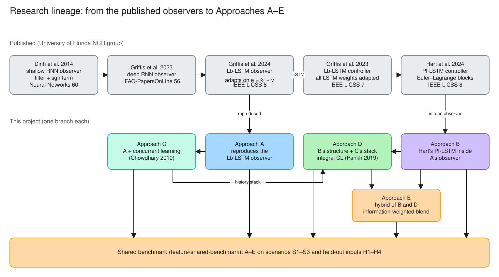

*Diagram 1. The published observers and controllers this project builds on (grey), and the five
approaches developed here.*

The observers studied here descend from one line of work at the University of Florida's
Nonlinear Controls and Robotics group. Each step keeps the same observer skeleton:

- an auxiliary dynamic filter that manufactures a measurable error;
- a learned acceleration model;
- a robust $\mathrm{sgn}$ term.

Each step changes the model class and, with it, the adaptation law.

1. **Dinh, Kamalapurkar, Bhasin & Dixon (2014) [1]** introduced the skeleton. A shallow dynamic
   (recurrent) neural network estimates the unknown dynamics online, and a dynamic filter estimates
   the unmeasurable state. A Lyapunov analysis proves asymptotic convergence, validated in
   simulation and experiment on a **two-link robot manipulator**. This is the "shallow dynamic RNN"
   baseline of §4.
2. **Griffis, Patil, Makumi & Dixon (2023) [2]** replaced the shallow network with a **deep**
   recurrent network. Its adaptation law is driven by a filtered estimation error, which removes the
   full-state-feedback requirement.
3. **Griffis, Patil, Hart & Dixon (2024) [4]** moved the continuous-time LSTM of [3] into the
   observer of [1]. In an observer the true estimation error is not measurable, so the weights adapt
   on the measurable auxiliary error $e = \tilde x_1 + \nu$, which satisfies $r = \dot e + \alpha e$.
   On a two-link manipulator the RMS velocity error fell by 41.13 % against the adaptive shallow RNN
   of [1] (0.2270 vs 0.3856 deg/s). **Approach A reproduces this observer.**
4. **Hart, Griffis, Patil & Dixon (2024) [5]** made the LSTM **physics-informed**: separate
   DNN + LSTM blocks estimate the inertia, Coriolis, potential and dissipation terms of the
   Euler–Lagrange equation. It is a tracking **controller**, not an observer. It reports 0.0185 rad
   RMS tracking error, 33.76 % better than a physics-informed DNN baseline, and it lists
   positive-definiteness of the learned inertia as future work. **Approach B carries this structure
   into A's observer and enforces that positive-definiteness by construction.**

> **Controller versus observer.** [3] and [5] adapt on $r = \dot e + \alpha e$ with
> $e = q - q_d$. That signal is measurable under full-state feedback. In an observer, $r$ contains
> the unmeasured velocity error, so every law and robustness argument must be rewritten in terms of
> the measurable $e$. The observer version of the argument is in §5.4–§5.5.

**Table 1. The published lineage.**

| | Dinh et al. 2014 [1] | Griffis et al. 2023 [2] | Griffis et al. 2024 [4] | Hart et al. 2024 [5] |
|:---|:---|:---|:---|:---|
| Venue | *Neural Networks* 60 | IFAC-PapersOnLine 56(2) | IEEE L-CSS 8 | IEEE L-CSS 8 |
| Task | State observer | State observer | State observer | Tracking controller |
| Learned model | Shallow dynamic NN | Deep RNN | Continuous-time LSTM, all weights adapted | Euler–Lagrange-structured DNN + LSTM blocks |
| Signal driving adaptation | Implementable filter signals | Filtered estimation error | $e = \tilde x_1 + \nu$ | $r = \dot e + \alpha e$ (measurable in control) |
| Guarantee claimed | Asymptotic | Asymptotic | Asymptotic, semi-global | Asymptotic tracking, semi-global |
| Benchmark | Two-link robot (simulation and experiment) | Numerical simulation | Two-link robot (simulation) | Two-link robot (simulation) |

[1], [4] and [5] all use a fully actuated manipulator. The underactuated cart–pendulum used here
is a new setting for this family, and it exposes an identifiability failure that cannot occur when
every coordinate is actuated (§9.4).

**Table 2. How the five approaches extend the lineage.** All five share the filter, feedback and
robust term of §5. They differ in the learned model and in how it adapts.

| | Model $\hat\Phi$ | Parameters | Adaptation | Rank condition imposed on | Needs $\ddot q$ | True parameters exist | Handles a plant change |
|:---|:---|---:|:---|:---|:---:|:---:|:---|
| **A** Black-box Lb-LSTM | Continuous-time LSTM | 1440 | $\mathrm{proj}(\Gamma\Phi'^Te)$ | — | no | no | slowly |
| **B** Physics-informed PI-LSTM | Cholesky $\hat M \succeq \epsilon_M I$, Christoffel $\hat V_m$, $\hat G = \nabla\hat P$, dissipative $\hat F$ | 398 | Blockwise, kinetic metric | — | no | no | partially |
| **C** Concurrent-learning Lb-LSTM | As A | 1440 | A's law + point history stack [9], [10] | Readout only (32 of 1440) | yes (Savitzky–Golay proxy) | no | no (clings to old data) |
| **D** Physics-structured integral CL | Linear-in-parameters EL model | 15 | Instantaneous + integral CL [11] | **All** 15 | **no** | **yes** | **detects and re-identifies** |
| **E** Hybrid of B and D | D's model, with each joint's own-coordinate inertia terms frozen | 13 free | Integral CL on identified directions, B's instantaneous law on the rest | Not needed: weighted by information, direction by direction | **no** | **yes** | **detects and re-identifies** |

Approach E was built after the first round of the shared benchmark showed that B was the most
reliable estimator and D had the best model when the data were rich.

---

## 4. Classical baselines and the architectural comparison matrix

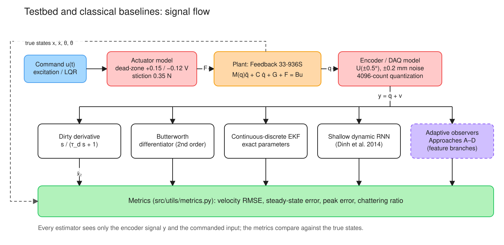

*Diagram 2. Signal flow of the testbed. The actuator and encoder models sit between the commanded
input and the measurement. Every estimator, classical or adaptive, sees only the encoder signal and
the commanded input. The metrics compare its velocity estimate with the true state.*

### 4.1 Comparison matrix

| Estimator | Formulation | Stability guarantee | Prior model required | PE condition needed? | Noise and chattering robustness | Primary weakness |
|:---|:---:|:---:|:---:|:---:|:---:|:---|
| **Dirty derivative filter** | 1st-order linear filter $\frac{s}{\tau_d s + 1}$ | Asymptotically stable filter poles | None | No | **Very poor** (chattering ratio $> 18\times$) | Strong high-frequency noise amplification; phase lag |
| **Butterworth differentiator** | 2nd-order band-pass $\frac{10^4 s}{s^2 + 70.7s + 10^4}$ | Hurwitz transfer function | None | No | **Moderate** (chattering ratio $\approx 3.0\times$) | Fixed bandwidth trades phase delay against noise cut-off |
| **Continuous–discrete EKF** | Nonlinear Riccati ODE + discrete update | Local exponential stability under small noise | Exact physical parameters $(M, m, l, I, b, d)$ | No | **Good** (chattering ratio $\approx 2.9\times$) | Sensitive to unmodelled stiction and parameter drift |
| **Shallow dynamic RNN** (Dinh et al. 2014 [1]) | Continuous RNN + Lyapunov leakage | Semi-global uniform ultimate boundedness | Nominal plant structure | No (bounded weights) | **High** (chattering ratio $\approx 1.0\times$) | Limited capacity for long-term state dependencies |
| **A: Black-box Lb-LSTM** (§6) | Continuous-time LSTM ODE + Lyapunov update | Asymptotic if $k_s$ meets the RISE bound; UUB as tuned | Black-box acceleration model | No | **High** (chattering ratio 1.0–1.6×) | Frozen model does not generalize to unseen inputs; implied inertia indefinite in 0.7–7 % of samples |
| **B: Physics-informed PI-LSTM** (§7) | EL-structured model: Cholesky inertia, Christoffel Coriolis, potential gravity, dissipative friction | As A; the learned model is passive by construction | Structural Euler–Lagrange properties | No | **High** (chattering ratio ≈ 1.06×; smallest seed-to-seed spread) | No improvement of the initial transient; inertia scale only partly identified (16 % error) |
| **C: Concurrent-learning Lb-LSTM** (§8) | Lb-LSTM + rank-conditioned history stack | As A for the state; with fixed gates, the readout converges to a neighbourhood of its stack least-squares fixed point | History stack of rich state–input pairs | **Relaxed** (no persistent excitation of the trajectory required) | **High** (same observer structure as A) | Stack management overhead; no change detector |
| **D: Physics-structured integral CL** (§9) | Linear-in-parameters EL model + integral concurrent learning | State and parameters converge with exact windows; UUB with noise | EL structure, joint types, input matrix | **Relaxed** (rank condition on all 15 parameters) | **High** (best steady velocity error when the data sweep the configuration space) | Larger initial transient; pendulum parameters loose with hanging-only data |
| **E: Hybrid of B and D** (§10) | D's model and integral CL, blended by information with B's instantaneous law | As D on the directions the data identify; bounded parameters elsewhere; UUB as tuned | EL structure, joint types, input matrix, serial-chain inertia structure | **Not needed** (information-weighted blend) | **High** (lowest steady $\dot\theta$ error in every benchmark scenario) | B is still faster in the first seconds of small-swing runs; instantaneous-gain margin about 3× |

The guarantee column states what the Lyapunov analysis actually delivers. Asymptotic
convergence needs the robust gain $k_s$ above the RISE bound. Every tuned configuration runs
below it, because a larger $k_s$ injects encoder noise, so the practical result is uniform
ultimate boundedness (§5.5).

### 4.2 Baseline benchmark

`python scripts/run_benchmarks.py` runs the four classical estimators under PCI-1711 noise and
asymmetric stiction (5000 steps at 1 kHz):

```text
================================================================================
FEEDBACK INSTRUMENTS 33-936S CART-INVERTED PENDULUM BENCHMARK TESTBED
Running Baseline Estimator Comparisons under PCI-1711 DAQ Noise & Stiction...
================================================================================

[+] Benchmark Completed across 4 Estimators (5000 time steps @ 1 kHz):
    - True plant states: x, x_dot, theta, theta_dot
    - Measurements: Optical Encoders with uniform noise & quantization
    - Non-linear effects: Asymmetric stiction deadband [+0.15V, -0.12V]

                     Cart_Pos_RMSE [m]  Cart_Vel_RMSE [m/s]  Theta_RMSE [rad]  Theta_Dot_RMSE [rad/s]  Vel_Chattering_Ratio  AngVel_Chattering_Ratio
Estimator                                                                                                                                           
Dirty_Derivative              0.000134             0.014140          0.005065                0.243687             18.964493              3545.064559
Butterworth_Diff              0.000134             0.004776          0.005065                0.135140              3.026037               547.372044
Continuous_EKF                0.000043             0.002251          0.001531                0.073982              2.911799               377.432751
Shallow_Dynamic_RNN           0.000149             0.000322          0.000782                0.003743              0.999903                10.893497

================================================================================
```

The chattering ratio is the total variation of the estimate divided by that of the truth, so 1
means no chattering.


*Figure 1. The four classical baselines on the first 4 s of the testbed run. Rows from top: cart
position, cart velocity, pendulum angle, pendulum angular velocity. Black is the truth.*

> **What it shows.** The two position rows (1 and 3) are measured, and every method follows them.
> The two velocity rows are *not* measured and must be estimated. For the cart velocity (row 2),
> all methods stay close to the truth. For the pendulum velocity (row 4), the dirty derivative
> (red) swings by ±0.5 rad/s around a true signal that never exceeds 0.1 rad/s. The Butterworth
> filter and the EKF are calmer but still noisy.
>
> **What it means.** The angle encoder's noise is large compared with the pendulum's slow motion,
> so differentiating it produces mostly noise. Only the shallow RNN, which is given the exact
> plant model, removes the chattering (ratio about 1, last row of the table). The rest of this
> project asks how close a *learning* observer can get to that without being given the model.

---

## 5. The common observer skeleton and its stability proof

All five approaches use the filter, the feedback $\chi$ and the robust term derived here. They
were first derived for Approach A, which follows Griffis et al. [4]. Each approach replaces only
the learned model $\hat\Phi$ and its adaptation law.

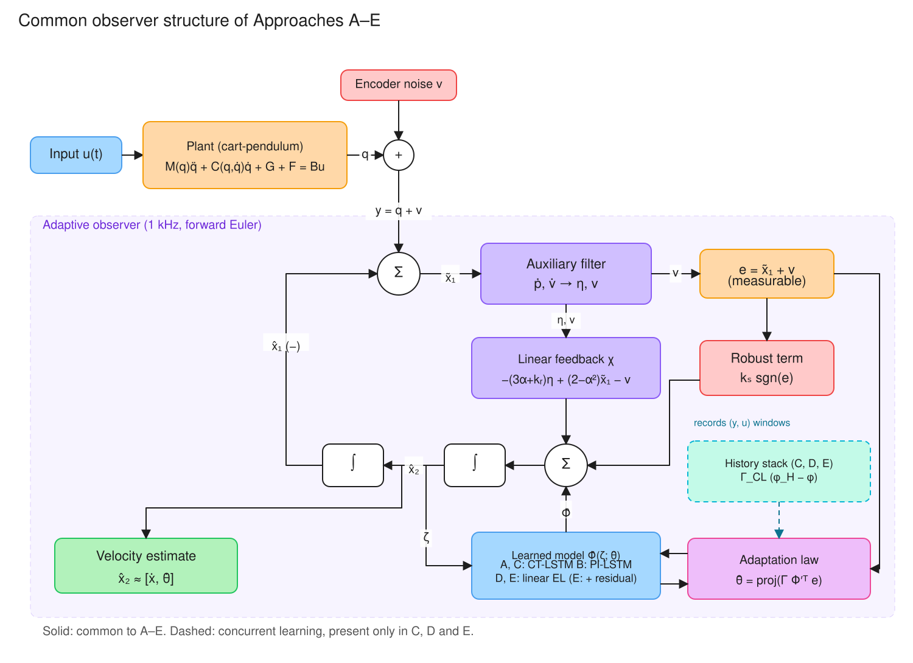

*Diagram 3. The observer structure shared by all five approaches. They differ only in the learned
model block and in the adaptation law. The dashed history stack exists in C, D and E.*

### 5.1 Problem setting

For $n$ measured generalized coordinates and $m$ inputs,

$$\dot{x}_1 = x_2, \qquad \dot{x}_2 = g(x, u), \qquad y = x_1 + v,$$

with $g$ unknown and $x_2$ unmeasured. On the rig: $x_1 = [x,\ \theta]^T$,
$x_2 = [\dot x,\ \dot\theta]^T$, $u = F$ ($n = 2$, $m = 1$). Every vector equation below
acts element-wise on the $n$ channels.

### 5.2 Filter and observer

With the measurable error $\tilde x_1 = y - \hat x_1$:

$$\eta = p - (\alpha + k_r)\tilde x_1$$

$$\dot p = -(k_r + 2\alpha)p - \nu + ((\alpha + k_r)^2 + 1)\tilde x_1, \qquad p(0) = (\alpha + k_r)\tilde x_1(0)$$

$$\dot\nu = p - \alpha\nu - (\alpha + k_r)\tilde x_1, \qquad \nu(0) = 0$$

$$e = \tilde x_1 + \nu$$

The observer is

$$\dot{\hat x}_1 = \hat x_2, \qquad \dot{\hat x}_2 = \hat\Phi + k_s\,\mathrm{sgn}(e) + \chi, \qquad \chi = -(3\alpha + k_r)\eta + (2 - \alpha^2)\tilde x_1 - \nu.$$

`sign_mode="tanh"` replaces $\mathrm{sgn}(e)$ with the boundary-layer approximation
$\tanh(e/\epsilon)$. Nothing in the filter requires the velocity.

> **Note on the $\tilde x_1$ coefficient in $\chi$.** Griffis et al. [4, Eq. (11)] print
> $(\alpha^2 + 2)$. With the filter exactly as written above, the cross terms of the Lyapunov
> derivative cancel **only for $(2 - \alpha^2)$**. The derivation follows, a SymPy check reproduces
> it, and `tests/test_blackbox_lstm.py` asserts it against the implemented vector field. With
> $(\alpha^2+2)$, a residual $-2\alpha^2\,\tilde x_1^T r$ remains. It is bounded and can be
> dominated with Young's inequality, but the cancellation is no longer exact. The printed variant
> is available as `chi_x1_coeff=alpha**2 + 2`.

### 5.3 Filter algebra and exact cancellation

**Derivation.** Define the unmeasurable filtered error $r = \tilde x_2 + \alpha\tilde x_1 + \eta$,
with $\tilde x_2 = x_2 - \hat x_2$.

1. **$\nu$ is a filtered copy of $\eta$.** Substituting $p = \eta + (\alpha+k_r)\tilde x_1$
   into $\dot\nu$ gives $\dot\nu = \eta - \alpha\nu$.

2. **$e$ is a filtered copy of $r$.** $\dot e = \tilde x_2 + \eta - \alpha\nu = r - \alpha e$,
   so $r = \dot e + \alpha e$. This is the RISE structure that lets $\mathrm{sgn}(e)$, a
   function of a *measurable* signal, act on the unmeasurable $r$.

3. **$\eta$ dynamics.** Differentiate $\eta$ and substitute $\dot p$, $p$ and
   $\tilde x_2 = r - \alpha\tilde x_1 - \eta$:

   $$\dot\eta = -(k_r+2\alpha)\eta - \alpha(\alpha+k_r)\tilde x_1 + \tilde x_1 - \nu - (\alpha+k_r)\tilde x_2 = -(\alpha + k_r)\,r - \alpha\eta + \tilde x_1 - \nu.$$

4. **$r$ dynamics.** $\dot r = \dot{\tilde x}_2 + \alpha\tilde x_2 + \dot\eta$, with
   $\dot{\tilde x}_2 = g - \hat\Phi - k_s\,\mathrm{sgn}(e) - \chi$:

   $$\dot r = g - \hat\Phi - k_s\,\mathrm{sgn}(e) - \chi - k_r r + (1 - \alpha^2)\tilde x_1 - 2\alpha\eta - \nu.$$

   Substituting $\chi$:

   $$\dot r = \underbrace{g - \hat\Phi - k_s\,\mathrm{sgn}(e)}_{\text{learning + robust terms}} - k_r r - \tilde x_1 + (\alpha + k_r)\eta.$$

5. **Cancellation.** Take $V_0 = \tfrac12(\tilde x_1^T\tilde x_1 + \eta^T\eta + \nu^T\nu + r^Tr)$
   and use $\dot{\tilde x}_1 = r - \alpha\tilde x_1 - \eta$:

   $$\begin{aligned}
   \dot V_0 ={}& \tilde x_1^T r - \alpha\|\tilde x_1\|^2 - \tilde x_1^T\eta \\
   &- (\alpha + k_r)\eta^T r - \alpha\|\eta\|^2 + \eta^T\tilde x_1 - \eta^T\nu \\
   &+ \nu^T\eta - \alpha\|\nu\|^2 \\
   &- k_r\|r\|^2 - r^T\tilde x_1 + (\alpha+k_r)r^T\eta + r^T(g - \hat\Phi - k_s\,\mathrm{sgn}(e)).
   \end{aligned}$$

   The pairs $\tilde x_1^T\eta$, $\eta^T\nu$, $\tilde x_1^T r$ and $\eta^T r$ cancel exactly:

   $$\dot V_0 = -\alpha\left(\|\tilde x_1\|^2 + \|\eta\|^2 + \|\nu\|^2\right) - k_r\|r\|^2 + r^T\left(g - \hat\Phi - k_s\,\mathrm{sgn}(e)\right).$$

   Every term of $\chi$ is there to remove one cross term: $-(3\alpha+k_r)\eta$ removes
   $\eta^Tr$, $(2-\alpha^2)\tilde x_1$ removes $\tilde x_1^Tr$, and $-\nu$ removes the
   $\nu$ leak from $\dot\eta$. The filter's own coefficients
   ($(\alpha+k_r)^2+1$ in $\dot p$, $-(\alpha+k_r)$ in $\dot\nu$) remove $\tilde x_1^T\eta$
   and $\eta^T\nu$.

### 5.4 An implementable adaptation law

The weights adapt on the measurable error: $\dot{\hat\theta} = \mathrm{proj}(\Gamma\,\Phi'^Te)$
(§6.3). A law driven by $r$, as in the tracking controllers [3], [5], cannot be implemented here,
because $r$ contains the unmeasured velocity error $\tilde x_2$. It is not needed either. The
argument is as follows.

Write $g = \Phi(\zeta,c;\theta^\ast) + \varepsilon$ on a compact set, with bounded ideal weights
$\theta^\ast$, and split the mismatch as

$$g - \hat\Phi = N_2 + N_3,\qquad N_3 \triangleq \Phi'\tilde\theta,\qquad N_2 \triangleq \big[\Phi(\zeta,c;\theta^\ast) - \Phi(\hat\zeta,\hat c;\theta^\ast)\big] + \mathcal O^2(\tilde\theta) + \varepsilon,$$

where $\tilde\theta = \theta^\ast - \hat\theta$. Add $\tfrac{\alpha}{2}\tilde\theta^T\Gamma^{-1}\tilde\theta$
to the Lyapunov function. The projection property
$\tilde\theta^T\Gamma^{-1}(\mathrm{proj}(\tau)-\tau) \ge 0$ [14] gives

$$\frac{d}{dt}\Big(\tfrac{\alpha}{2}\tilde\theta^T\Gamma^{-1}\tilde\theta\Big) \le -\alpha\,e^TN_3.$$

Since $r = \dot e + \alpha e$, the cross term $r^TN_3$ in $\dot V_0$ splits into
$\dot e^TN_3 + \alpha e^TN_3$. The measurable law cancels **only the $\alpha e^TN_3$ half**. The
remainder $\dot e^TN_3$ is bounded, because $\tilde\theta$ is bounded (by projection), and it is
dominated by the robust term through the integral bound of §5.5. The weight error is therefore
handled by boundedness and domination, not by an exact cancellation. Griffis et al. [4] use the
same law without projection.

> **Remark.** By integration by parts,
> $\int_0^t\Gamma\Phi'^Tr = \Gamma\Phi'^Te\big|_0^t - \int_0^t\Gamma\dot\Phi'^Te + \alpha\int_0^t\Gamma\Phi'^Te$.
> An $r$-driven law could therefore be realized if $\dot\Phi'$ were computable, which needs $\dot u$
> and the second derivatives of the network. It would restore the exact cancellation but could not be
> combined directly with projection, so it is not used.

### 5.5 Robustness: the RISE integral lemma

The observer injects $k_s\,\mathrm{sgn}(e)$, not $\mathrm{sgn}(r)$. The pointwise product
$r^T(N - k_s\,\mathrm{sgn}(e))$ can be positive for any $k_s$, because $r$ and $e$ need not share
signs at a given instant, so "$k_s$ larger than the disturbance" does **not** give domination.
Domination holds in integral, because $e$ is a filtered version of $r$. This is the lemma of
Xian et al. [6].

**Lemma 1 (RISE integral bound).** Let $r = \dot e + \alpha e$ with $\alpha > 0$. Let
$\lVert N_B\rVert \le \zeta_1$, $\lVert N_D\rVert \le \zeta_2$ and
$\lVert\dot N_B + \dot N_D\rVert \le \zeta_3$, and define
$L \triangleq r^T(N_B + N_D - k_s\,\mathrm{sgn}(e)) - \alpha e^TN_D$. If

$$k_s \ge \max\Big\{\zeta_1 + \zeta_2,\ \ \zeta_1 + \tfrac{1}{\alpha}\zeta_3\Big\},$$

then $\int_0^tL\,d\tau \le \zeta_b \triangleq k_s\lVert e(0)\rVert_1 - e(0)^T\big(N_B(0)+N_D(0)\big)$
for all $t \ge 0$.

*Proof.* Substitute $r = \dot e + \alpha e$; the $\alpha e^TN_D$ terms cancel. Integrate
$\dot e^T(N_B + N_D)$ by parts, use $\int_0^t\dot e^T\mathrm{sgn}(e) = \lVert e(t)\rVert_1 - \lVert e(0)\rVert_1$
and $\lvert e^Tv\rvert \le \lVert e\rVert_1\lVert v\rVert$:

$$\int_0^tL \le \lVert e(t)\rVert_1(\zeta_1+\zeta_2-k_s) + \alpha\int_0^t\lVert e\rVert_1\Big(\zeta_1+\tfrac{\zeta_3}{\alpha}-k_s\Big) + \zeta_b \le \zeta_b.\ ∎$$

With $N_B = N_2$ and $N_D = N_3$, define $P(t) \triangleq \zeta_b - \int_0^tL\,d\tau \ge 0$, so that
$\dot P = -L$.

**Proposition 1 (convergence).** Let
$V = V_0 + \tfrac{\alpha}{2}\tilde\theta^T\Gamma^{-1}\tilde\theta + P$ and
$\xi = [\tilde x_1^T,\eta^T,\nu^T,r^T,\tilde\theta^T,\sqrt P]^T$. Suppose the bounds of Lemma 1 hold
while $\xi$ is in the ball $\mathcal S = \{\lVert\xi\rVert < \omega\}$, $k_s$ satisfies the lemma's
condition, and $\xi(0) \in \{\lVert\xi\rVert < \sqrt{\beta_1/\beta_2}\,\omega\}$, where
$\beta_1\lVert\xi\rVert^2 \le V \le \beta_2\lVert\xi\rVert^2$. Then all signals stay bounded, and
$\tilde x_1, \eta, \nu, r \to 0$, hence $\tilde x_2 = r - \alpha\tilde x_1 - \eta \to 0$.

*Proof sketch.* By the cancellation of §5.3, §5.4 and $\dot P = -L$, for almost all $t$ with
$\xi \in \mathcal S$,

$$\dot V \le -\alpha\big(\lVert\tilde x_1\rVert^2 + \lVert\eta\rVert^2 + \lVert\nu\rVert^2\big) - k_r\lVert r\rVert^2.$$

So $\lVert\xi(t)\rVert \le \sqrt{\beta_2/\beta_1}\lVert\xi(0)\rVert < \omega$, and $\xi$ stays in
$\mathcal S$. The closed loop is a Filippov differential inclusion because of $\mathrm{sgn}(e)$
[15], [16], and the nonsmooth LaSalle–Yoshizawa corollary [8] gives
$(\tilde x_1, \eta, \nu, r) \to 0$. ∎

The result is semi-global: $\omega$ can be as large as desired, at the price of larger bounds and a
larger $k_s$. It gives **no** parameter convergence ($\dot V$ has no $-\lVert\tilde\theta\rVert^2$
term) and no exponential rate; an exponential variant needs a modified $P$-function [7]. Griffis et
al. [4] use that variant and obtain $k_s \ge \kappa_1 + \kappa_2 + (\alpha\kappa_2+\kappa_3)/(\alpha-1)$
with $\alpha > 1$.

**Operating regime of the tuned observers.** With $\tanh(e/\epsilon)$, or with $k_s$ below the
lemma's bound, the conclusion weakens to uniform ultimate boundedness, with the residual set
shrinking as $\hat\Phi \to g$. **The tuned $k_s = 0.2$ is below the bound**: the unlearned
acceleration mismatch is of order $1\ \text{rad/s}^2$. All experiments in this repository
therefore run in the UUB regime. The linear feedback $\chi$ and the learned $\hat\Phi$ do the
work, and a larger $k_s$ mostly injects noise (§6.6).

---

## 6. Approach A: black-box Lb-LSTM observer

Approach A implements the Lyapunov-based LSTM (Lb-LSTM) adaptive observer of **Griffis, Patil,
Hart & Dixon [4]** on the cart–pendulum. The LSTM treats the acceleration field $g(x, u)$ as a
**complete black box**. It uses no mass, inertia, damping or kinematic structure. The only plant
knowledge it uses is the relative degree: positions are measured and $\dot{x}_1 = x_2$. All
updates are analytical ODEs in NumPy, with no autograd.

- **Velocity estimation.** The observer cuts velocity error 7–15× compared with the dirty
  derivative and removes its chattering. The result holds across initialization seeds.
- **Online model fit.** During observation the adapted $\hat{\Phi}$ fits the true
  accelerations well: NMSE 0.05.
- **Identification.** The *frozen* weights do **not** generalize as a digital twin to
  unseen inputs: median one-step $\ddot\theta$ NMSE is about 1 across seeds. The adaptation
  law learns what it needs to observe, not a globally valid model. §6.7.4 explains why, and
  why this motivates Approaches B and C.

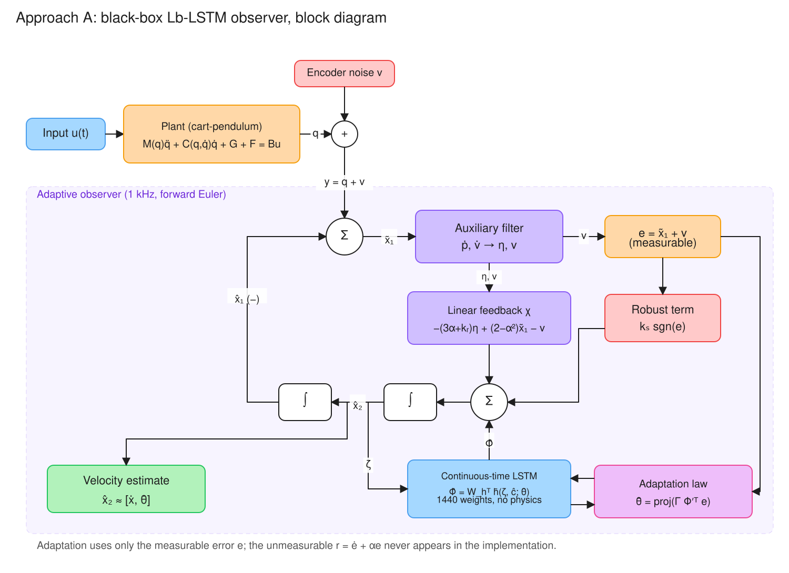

*Diagram 4. Block diagram of Approach A's observer. The auxiliary filter turns the measurable error
$\tilde x_1$ into $\eta$ and $\nu$ (§5.2). The linear feedback $\chi$, the robust term and the LSTM
output $\hat\Phi$ add up to $\dot{\hat x}_2$, and two integrators give the estimates. Adaptation is
driven only by the measurable error $e$.*

### 6.1 Continuous-time LSTM

The augmented input is
$\zeta = [\hat{x}_1^T,\ \hat{x}_2^T,\ u^T,\ \hat{h}^T,\ 1]^T \in \mathbb{R}^{d}$, with
$d = 2n + m + L + 1$. The gates and the instantaneous cell and hidden outputs are ([4], Eqs. 7–8)

$$f = \sigma_g(W_f^T\zeta),\quad i = \sigma_g(W_i^T\zeta),\quad c^\ast = \sigma_c(W_c^T\zeta),\quad o = \sigma_g(W_o^T\zeta)$$

$$c = f \odot \hat{c} + i \odot c^\ast, \qquad h = o \odot \sigma_c(c), \qquad \hat{\Phi} = W_h^T h,$$

and the continuous memory evolves as

$$\dot{\hat c} = -b_c\,\hat c + b_c\,(f\odot\hat c + i\odot c^\ast), \qquad \dot{\hat h} = -b_h\,\hat h + b_h\,(o\odot\sigma_c(c)),$$

where $\sigma_g$ is the logistic sigmoid, $\sigma_c = \tanh$, $W_{c,i,f,o}\in\mathbb{R}^{d\times L}$
and $W_h\in\mathbb{R}^{L\times n}$ [17].

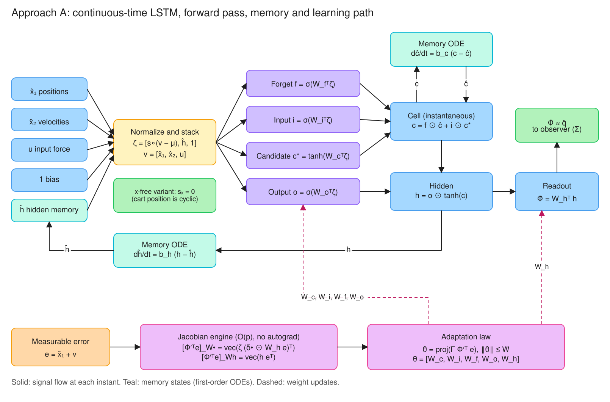

*Diagram 5. Data flow through the continuous-time LSTM. The inputs are normalized and stacked with the
hidden memory and a bias into $\zeta$ (written $z$ in the figure). The four gates produce the
instantaneous cell $c$ and hidden output $h$ (drawn $\bar c$, $\bar h$), and the readout gives
$\hat\Phi$. The memories $\hat c$, $\hat h$ follow first-order ODEs. The dashed path is learning:
the measurable error $e$ and the forward-pass quantities give $\Phi'^Te$ in $O(p)$ (§6.2), and the
adaptation law (§6.3) updates every weight block. The green note marks the cart-position input scale,
which the shared benchmark sets to zero (x-free variant, §11.5).*

**Interpretation used here.** $\hat c$ and $\hat h$ are the recurrent *memory states*.
They are first-order low-pass copies of the cell and hidden outputs, the continuous-time
analogue of the one-step delay in a discrete LSTM. $c$ and $h$ are the *instantaneous*
outputs of the gate network. At each instant the LSTM is therefore a static map of
$(\zeta, \hat c)$. This is what gives $\hat\Phi$ a non-zero partial derivative with respect
to **every** weight block (§6.2). Had $\sigma_c(\hat c)$ been used in the output instead, the
Jacobian with respect to $W_c, W_i, W_f$ would vanish identically.

**Input preconditioning.** In the code,
$\zeta = [s\odot([\hat x_1, \hat x_2, u] - \mu),\ \hat h,\ 1]$. The per-channel scale $s$
and offset $\mu$ are data normalization, not model knowledge. On the rig, $\mu$ is the mean
of the first second of encoder data. This matters: the pendulum hangs at
$\theta \approx \pi$, so without centring the informative $\pm 0.4$ rad variation rides on
a large offset. The gates then cannot resolve it with bounded weights. In the tuning
sweeps, uncentred configurations fit the training trajectory with frozen-weight
$\ddot\theta$ NMSE 0.85–1.5; the chosen centred configuration reaches 0.06–0.13.

### 6.2 Analytical Jacobians

The parameter vector stacks column-major vecs:
$\theta = [\mathrm{vec}(W_c)^T, \mathrm{vec}(W_i)^T, \mathrm{vec}(W_f)^T, \mathrm{vec}(W_o)^T, \mathrm{vec}(W_h)^T]^T \in \mathbb{R}^{4dL + Ln}$
(1440 weights for $L = 16$). Holding $(\zeta, \hat c)$ fixed, with pre-activations
$a_\bullet = W_\bullet^T\zeta$ and $s = \partial h/\partial c = o \odot (1 - \tanh^2 c)$, the
gate sensitivities $\delta_\bullet = \partial h / \partial a_\bullet$ are

$$\delta_c = s \odot i \odot (1 - c^{\ast 2}),\qquad \delta_i = s \odot c^\ast \odot i \odot (1 - i),$$

$$\delta_f = s \odot \hat c \odot f \odot (1 - f),\qquad \delta_o = \tanh(c) \odot o \odot (1 - o).$$

Because $\partial a_\bullet / \partial\,\mathrm{vec}(W_\bullet) = I_L \otimes \zeta^T$, the blocks
of $\Phi' = \partial\hat\Phi/\partial\theta \in \mathbb{R}^{n\times p}$ are

$$\frac{\partial\hat\Phi}{\partial\,\mathrm{vec}(W_\bullet)} = \big(W_h^T\,\mathrm{diag}(\delta_\bullet)\big) \otimes \zeta^T \quad (\bullet \in \{c,i,f,o\}), \qquad \frac{\partial\hat\Phi}{\partial\,\mathrm{vec}(W_h)} = I_n \otimes h^T.$$

The observer only ever needs $\Phi'^Te$. The mixed-product rule
$(A\otimes\zeta)(e\otimes 1) = (Ae)\otimes\zeta$ turns that product into outer products,
so it costs $O(p)$ without forming $\Phi'$:

$$\big[\Phi'^T e\big]_{W_\bullet} = \mathrm{vec}\big(\zeta\,(\delta_\bullet \odot W_h e)^T\big), \qquad \big[\Phi'^T e\big]_{W_h} = \mathrm{vec}(h\,e^T).$$

`tests/test_jacobian_engine.py` checks the explicit $\Phi'$ against central finite
differences (agreement to about $10^{-11}$, all five blocks non-degenerate) and checks the
fast product against $\Phi'^Te$ to machine precision.

> **Layout convention.** With gates written as $W z$,
> $W \in \mathbb R^{l_2\times l_1}$, and column-stacking $\mathrm{vec}$, the factor above appears as
> $(z^T\otimes I_{l_2})$. For the output gate:
> $\partial h/\partial\,\mathrm{vec}(W_o) = D(\sigma_c(c))\,D(\sigma_g'(W_oz))\,(z^T\otimes I_{l_2})$.
> Without that factor the result would be $l_2\times l_2$, where an $l_2 \times l_1l_2$ matrix is
> needed. $(z^T\otimes I_{l_2})$ and the $I_L\otimes\zeta^T$
> used here are the same derivative in different memory layouts. A finite-difference check of the
> full set, in the $Wz$ layout, agrees to $7.6\times10^{-11}$.

> **Caveat: static-map Jacobian.** $\Phi'$ differentiates the instantaneous map
> $(\zeta, \hat c) \mapsto \hat\Phi$ with the memories held fixed. It drops the dependence of
> $\hat c$ and $\hat h$ on $\theta$ through their ODEs, which backpropagation-through-time or
> real-time recurrent learning would keep. This is the standard choice in [4] and in the Lyapunov
> analysis, but it is an approximation of the true sensitivity, not the exact gradient.

### 6.3 Adaptation law and smooth projection

$$\dot{\hat\theta} = \mathrm{proj}\left(\Gamma\,\Phi'^T e\right), \qquad \Gamma = \mathrm{diag}(\gamma_g I_{4dL},\ \gamma_h I_{Ln}).$$

The projection uses the convex boundary function
$f(\theta) = \dfrac{(1+\epsilon_p)\|\theta\|^2 - \bar W^2}{\epsilon_p\bar W^2}$, which is
zero at $\|\theta\| = \bar W/\sqrt{1+\epsilon_p}$ and one at $\|\theta\| = \bar W$
(Pomet & Praly [13]; Lavretsky & Wise [14]):

$$\mathrm{proj}(\tau) = \begin{cases} \tau - f(\theta)\,\dfrac{\Gamma\theta\,\theta^T\tau}{\theta^T\Gamma\theta} & f(\theta) > 0 \text{ and } \theta^T\tau > 0, \\[4pt] \tau & \text{otherwise.}\end{cases}$$

The operator is Lipschitz. It leaves $\tau$ untouched in the interior and removes exactly
the outward radial component on the outer sphere, so $\|\hat\theta(t)\| \le \bar W$ for the
continuous flow. It also preserves the Lyapunov inequality
$\tilde\theta^T\Gamma^{-1}(\mathrm{proj}(\tau) - \tau) \ge 0$ for $\|\theta^\ast\| \le \bar W/\sqrt{1+\epsilon_p}$.

Initialization: gate weights are $\mathcal N(0, 0.5^2)$ and $W_h(0) = 0$, so that
$\hat\Phi(0) = 0$ (no prior model). Random gates are necessary. With all weights at zero,
$h \equiv 0$ and $\Phi'^Te \equiv 0$, and nothing would ever adapt.

### 6.4 Euler discretization

The observer is a continuous ODE in
$X = (\hat x_1, \hat x_2, p, \nu, \hat c, \hat h, \hat\theta)$, of dimension
$4n + 2L + p = 1480$. Between DAQ samples the measurement and input are zero-order held,
and the ODE is integrated by forward Euler with $n_s$ sub-steps of $\Delta = T_s / n_s$:

$$X_{j+1} = X_j + \Delta\, F(X_j,\ y_k,\ u_k), \qquad j = 0, \dots, n_s - 1, \qquad \hat\theta \leftarrow \hat\theta\cdot\min\!\big(1,\ \bar W / \|\hat\theta\|\big).$$

Why Euler is adequate here:

- **Linear error modes.** With $\hat\Phi = g$ and $k_s = 0$, the per-channel error system
  in $(\tilde x_1, \tilde x_2, p, \nu)$ has eigenvalues
  $\{-4.03 \pm 0.08j,\ -5.97 \pm 11.95j\}$ at $\alpha = 4$, $k_r = 8$. Hence
  $\Delta|\lambda|_{\max} = 0.013 \ll 2$ at $T_s = 1$ ms. The memory filters contribute
  $\Delta b_{c,h} = 0.005$.
- **Discontinuous feedback.** $\mathrm{sgn}(e)$ is discontinuous, so higher-order
  Runge–Kutta gains no accuracy. Its discrete effect is a ripple of amplitude about
  $k_s\Delta = 2\times10^{-4}$ in $\hat x_2$, far below the noise floor. This is why the
  sgn and tanh variants give nearly identical chatter ratios.
- **Projection overshoot.** Invariance of the ball holds for the flow, but one Euler step
  can overshoot it by $O(\Delta)$. The radial rescale after each step
  (`LyapunovAdaptationLaw.enforce_bound`) is a discretization safeguard only; it never
  activates in the reported runs ($\|\hat\theta\| \approx 19 < \bar W = 40$).
- **Sub-stepping.** `n_substeps > 1` is needed only if gains are raised until
  $T_s|\lambda|_{\max}$ approaches 1.

The digital twin (§6.5) is smooth, with no sgn term, so it uses classical RK4. Approaches B–E use
the same discretization (forward Euler, one sub-step, radial rescale per parameter block).

### 6.5 System identification stage

`src/identification/extract_model.py` runs four steps:

1. **Freeze** $\hat\theta$ at $t_{\text{freeze}} \ge 20$ s. `freeze_observer` refuses
   earlier times. The experiment reports both $t = 20$ s and $t = 50$ s.
2. **Decouple** the LSTM from the observer feedback. The filter $(p, \nu)$, $\chi$, the
   robust term and adaptation are dropped. What remains is the autonomous model
   $\dot x_1 = x_2,\ \dot x_2 = \hat\Phi(\zeta, \hat c; \theta_{\text{frozen}})$ plus the
   $\hat c$, $\hat h$ memory ODEs. Here $\zeta$ is built from the twin's own states, and
   the memory is relaxed to its equilibrium at the initial condition.
3. **Drive** the twin open loop with inputs absent from the adaptation data, starting from
   rest at the hanging equilibrium:
   - a step doublet: ±1 N for 1 s each, 8 s horizon;
   - a linear chirp: 0.3 → 1.2 Hz, 1 N, cosine-ramped, 15 s horizon.
4. **Score** the twin two ways. *Free-running state MSE* is the digital-twin metric.
   *One-step acceleration MSE/NMSE*, with $\hat\Phi$ evaluated on the true states,
   isolates model error from integrator drift. NMSE = MSE / Var(truth), so predicting zero
   scores about 1.

### 6.6 Tuning guidelines

These were tuned on the 50 s validation trajectory, **never on the identification test
inputs**. Defaults are in `LbLSTMObserverConfig`. Approaches B–E keep $\alpha$, $k_r$ and $k_s$.

| Gain | Default | Role and guidance |
|:---|:---:|:---|
| $\alpha$ | 4 | Rate of $e$, $\nu$, $\tilde x_1$ ($\dot e = -\alpha e + r$). Sets two of the four error poles at $\approx -\alpha$. Raise it for faster transients, at the cost of noise gain. |
| $k_r$ | 8 | Damping of $r$. With $\alpha$, sets the complex pair ($\lvert\lambda\rvert \approx 13$ rad/s), i.e. the observer bandwidth and its noise gain. **$\Gamma$ must scale with this bandwidth**: $\alpha = 3$, $k_r = 6$ with the same $\Gamma$ drove $\hat\theta$ to the projection boundary and diverged. |
| $k_s$ | 0.2 | Robust sgn gain. Theory wants $k_s > \lVert N\rVert_\infty + \lVert\dot N\rVert_\infty/\alpha$. In practice, because $e$ is dominated by encoder noise, a larger $k_s$ adds noise (0.5 was worse). Keep it small and let $\hat\Phi$ learn. |
| $\epsilon$ (tanh) | 0.005 | Boundary layer. Set it at about the size of the $e$ noise. The sgn and tanh variants perform alike here (§6.4). |
| $\gamma_h$ (readout) | 300 | The dominant learning channel. The signal $e$ has DC gain of roughly $1/(\alpha k_r)$ from the mismatch, so $\gamma_h$ must be large ($10^2$–$10^3$). Above about 1500, individual seeds diverge to the projection boundary. |
| $\gamma_g$ (gates) | 30 | Much smaller than $\gamma_h$. Gate weights drift only about 0.6 (vs about 4 for $W_h$) over 50 s. Gates above about 50 combined with $\gamma_h \ge 1000$ destabilize the loop. |
| $b_c,\ b_h$ | 5 | Memory bandwidth [1/s]. Place it near or above the excitation band (1.5–3 rad/s). Results change little over $b \in [1, 10]$. |
| $\bar W$, $\epsilon_p$ | 40, 0.1 | Choose $\bar W$ about 2× the expected $\lVert\theta^\ast\rVert$. Here $\lVert\hat\theta\rVert$ settles near 19 (dominated by the random gate initialization). |
| $L$ | 16 | $L = 8$ halves the parameters but gives 3× worse cart-velocity error and unstable twins. |
| $s,\ \mu$ | see §6.1 | Scale each signal to about $\pm1$ over its expected range. Centre using measured data. Essential for the angle channel. |

**Tuning procedure:**

1. Fix $\alpha$ and $k_r$ from the desired bandwidth with $\Gamma = 0$.
2. Raise $\gamma_h$ until the online acceleration NMSE stops improving.
3. Add a small $\gamma_g$.
4. Check at least five initialization seeds. The failure mode is abrupt: $\lVert\hat\theta\rVert$ jumps to $\bar W$.

### 6.7 Results

#### 6.7.1 Scenario

`python experiments/run_blackbox_validation.py --seeds 5`. This is scenario S1 of the shared
benchmark (§11.1).

- **Excitation.** $u(t) = 2.0\sin(1.5t) + 1.2\cos(3.0t)$ open loop, 50 s at 1 kHz.
- **Noise.** Encoder noise U(±0.5°) on $\theta$, plus the testbed's ±0.2 mm cart noise and
  4096-count quantization.
- **Initial state.** The pendulum starts 0.4 rad from the *hanging* equilibrium, because the
  upright one is open-loop unstable under a prescribed open-loop input. The cart starts at
  $v_0 = -2/(1.5(M+m))$, the velocity that cancels the secular drift of $2\sin(1.5t)$ on a
  free cart; otherwise it hits the ±0.5 m bumpers.
- **Actuator effects** (dead-zone and stiction) are **off** by default. Their asymmetric
  dead-band biases the net force and pushes the open-loop cart into the bumper.
  `--actuator-effects` enables them.
- **Observer inputs.** All observers receive the encoder data and the *commanded* force.

#### 6.7.2 Velocity estimation (seed 0)

| Estimator | RMSE $\dot x$ [m/s] | RMSE $\dot\theta$ [rad/s] | SS RMSE $\dot x$ | SS RMSE $\dot\theta$ | SS mean $\lVert x_2-\hat x_2\rVert$ | Chatter $\dot x$ | Chatter $\dot\theta$ |
|:---|---:|---:|---:|---:|---:|---:|---:|
| **Lb-LSTM (sgn)** | 0.0225 | 0.0266 | **0.0024** | **0.0167** | **0.0137** | 1.02 | 1.64 |
| Lb-LSTM (tanh) | 0.0232 | 0.0266 | 0.0061 | 0.0166 | 0.0150 | 1.00 | 1.60 |
| Shallow RNN (Dinh et al. [1]) | 0.0241 | 0.0037 | 0.0004 | 0.0038 | 0.0030 | 1.00 | 1.37 |
| Dirty derivative ($\tau_d = 20$ ms) | 0.0184 | 0.2452 | 0.0171 | 0.2444 | 0.2116 | 13.7 | 337 |

SS means $t \ge 20$ s. Chatter is total variation of the estimate divided by that of the
truth, so 1 means no chattering. Bold marks the best of the learning observers.

- The Lb-LSTM's full-horizon $\dot x$ RMSE is transient-dominated. It starts at
  $\hat x_2 = 0$ against a true $-0.51$ m/s and needs about 1 s to converge, while the
  dirty derivative locks on within 50 ms.
- **The shallow RNN is not black box.** It integrates the exact nominal plant model and
  learns only a residual, so it bounds what model knowledge buys. The black-box Lb-LSTM
  closes most of the gap between the dirty derivative and that bound, with no parameters.
- **Online model fit** ($t \ge 20$ s): NMSE$(\hat\Phi, g)$ = 0.047 for $\ddot x$ and
  0.048 for $\ddot\theta$.

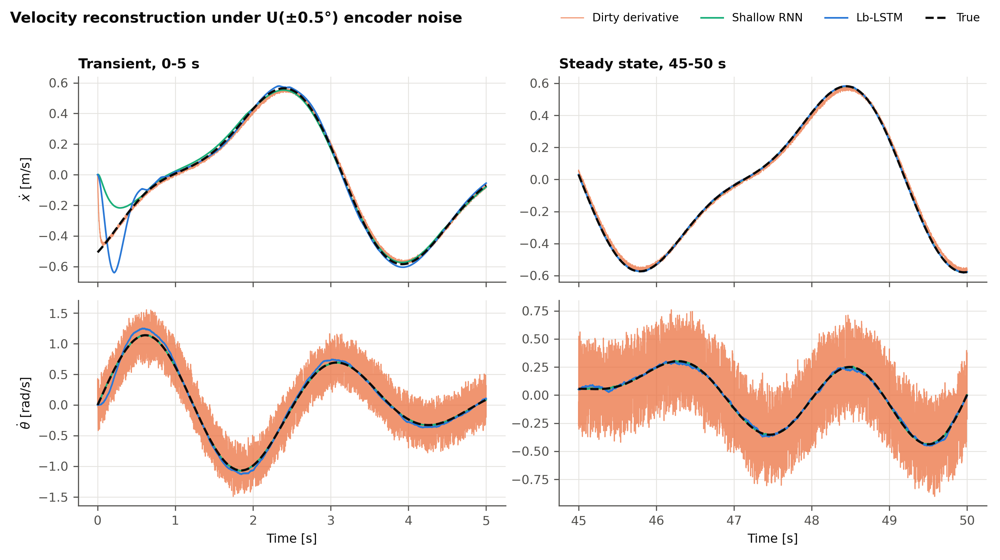

*Figure 2. Estimated against true velocities on S1, seed 0. Left: the first 5 s. Right: the last
5 s. Top: cart velocity. Bottom: pendulum angular velocity.*

> **What it shows.** In the first half-second the Lb-LSTM (blue) starts from zero while the cart
> is already moving at −0.5 m/s. It overshoots to about −0.63 m/s, then locks onto the truth by
> about 1 s. The dirty derivative (orange) follows the cart at once but is a wide noisy band
> around the pendulum velocity. In the last 5 s the Lb-LSTM and shallow RNN lie on top of the
> dashed truth in both channels.
>
> **What it means.** The learning observer needs about a second to settle, because its model
> starts empty. After that it gives a clean pendulum velocity, which differentiation cannot.

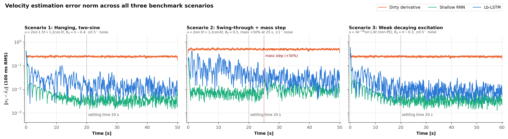

*Figure 3. Size of the velocity-estimation error (100 ms RMS, log scale) for the dirty derivative,
the shallow RNN and the Lb-LSTM on all three benchmark scenarios S1–S3 (§11.1). Produced by
`scripts/generate_three_scenario_comparison.py`.*

> **What it shows.** The dirty derivative's error is flat at about 0.25 (S1, S3) and 0.5 (S2,
> where the encoder noise is doubled) for the whole run. The Lb-LSTM starts near 0.4 and falls
> within seconds to 0.01–0.05, settling further by the 20 s mark. The shallow RNN, which is given
> the exact plant model, sits lower still, at 0.002–0.01. On S2 the shallow RNN's error rises
> after the +50 % mass step at 25 s, because its fixed model is now wrong; the Lb-LSTM shows no
> lasting rise.
>
> **What it means.** In every scenario, the black-box observer is about ten times more accurate
> than differentiation, without being told anything about the plant. It stays about 3–5× behind
> an observer that knows the exact model. The swing-through S2 is the hardest scenario for it.

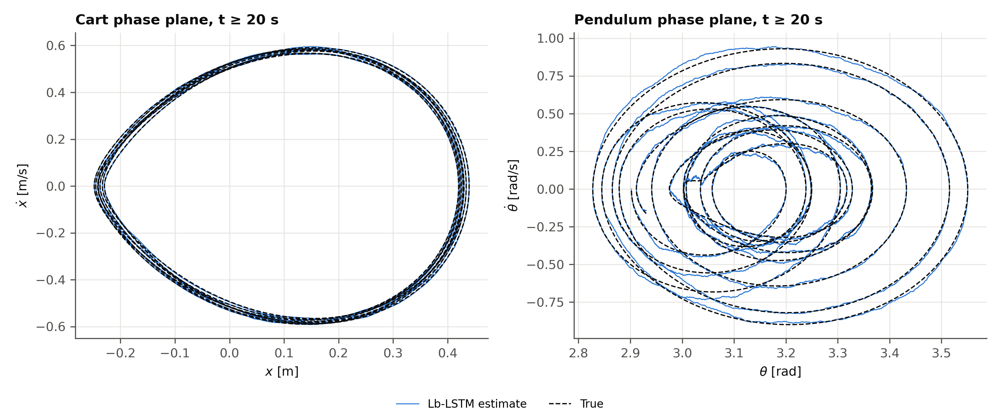

*Figure 4. Phase portraits after 20 s: velocity against position for the cart (left) and the
pendulum (right). Blue: estimate. Dashed: truth.*

> **What it shows.** For the cart, the estimated orbit lies exactly on the true one. For the
> pendulum, it follows every loop of the true trajectory with a small high-frequency wiggle.
>
> **What it means.** The estimate traces the correct trajectory through state space, not just
> the right numbers on average. The wiggle is the residual pendulum error of about 0.02 rad/s
> left by the 0.5° encoder noise.

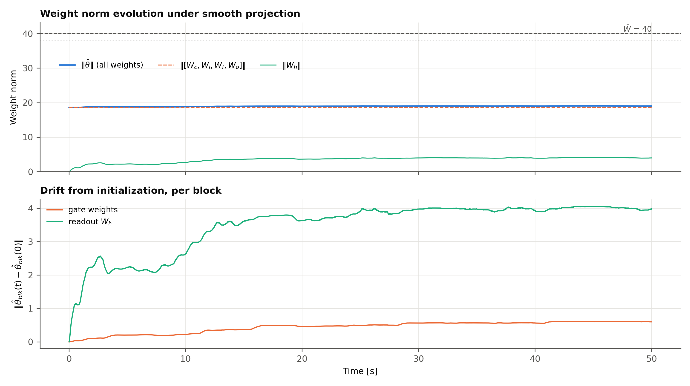

*Figure 5. Top: the size of all 1440 weights, of the gate weights and of the readout $W_h$, against
the projection bound $\bar W = 40$ (dashed; dotted: where projection begins to act). Bottom: how
far each block has moved from its initial value.*

> **What it shows.** The total weight norm stays near 19, far below the bound, so projection
> never activates. Almost all of that norm is the random gate initialization. The readout moves
> by about 4 and the gates by only about 0.6 over 50 s.
>
> **What it means.** Learning happens almost entirely in the readout layer. The gates act as a
> fixed random feature generator, which is why Approach C can impose its rank condition on the
> readout alone (§8.2).

#### 6.7.3 Digital twin on unseen inputs (seed 0)

| $\hat\theta$ frozen at | Test | MSE $x$ | MSE $\dot x$ | MSE $\theta$ | MSE $\dot\theta$ | one-step NMSE $\ddot x$ | one-step NMSE $\ddot\theta$ |
|:---|:---|---:|---:|---:|---:|---:|---:|
| 20 s | step doublet | 1.11e-2 | 1.20e-2 | 7.58e-3 | 3.21e-2 | 0.62 | 0.43 |
| 20 s | chirp | 3.47e-1 | 5.92e-3 | 6.43e-3 | 3.25e-2 | 0.96 | 1.06 |
| 50 s | step doublet | 1.21e-2 | 7.36e-3 | 9.37e-3 | 6.55e-2 | 0.43 | 0.20 |
| 50 s | chirp | 1.50e-1 | 2.87e-3 | 1.46e-2 | 1.02e-1 | 1.13 | 0.73 |

For scale: the true $\theta - \pi$ in these tests stays within ±0.15 rad (variance about
$6\times10^{-3}$ rad²). A $\theta$ MSE of $7\times10^{-3}$ is therefore no better than
predicting the equilibrium.

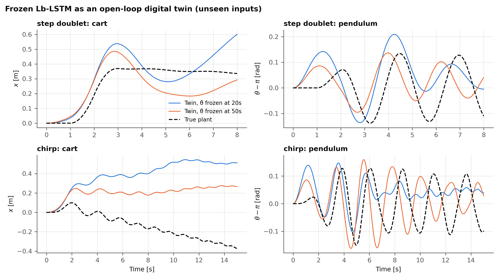

*Figure 6. The frozen Lb-LSTM run as an open-loop simulator (digital twin) on two inputs it never
saw: a step doublet (top) and a chirp (bottom). Blue: weights frozen at 20 s. Orange: frozen at
50 s. Dashed: the true plant.*

> **What it shows.** On the step doublet, the twin's pendulum starts swinging about a second
> before the input does, while the true pendulum is still at rest, and its cart overshoots to
> 0.5–0.6 m where the truth settles at 0.35 m. On the chirp, the true cart drifts to −0.37 m,
> but both twins drift the opposite way, and the twin pendulum's oscillations have the wrong
> phase and amplitude.
>
> **What it means.** The weights that observe so well online are not a model of the rig. The
> network learned the particular training trajectory, including its phase, rather than the
> physics. Freezing later (50 s) does not fix this.

**Robustness over initialization seeds 1–5**, reported as median [min, max]:

| Metric | Value |
|:---|:---|
| SS RMSE $\dot x$ | 0.002 [0.002, 0.005] m/s |
| SS RMSE $\dot\theta$ | 0.019 [0.014, 0.022] rad/s |
| Twin one-step NMSE $\ddot\theta$, frozen at 20 s: doublet / chirp | 1.27 [0.78, 3.15] / 1.07 [0.85, 3.36] |
| Twin one-step NMSE $\ddot\theta$, frozen at 50 s: doublet / chirp | 1.56 [0.91, 5.79] / 0.99 [0.52, 2.40] |
| Twin free-run MSE $\theta$, frozen at 20 s: doublet / chirp | 0.073 [0.014, 3.8] / 0.075 [0.025, 39] |

#### 6.7.4 Findings

1. **Observation works robustly.** Every seed beats the dirty derivative by more than an
   order of magnitude on $\dot\theta$, with a chatter ratio near 1.
2. **Identification from this experiment does not generalize.** The frozen model fits the
   training trajectory: frozen, teacher-forced $\ddot\theta$ NMSE is 0.13 (frozen at 20 s)
   and 0.06 (frozen at 50 s) for seed 0, and 0.06–0.43 across seeds 1–5. On
   unseen inputs, the median one-step NMSE is about 1: no better than predicting zero. The
   seed-to-seed spread is large, which is the signature of non-identifiable weights.
3. **Why.**
   - The law $\dot{\hat\theta} = \Gamma\Phi'^Te$ drives $e \to 0$, and it only needs
     $\hat\Phi = g$ *along the visited trajectory*.
   - The two-tone excitation confines the state to a thin manifold, which does not
     persistently excite the 1440-dimensional $\hat\theta$.
   - The recurrent inputs $\hat h$ let the network fit the trajectory's *phase* as well as
     its state. The frozen model even predicts $\hat{\ddot\theta} = 0.48$ rad/s² at rest at
     the hanging equilibrium, where the truth is 0. That is why the twin moves before the
     doublet starts.
4. **Implication.** Approach A is a strong black-box *velocity observer*. It is not, from
   one run, a digital twin. Converging $\hat\theta$ needs either richer excitation or a
   parameter-error-driven term. Approach C's concurrent-learning history stack adds
   exactly that (§8). Approach B's physical structure shrinks the hypothesis class instead (§7).

---

## 7. Approach B: physics-informed PI-LSTM observer

Approach B is a Lyapunov-based **physics-informed** LSTM observer in the spirit of **Hart,
Griffis, Patil & Dixon [5]**. Approach A learns the whole acceleration field $g(x,u)$ as a black
box. Approach B instead learns the four terms of the Euler–Lagrange equation,

$$M(q)\ddot q + V_m(q,\dot q)\dot q + G(q) + F(\dot q) = Bu,$$

with sub-networks whose **parametrization** enforces the mechanical invariants. The
invariants hold for *every* parameter value, so they hold throughout the adaptation
transient, not only at convergence:

| Invariant | How it is enforced | Holds for |
|:---|:---|:---|
| $\hat M = \hat M^T \succeq \epsilon_M I$ | modified Cholesky $\hat M = LL^T + \epsilon_M I$, softplus diagonal | all $\theta_M$ |
| $z^T(\dot{\hat M} - 2\hat V_m)z = 0$ | $\hat V_m$ from Christoffel symbols of $\hat M$, plus a skew gyroscopic term | all $\theta_M, \theta_V$ |
| $\hat G$ conservative | $\hat G = \nabla_q \hat P$, gradient of a learned potential | all $\theta_G$ |
| $\dot q^T\hat F \ge 0$ | $\hat F = \mathrm{diag}(d_i)\dot q$, $d_i = d^0_i\,\mathrm{softplus}(\cdot) > 0$ | all $\theta_F$ |
| $\hat M, \hat P$ independent of the cart position $x$ | $x$ is a cyclic coordinate of the learned Lagrangian | all $\theta$ |

Together these make the learned model **passive**: $\frac{d}{dt}(\hat T + \hat P) \le \dot q^TBu$.

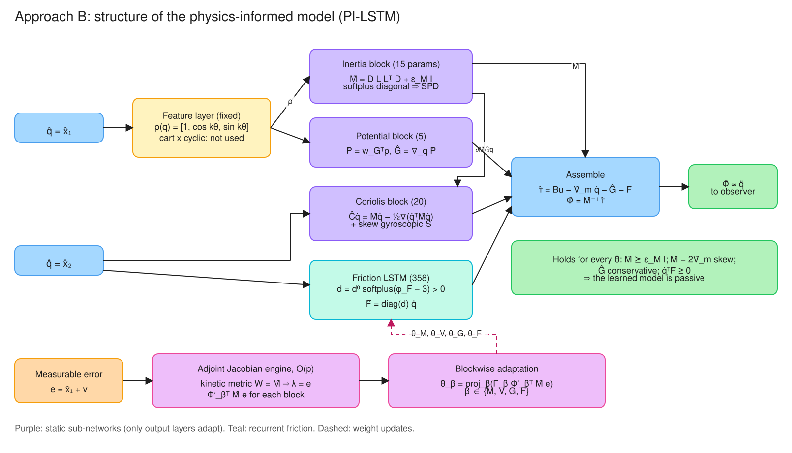

*Diagram 6. Structure of the PI-LSTM. Fixed harmonic features of the configuration feed the inertia
and potential blocks. The Coriolis force follows from the inertia by the Christoffel construction,
and a recurrent block learns a dissipative friction. The blocks are assembled into
$\hat\Phi = \hat M^{-1}\hat\tau$. The invariants in the green box hold for every parameter value.
Learning (dashed) uses only the measurable error $e$, through an adjoint Jacobian in the kinetic
metric (§7.5).*

**Relation to Hart et al. [5].** [5] is a *tracking controller*. Its adaptation laws and its
$\mathrm{sgn}$ term use $r = \dot e + \alpha e$ with $e = q - q_d$, which is measurable under
full-state feedback. Carried into an observer, $r$ contains the unmeasured velocity error, so B
adapts on the measurable error $e = \tilde q + \nu$ of §5, and its robustness rests on the
integral (RISE) argument of §5.5 instead. [5] also lists positive-definiteness of the learned
inertia as future work. Here it holds by construction for every parameter value (§7.2).

All updates are analytical ODEs in NumPy, with no autograd. The Jacobians of all four
parameter blocks match central finite differences to about $10^{-9}$.

- **What the structure buys.** It halves the steady-state velocity error of A. It recovers from
  the parameter step twice as fast. The frozen model is a usable, energy-consistent digital
  twin. It has 398 parameters instead of 1440.
- **What it does not buy.** It does not reduce the *initial* peaking (§7.8.5). Inertia
  identification is incomplete: $\hat M$ has 16 % relative error at 50 s, and $\hat M_{22}$
  does not track the post-shift increase (§7.8.4).

### 7.1 Problem setting and Euler–Lagrange invariants

For the rig, the coordinates are $q = [x,\ \theta]^T$ and the input is $u = F$ (with $n = 2$,
$m = 1$). Only $q$ is measured, $y = q + v$, and $\dot q$ must be estimated. Approach B uses
**structural** knowledge only:

- the plant is an Euler–Lagrange system;
- the joint types: $x$ is prismatic, $\theta$ is revolute;
- the input matrix $B = [1,\ 0]^T$: the force acts on the cart;
- the track is level, so $x$ is cyclic;
- the order of magnitude of the inertia (§7.2.4).

It uses **no** parameter values: no $M$, $m$, $l$, $I$, $g$, $b$ or $d$.

For a mechanical system with Lagrangian $\mathcal L = \tfrac12\dot q^TM(q)\dot q - P(q)$:

- **(P1)** $M(q) = M(q)^T \succ 0$. The kinetic energy $T = \tfrac12\dot q^TM\dot q$ is a
  positive-definite metric.
- **(P2)** With $V_m$ built from the Christoffel symbols of $M$, the matrix $\dot M - 2V_m$
  is skew-symmetric. So $\dot q^T(\tfrac12\dot M - V_m)\dot q = 0$: Coriolis and centripetal
  forces do no work.
- **(P3)** $G = \nabla_q P$ is conservative.
- **(P4)** Friction is dissipative: $\dot q^TF \ge 0$.
- **(P5)** Power balance: $\dot H = \dot q^T(Bu - F) \le \dot q^TBu$ for $H = T + P$. The
  system is passive from $u$ to $B^T\dot q$.

An unconstrained approximator of $\ddot q$ satisfies none of these. Its implied inertia can
be indefinite, and its free response can create or destroy energy. §7.8.3 measures both
effects for Approach A.

### 7.2 Inertia sub-network: modified Cholesky parametrization

`src/observers/pilstm_network.py::cholesky_inertia`

$$\hat M(q) = L(q)L(q)^T + \epsilon_M I,\qquad L = D\tilde L,\qquad
\tilde L_{ii} = \mathrm{softplus}(a_{ii}),\quad \tilde L_{ij} = a_{ij}\ (i>j),\quad a = W_M^T\rho(q),$$

where $D = \mathrm{diag}(d_i) \succ 0$ is a fixed row scale (§7.2.4) and $\rho(q)$ is the
feature layer (§7.2.3).

#### 7.2.1 Proofs

**Proposition 2 (symmetry and uniform positive-definiteness).** For every $W_M$ and every
$q$: $\hat M = \hat M^T$, $\lambda_{\min}(\hat M) \ge \epsilon_M$, and
$\lVert\hat M^{-1}\rVert_2 \le 1/\epsilon_M$.

*Proof.* $(LL^T)^T = LL^T$. For any $z$,
$z^T\hat Mz = \lVert L^Tz\rVert^2 + \epsilon_M\lVert z\rVert^2 \ge \epsilon_M\lVert z\rVert^2$.
Hence $\lambda_{\min} \ge \epsilon_M$ and $\lVert\hat M^{-1}\rVert_2 = 1/\lambda_{\min} \le 1/\epsilon_M$. ∎

The softplus diagonal makes $L$ nonsingular ($\det L = \prod_i d_i\tilde L_{ii} > 0$), so
$LL^T \succ 0$ already. The $\epsilon_M I$ term adds a margin that is **uniform in the
parameters**: softplus can approach 0, so $\lambda_{\min}(LL^T)$ alone has no parameter-free
lower bound. Consequently, $\hat\Phi = \hat M^{-1}\hat\tau$ is always well defined, and no
adaptation transient can produce a singular inertia.

**Proposition 3 (no loss of generality).** The map $L \mapsto LL^T + \epsilon_MI$, over
lower-triangular $L$ with positive diagonal, is a bijection onto
$\{M = M^T : M - \epsilon_MI \succ 0\}$.

*Proof.* Every symmetric positive-definite matrix $M - \epsilon_MI$ has a unique Cholesky
factor with positive diagonal. Softplus maps $\mathbb R$ onto $(0,\infty)$, so every such
factor is reached. ∎

So the constraint excludes only physically impossible inertias (and those lighter than
$\epsilon_M$). $\epsilon_M = 0.05$, while the rig's true $\lambda_{\min}(M) \approx 0.126$.

**Proposition 4 (upper bound).** With the harmonic features of §7.2.3, $\lVert\rho\rVert^2 = 1 + K$
for one revolute joint. So $\lvert a_r\rvert \le \lVert W_M\rVert\sqrt{1+K} \le \bar W_M\sqrt{1+K}$
under the projection of §7.5, and $\hat M$ is bounded above by an explicit
$\bar M(\bar W_M, D)$. The adapted inertia therefore lives in the compact set
$\epsilon_MI \preceq \hat M \preceq \bar MI$.

#### 7.2.2 Configuration derivatives

The Christoffel symbols and the adaptation law both need $\partial\hat M/\partial q_k$:

$$\frac{\partial L_r}{\partial q_k} = g_r'(a_r)\,W_{M,r}^T\frac{\partial\rho}{\partial q_k},\qquad
\frac{\partial\hat M}{\partial q_k} = \frac{\partial L}{\partial q_k}L^T + L\frac{\partial L}{\partial q_k}^T,$$

with $g_r = d_i\,\mathrm{softplus}$ on the diagonal and $g_r = d_i\cdot\mathrm{id}$ below
it. `tests/test_pilstm.py` checks $\partial\hat M/\partial q$ against finite differences.

#### 7.2.3 Feature layer

$$\rho(q) = \big[\,1,\ \xi(q),\ \tanh(V_0^T\xi(q) + b_0)\,\big],\qquad
\xi(q) = \big[\cos k\theta,\ \sin k\theta\big]_{k=1..K}\ \ (\text{revolute}),\quad s(x - \mu)\ \ (\text{prismatic}).$$

The first layer is fixed; only the output layers $W_M$, $W_V$ and $w_G$ adapt. This keeps
$\partial^2\hat M/\partial q\,\partial\theta_M$, which the Christoffel Jacobian needs
(§7.5), in closed form.

- **Default:** $K = 2$ harmonics and no random tanh units. For the rig this gives 5 features.
- **Why harmonics.** They are orthogonal over a revolution, so the adaptation is well
  conditioned.
- **Measured alternative.** A random tanh layer (24 units, $K = 1$) makes the gravity block
  adapt 2–3× more slowly and worsens the post-shift $\dot\theta$ error 2.3× (§7.8.6).
- **Capacity.** `n_features > 0` adds random tanh capacity for mechanisms outside the
  harmonic span.

#### 7.2.4 Dimensionless row scale and the inertia prior

On the rig, $M_{11} \approx 2.6$ kg and $M_{22} \approx 0.13$ kg·m², a 20× spread. With
$D = I$, a single adaptation gain $\gamma_M$ is simultaneously too slow for the cart row
and too fast for the pendulum row.

Setting $D = \mathrm{diag}(\sqrt{m^0_i})$, where $m^0$ is the inertia prior, makes $W_M$
dimensionless. $DL$ is still lower-triangular with a positive diagonal, so Propositions
2–4 are unchanged. The row scale folds into $g'$ and $g''$, so the Jacobian engine is
unchanged too.

The initial parameters give $\hat M(q;\theta(0)) = \mathrm{diag}(m^0)$ for all $q$. The
default $m^0 = (2.0, 0.2)$ is an order-of-magnitude, datasheet-level prior. It is 24 % and
55 % off the true pre-shift values, and 27 % and 3 % off the post-shift values. §7.8.6
reports $m^0 = (1, 0.1)$ and $(5, 0.5)$ as well. Approaches D and E start from the same prior.

#### 7.2.5 Cyclic coordinates

On a level track, $x$ does not appear in $\mathcal L$. The configuration features therefore
embed only the non-cyclic coordinates, so $\hat M$, $\hat P$ and $S$ are invariant to $x$
**by construction**, and $\hat G_x \equiv 0$. By Noether's theorem, the learned model then
conserves the cart momentum $(\hat M\dot q)_1$ whenever $u = 0$ and $\hat F = 0$.

In the final configuration this prior makes little numerical difference (§7.8.6). With random
features and $D = I$, however, an $x$-dependent inertia produces spurious Christoffel forces that
destabilize adaptation, so the prior is kept. The same symmetry, imposed on the black boxes, is
improvement 2 of the shared benchmark (§11.5).

### 7.3 Coriolis, gravity and friction sub-networks

#### 7.3.1 Skew-symmetry by construction (Christoffel symbols)

$$\hat C_{ij}(q,\dot q) = \sum_k \Gamma_{ijk}\dot q_k,\qquad
\Gamma_{ijk} = \tfrac12\left(\frac{\partial\hat M_{ij}}{\partial q_k} + \frac{\partial\hat M_{ik}}{\partial q_j} - \frac{\partial\hat M_{jk}}{\partial q_i}\right).$$

**Proposition 5.** For every $\theta_M$, $N := \dot{\hat M} - 2\hat C$ is skew-symmetric.

*Proof.* With $\dot{\hat M}_{ij} = \sum_k \partial_k\hat M_{ij}\,\dot q_k$:

$$N_{ij} = \sum_k\left(\partial_k\hat M_{ij} - \partial_k\hat M_{ij} - \partial_j\hat M_{ik} + \partial_i\hat M_{jk}\right)\dot q_k
= \sum_k\left(\partial_i\hat M_{jk} - \partial_j\hat M_{ik}\right)\dot q_k.$$

Swapping $i \leftrightarrow j$ flips the sign, so $N^T = -N$. The proof uses only symmetry
and differentiability of $\hat M$, and Proposition 2 guarantees both for every parameter
value. ∎

- **Implementation.** The code evaluates the equivalent vector form
  $\hat C\dot q = \dot{\hat M}\dot q - \tfrac12\nabla_q(\dot q^T\hat M\dot q)$.
- **Check against the true rig.** For the true $M(\theta)$ this reproduces
  $C = \begin{bmatrix}0 & -ml\dot\theta\sin\theta\\ 0 & 0\end{bmatrix}$.
- **Tests.** The tests check the matrix against a brute-force Christoffel sum over
  finite-difference derivatives, and check $z^TNz = 0$ for random parameters.
- **Measured along the trajectory.** $\max\lvert z^TNz\rvert/\lVert z\rVert^2 = 7\times10^{-17}$.

**Gyroscopic block $\theta_V$.** The Christoffel term is fully determined by $\theta_M$.
The separate block $\theta_V$ parametrizes

$$S(q,\dot q) = \sum_{i<j} s_{ij}\,(E_{ij} - E_{ji}),\qquad s_{ij} = W_{V,ij}^T\big(\rho(q)\otimes\dot q\big),$$

and $\hat V_m = \hat C + S$. $S$ is skew, so $\dot{\hat M} - 2\hat V_m = N - 2S$ remains
skew-symmetric, and $\dot q^TS\dot q = 0$: the extra force does no work. It is quadratic
in $\dot q$, like a real Coriolis force. It can represent power-neutral forces outside the
Christoffel family, such as gyroscopic coupling. The rig has none, and $\theta_V$ indeed
stays near 0: its drift from initialization is below 0.01 (Figure 12).

#### 7.3.2 Conservative gravity

$$\hat P(q) = w_G^T\rho(q),\qquad \hat G(q) = \nabla_q\hat P = D\rho(q)^Tw_G.$$

$\hat G$ is a gradient, so it is curl-free for every $w_G$, and it is linear in $w_G$. On
the rig's true potential $P = mgl\cos\theta$, the idealized test (true $M$, 1° noise)
converges to $w_{G,\cos\theta} = 0.808$ against the true $mgl = 0.812$.

#### 7.3.3 Dissipative recurrent friction

A continuous-time LSTM with the same cell as Approach A (§6.1) runs on
$\zeta_F = [s\odot\dot q,\ \hat h_F,\ 1]$. Its readout $\phi_F = W_h^Th$ sets a diagonal,
velocity- and history-dependent damping:

$$\hat F = \mathrm{diag}(d)\,\dot q,\qquad d_i = d^0_i\,\mathrm{softplus}(\phi_{F,i} - 3) > 0
\ \ \Rightarrow\ \ \dot q^T\hat F = \textstyle\sum_i d_i\dot q_i^2 \ge 0.$$

Viscous, Coulomb and Stribeck laws all have this form, with
$d_i(v) = F_i(v)/v \ge 0$. The LSTM memory lets $d_i$ depend on the velocity history, so it
can capture dynamic friction and belt hysteresis *to the extent that these are dissipative*.

- **The price.** Pre-sliding hysteresis that temporarily returns energy (as in LuGre bristle
  dynamics) cannot be represented.
- **Unconstrained option.** `dissipative_friction=False` gives $\hat F = \phi_F$. Its
  learned friction injected power in **58 %** of samples (§7.8.6). The dissipative form gives
  0 %.

#### 7.3.4 Power balance of the learned model

**Proposition 6.** Along the learned dynamics
$\hat M\ddot q + \hat V_m\dot q + \hat G + \hat F = Bu$, the learned energy
$\hat H = \tfrac12\dot q^T\hat M\dot q + \hat P$ satisfies
$\dot{\hat H} = \dot q^TBu - \dot q^T\hat F \le \dot q^TBu$, for every $\theta$.

*Proof.*

$$\dot{\hat H} = \dot q^T\hat M\ddot q + \tfrac12\dot q^T\dot{\hat M}\dot q + \nabla\hat P^T\dot q
= \dot q^T(Bu - \hat V_m\dot q - \hat G - \hat F) + \tfrac12\dot q^T\dot{\hat M}\dot q + \hat G^T\dot q
= \dot q^T(Bu - \hat F) + \tfrac12\dot q^T(\dot{\hat M} - 2\hat V_m)\dot q.$$

The last term vanishes by Proposition 5, and $\dot q^T\hat F \ge 0$ by §7.3.3. ∎

- **Consequence.** The frozen PI-LSTM is passive. With $u = 0$ it can never gain energy,
  and with $u = 0$, $\hat F = 0$ it conserves $\hat H$ exactly.
- **Numerical check.** On the adapted model (RK4, 1 ms, 10 s free swing),
  $\max\lvert\hat H(t) - \hat H(0)\rvert = 7.5\times10^{-14}$ J (§7.8.3).

### 7.4 Observer

`src/observers/pilstm_observer.py`. The observer is the skeleton of §5 with the black box
replaced by the structured model:

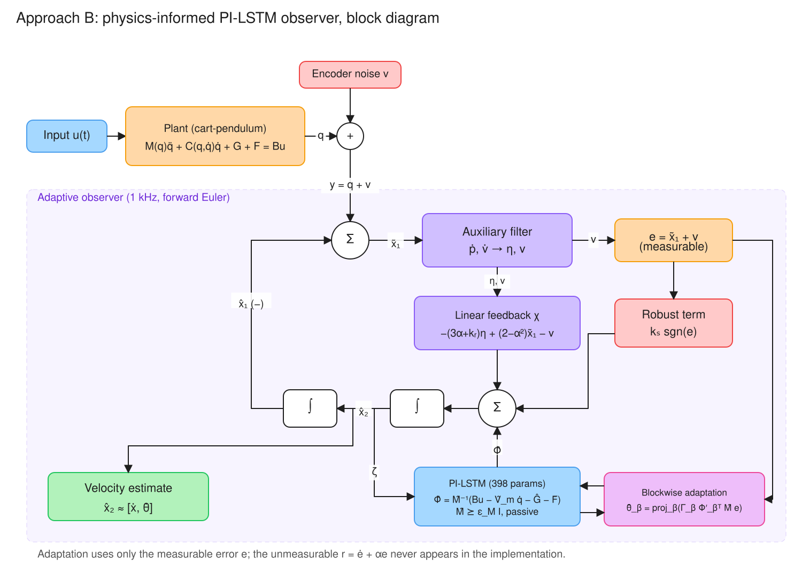

*Diagram 7. Block diagram of the PI-LSTM observer. The filter, the feedback $\chi$ and the robust
term are those of §5. Only the model block (Diagram 6) and the blockwise adaptation law differ.*

$$\dot{\hat q} = \hat{\dot q},\qquad
\dot{\hat{\dot q}} = \hat\Phi + k_s\,\mathrm{sgn}(e) + \chi,\qquad
\hat\Phi = \hat M^{-1}(\hat q)\big[Bu - \hat V_m(\hat q,\hat{\dot q})\hat{\dot q} - \hat G(\hat q) - \hat F\big].$$

The auxiliary filter $(p,\nu,\eta,e)$ and $\chi$ are exactly those of §5.2 with
$\tilde x_1 = \tilde q$. With $r = \tilde{\dot q} + \alpha\tilde q + \eta$ and $V_0$ of §5.3,

$$\dot V_0 = -\alpha(\lVert\tilde q\rVert^2 + \lVert\eta\rVert^2 + \lVert\nu\rVert^2) - k_r\lVert r\rVert^2 + r^T\big(\ddot q - \hat\Phi - k_s\,\mathrm{sgn}(e)\big).$$

**Stability sketch.** Let $N = \ddot q - \hat\Phi$. As in §5.5, if $\hat\theta$ stays in a compact
set (guaranteed by projection, §7.5) and $N, \dot N$ are bounded along the trajectory, the RISE
integral lemma gives asymptotic convergence when $k_s$ exceeds its bound,
$\max\{\zeta_1+\zeta_2,\ \zeta_1+\zeta_3/\alpha\}$. With the kinetic metric of §7.5 the adaptation
cancels $\alpha e^T\hat M\Phi'\tilde\theta$ rather than $\alpha e^T\Phi'\tilde\theta$. The difference,
$\alpha e^T(I - \hat M)\Phi'\tilde\theta$, is bounded and adds its bound to the second entry of that
maximum. Otherwise it gives uniform ultimate boundedness. The default $k_s = 0.2$ is below the
bound, so the experiments run in the UUB regime, as in A.

The structure changes the bound on $\hat\Phi$ in two opposite ways:

- **Tighter.** By Propositions 2 and 4, $\lVert\hat M^{-1}\rVert \le 1/\epsilon_M$, and
  $\hat G$ and $\hat F$ are bounded on compact sets, uniformly over the projection balls.
  Every learned term has a physical interpretation and a certified bound.
- **Looser.** The Christoffel term is **quadratic** in $\hat{\dot q}$:
  $\lVert\hat C\hat{\dot q}\rVert \le k_C\lVert\hat{\dot q}\rVert^2$. Approach A's
  $\hat\Phi = W_h^T h$ is instead globally bounded, because $\lVert h\rVert_\infty \le 1$.
  The PI-LSTM's boundedness argument is therefore **semi-global**, not global: a large
  velocity-estimate transient can feed itself through the learned Coriolis term. The true
  plant has the same quadratic term, so this is the price of representing it faithfully.
  §7.7 shows this failure mode with the Euclidean-metric gradient.

### 7.5 Jacobian engine and blockwise adaptation

`src/adaptation/pilstm_jacobian_engine.py`

$\theta = [\theta_M, \theta_V, \theta_G, \theta_F]$ has 398 parameters on the rig: 15, 20,
5 and 358. Every block adapts simultaneously:

$$\dot{\hat\theta}_\beta = \mathrm{proj}_\beta\big(\Gamma_\beta\,\Phi_\beta'^T W e\big),\qquad \lVert\hat\theta_\beta\rVert \le \bar W_\beta,\qquad \beta \in \{M, V, G, F\},$$

with the smooth projection of §6.3 applied per block.

**Adjoint form.** $\hat\Phi = \hat M^{-1}\hat\tau$, so
$\Phi'_\beta = \hat M^{-1}(\partial\hat\tau/\partial\theta_\beta - (\partial\hat M/\partial\theta_\beta)\hat\Phi)$.
With the adjoint vector $\lambda = \hat M^{-1}We$:

$$\Phi_\beta'^TWe = \frac{\partial}{\partial\theta_\beta}\Big[\lambda^T\hat\tau - \lambda^T\hat M\hat\Phi\Big]_{\lambda,\hat\Phi\ \text{held}}.$$

This is evaluated in $O(p)$ without forming $\Phi'$:

| Block | $\Phi_\beta'^TWe$ |
|:---|:---|
| $G$ | $-D\rho\,\lambda$ |
| $V$ (pair $ij$) | $-(\lambda_i\dot q_j - \lambda_j\dot q_i)\,(\rho\otimes\dot q)$ |
| $F$ | $\Phi_F'^T(-\lambda\odot\partial\hat F/\partial\phi_F)$, via the Kronecker product form of §6.2 |
| $M$ (entry $r$) | $-(Z + K)_r\,g_r'\rho - \sum_k Y_{k,r}\big(g_r''\,\beta_{rk}\,\rho + g_r'\,\partial_k\rho\big)$ |

The inertia block is the only nontrivial one. $\hat M$ enters both through $\hat M^{-1}$
and through the Christoffel vector
$\lambda^T\hat C\dot q = \sum_k a_k^T\,\partial_k\hat M\,\dot q$, with
$a_k = \dot q_k\lambda - \tfrac12\lambda_k\dot q$. That gives

$$K = (\lambda\hat\Phi^T + \hat\Phi\lambda^T)L,\qquad
Z = \sum_k(\dot q\,a_k^T + a_k\dot q^T)\,\partial_kL,\qquad
Y_k = a_k\dot q^TL + \dot q\,a_k^TL,$$

with $\beta_{rk} = W_{M,r}^T\partial_k\rho$. The second-order term
$\partial(\partial_kL_r)/\partial W_r = g_r''\beta_{rk}\rho + g_r'\partial_k\rho$ is why the
feature layer is kept fixed.

`tests/test_pilstm.py` checks all four blocks against central finite differences (for both
friction forms), and checks the fast product against the explicit $\Phi'^TWe$.

**Error metric $W$** (`metric=`):

| `metric` | $W$ | $\lambda$ | Gradient of |
|:---|:---|:---|:---|
| `"euclidean"` | $I$ | $\hat M^{-1}e$ | $\tfrac12\lVert e\rVert^2$ |
| `"kinetic"` (default) | $\hat M$ | $e$ | $\tfrac12 e^T\hat Me$, the kinetic-energy metric |

Both are descent directions, since $\Phi'^TW\Phi' \succeq 0$, and both keep $\hat\theta$
in the projection balls. They differ in loop gain. The Euclidean law's effective gain
scales as $\hat M^{-2}$: that is $\hat M_{22}^{-2} \approx 60$ for the light pendulum
coordinate, against $\hat M_{11}^{-2} \approx 0.14$ for the cart, a ratio of about 400. It also
grows further whenever adaptation shrinks $\hat M$. The kinetic metric removes one factor of
$\hat M^{-1}$ and, together with the dimensionless row scale of §7.2.4, balances the two
channels. Measured: the Euclidean law diverges at $t = 3.6$ s on the benchmark (§7.8.6). D and E
reuse the kinetic metric for their instantaneous laws.

### 7.6 Discretization

As in §6.4: measurements and inputs are held zero-order between 1 kHz samples, and all
observer states are integrated with forward Euler ($n_s = 1$ sub-step). After each step a radial
rescale per block keeps the discrete flow inside $\bar W_\beta$ (a safeguard; in the reported
runs every block stays below 48 % of its radius). The frozen-model rollouts in §7.8.3 use RK4.

### 7.7 Design decisions

Each choice below was tested against its alternative. The last column gives the measured effect.

| Choice | Alternative | Measured effect of the alternative |
|:---|:---|:---|
| Kinetic-energy metric (§7.5) | Euclidean gradient | Diverges at 3.6 s (§7.8.6). The adjoint $\lambda = \hat M^{-1}e$ amplifies the light pendulum channel about 100× |
| Harmonic features (§7.2.3) | 24 random tanh features | Slower gravity learning; post-shift $\dot\theta$ error 2.3× worse (§7.8.6) |
| Dimensionless Cholesky row scale (§7.2.4) | $D = I$ | One gain cannot suit the 20× inertia spread. Combined with random features, the quadratic Christoffel term drove $\hat M_{12}$ from −0.15 to −0.70 within 250 ms (the semi-global effect of §7.4) |
| Cyclic cart coordinate (§7.2.5) | $x$ among the features | Little effect in the final configuration (§7.8.6). With random features and $D = I$, the $x$-features of $\hat P$ absorbed the $u$-correlated cart error and gravity was not learned ($\lVert w_G\rVert \approx 0.3$, against $mgl = 0.81$) |
| Dissipative friction (§7.3.3) | Unconstrained $\hat F = W_h^Th$ | Learned friction injects power in 58 % of samples |

With all five choices in place, the observer is stable for every prior and seed tried.

The Approach A baseline was re-tuned on this scenario too: input scales, $\gamma_h$,
$\gamma_g$ and $L$. Its defaults, with the same data-driven normalization, were within noise of
its best, so they are used unchanged.

### 7.8 Results

#### 7.8.1 Scenario

`python experiments/run_pilstm_validation.py --seeds 5 --ablations` (about 2.5 min). This is
scenario S2 of the shared benchmark (§11.1).

- **Large deflection.** $\theta(0) = 0.5$ rad from **upright**, in the plant's convention.
  The pendulum falls and swings almost full circle: $\theta \in [0.5, 5.8]$ rad and
  $\lvert\dot\theta\rvert$ up to 5 rad/s. This exercises $\hat M(\theta)$ and $\hat P(\theta)$
  over their whole domain.
- **Noise.** U(±1.0°) encoder noise on $\theta$, twice the testbed default, plus ±0.2 mm
  cart noise and 4096-count quantization.
- **Sudden parameter shift.** At $t = 25$ s the pendulum becomes 50 % heavier: $m$ and $I$
  are both scaled by 1.5 (same geometry, denser rod; `--mass-only` keeps $I$). The true
  $M_{22}$ jumps from 0.129 to 0.193, the amplitude of $M_{12}$ from 0.083 to 0.124, and
  $mgl$ from 0.81 to 1.22.
- **Excitation.** Open-loop $u = 2\sin 3t + 1.2\cos 6t$. The cart starts at the
  drift-cancelling velocity $-2/(3(M+m))$. A's $1.5$ rad/s excitation drives the
  cart into the ±0.5 m bumpers once the mass step breaks the momentum balance. With this
  excitation the cart stays within ±0.16 m.
- **Observer inputs.** Encoder data and the *commanded* force. Both LSTMs are normalized
  from the first 5 s of encoder data.

#### 7.8.2 Velocity reconstruction (noise seed 42)

| RMSE / peak | PI-LSTM | Lb-LSTM (A) | Dirty derivative |
|:---|---:|---:|---:|
| $\dot x$, transient 0–5 s [m/s] | 0.0348 | 0.0469 | **0.0198** |
| $\dot\theta$, transient 0–5 s [rad/s] | **0.147** | 0.158 | 0.502 |
| $\dot x$, pre-shift 15–25 s | **0.0026** | 0.0147 | 0.0161 |
| $\dot\theta$, pre-shift 15–25 s | **0.0265** | 0.0590 | 0.502 |
| $\dot x$, post-shift 25–30 s | **0.0038** | 0.0103 | 0.0131 |
| $\dot\theta$, post-shift 25–30 s | **0.0244** | 0.0375 | 0.496 |
| $\dot x$, steady 35–50 s | **0.0026** | 0.0057 | 0.0149 |
| $\dot\theta$, steady 35–50 s | **0.0225** | 0.0340 | 0.496 |
| peak $\lvert\dot\theta\text{ err}\rvert$, 0–2 s | 0.470 | **0.441** | 1.14 |
| peak $\lvert\dot\theta\text{ err}\rvert$, 25–27 s | **0.047** | 0.106 | 1.17 |
| chatter ratio $\dot\theta$ (steady) | **1.06** | 1.07 | 140 |

Online model fit (35–50 s), as NMSE of $\hat\Phi$ against the true acceleration:

| | PI-LSTM | Lb-LSTM (A) |
|:---|---:|---:|
| $\ddot x$ | 0.044 | 0.095 |
| $\ddot\theta$ | 0.0011 | 0.0052 |

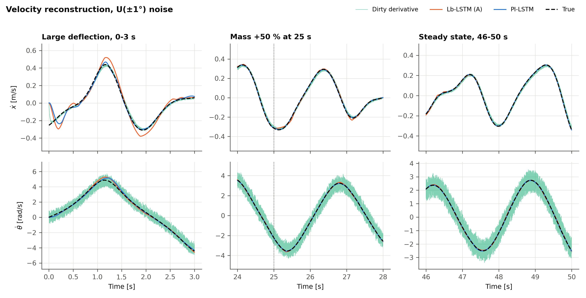

*Figure 7. Estimated against true velocities on the swing-through scenario, in three windows: the
first 3 s after release, around the mass step at 25 s, and the last 4 s. Top: cart. Bottom:
pendulum.*

> **What it shows.** In the first second both learned observers miss the cart velocity, A (red)
> by more than B (blue): A overshoots to 0.52 m/s and −0.38 m/s where the truth peaks at 0.44
> and −0.30. Around the mass step and in steady state, both lie on the dashed truth, while the
> dirty derivative (green) is a ±0.7 rad/s noise band around the pendulum velocity.
>
> **What it means.** Once settled, both observers give clean velocities. The structured model
> makes smaller errors while it is still learning, especially on the cart.

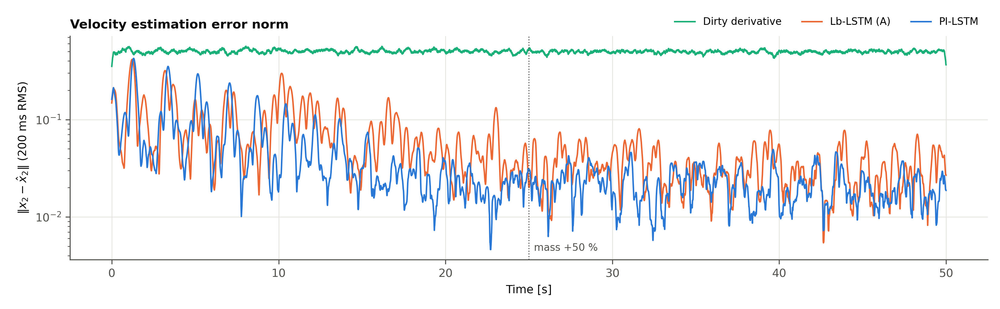

*Figure 8. Size of the velocity-estimation error (200 ms RMS, log scale) over the whole 50 s
swing-through run.*

> **What it shows.** Both learned observers start near 0.2–0.4 and fall below 0.1 within a few
> seconds. From about 10 s on, B (blue) sits mostly below A (red), and nothing happens to B's
> error at the mass step (dotted line). The dirty derivative stays flat near 0.5.
>
> **What it means.** The physics structure roughly halves the steady-state error, and a sudden
> 50 % change of the pendulum causes no error burst.

**Robustness over seeds 1–5**, where the seed sets the noise realization and both
observers' initialization. Values are median [min, max]; neither observer diverged in any
run.

| Metric | PI-LSTM | Lb-LSTM (A) |
|:---|:---|:---|
| $\dot x$ RMSE, steady | **0.0025** [0.0025, 0.0026] | 0.0061 [0.0041, 0.0092] |
| $\dot\theta$ RMSE, steady | **0.020** [0.020, 0.022] | 0.041 [0.032, 0.043] |
| $\dot\theta$ RMSE, post-shift 25–30 s | **0.020** [0.018, 0.023] | 0.047 [0.042, 0.069] |
| peak $\lvert\dot\theta\text{ err}\rvert$, 0–2 s | 0.46 [0.44, 0.47] | **0.43** [0.40, 0.45] |
| samples with $(\hat M^{-1})_{11} \le 0$ | **0 %** [0, 0] | 1.6 % [0.7, 7.0] |

The PI-LSTM's seed-to-seed spread is 5–50× smaller than Approach A's.

#### 7.8.3 Physical plausibility and energy

| Along the 50 s trajectory | PI-LSTM | Lb-LSTM (A) |
|:---|---:|---:|
| $\min_t\lambda_{\min}(\hat M(\hat q))$ (floor $\epsilon_M = 0.05$) | 0.115 | n/a (no $\hat M$) |
| $\min_t\hat T$ | 0 (at $\hat{\dot q} = 0$) | n/a |
| $\max\lvert z^T(\dot{\hat M} - 2\hat V_m)z\rvert/\lVert z\rVert^2$ | $7\times10^{-17}$ | n/a |
| friction injects power | 0 % of samples | n/a |
| implied input gain $\partial\hat\Phi_x/\partial u \le 0$ | **0 %** | **5.7 %** |
| median $\lVert\partial\hat\Phi/\partial u - M^{-1}B\rVert / \lVert M^{-1}B\rVert$ (steady) | 0.19 | 0.88 |

**Why the input gain is the right comparison.** The black box has no inertia matrix, but
for any Euler–Lagrange plant, $\partial\ddot q/\partial u = M^{-1}B$. Its first entry
$(M^{-1})_{11} > 0$ because the inverse of a positive-definite matrix has a positive
diagonal. A black box that predicts $\partial\hat\Phi_x/\partial u \le 0$ is predicting
that pushing the cart forward accelerates it backward: a negative effective mass.
Approach A does this in 5.7 % of samples, and its implied gain is off by 88 % even in
steady state. The PI-LSTM's is off by 19 %, and positive by construction.

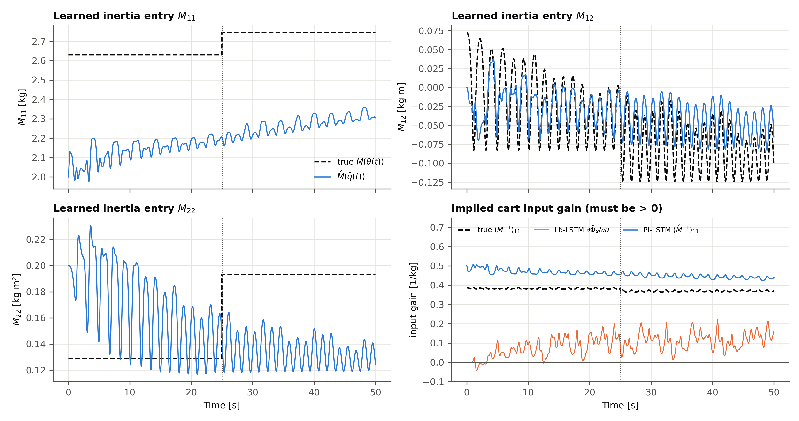

*Figure 9. The inertia matrix the PI-LSTM learns, entry by entry, against the truth (dashed), and
(bottom right) the cart's input gain implied by each model. The dotted line marks the mass step.*

> **What it shows.** $\hat M_{11}$ (cart plus pendulum mass) climbs slowly from the prior 2.0 to
> 2.3 kg but never reaches the true 2.63–2.75 kg. $\hat M_{12}$ oscillates with the right shape
> and sign, at about 60 % of the true amplitude after the step. $\hat M_{22}$ oscillates with
> the swing where the truth is constant, and does not follow the jump from 0.129 to 0.193. In
> the last panel, B's input gain stays positive near 0.45 (truth 0.38). A's hovers at 0–0.2 and
> dips below zero early in the run.
>
> **What it means.** B's inertia is always physically valid, but it is not accurately
> identified: the velocity estimate only needs the right *ratio* of inertia to gravity, and the
> open-loop data do not pin down the absolute scale. A's implied input gain is far off and, at
> times, physically impossible: a negative mass.

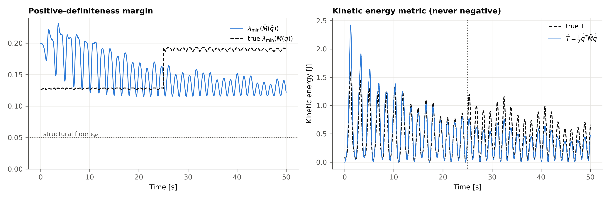

*Figure 10. Left: the smallest eigenvalue of the learned inertia, against the structural floor
$\epsilon_M = 0.05$ and the true value. Right: the learned kinetic energy against the true one.*

> **What it shows.** The learned inertia's smallest eigenvalue stays between 0.115 and 0.23, far
> above the floor, for the whole run. The learned kinetic energy is never negative and follows
> the true energy's peaks, slightly lower after the mass step.
>
> **What it means.** The mechanical laws built into B hold at every instant of learning, not
> just at the end. That is the guarantee of Propositions 2 and 6, observed in practice.

**Frozen models on an unseen free swing.** Weights are frozen at 50 s. Each model is
released from rest at $\theta = \pi - 1$ with $u = 0$ for 10 s and compared with the true
post-shift rigid body (friction removed).

| Frozen model | $\theta$ RMSE | True energy along the response |
|:---|---:|:---|
| PI-LSTM | **0.070 rad** | stays within 0.01 J of the truth |
| Lb-LSTM (A) | 0.613 rad | **loses up to 0.55 J of the 0.56 J swing** |

The black box encodes a spurious, configuration-dependent dissipation. The PI-LSTM's own
energy $\hat H$ is conserved to $7.5\times10^{-14}$ J, as Proposition 6 requires.

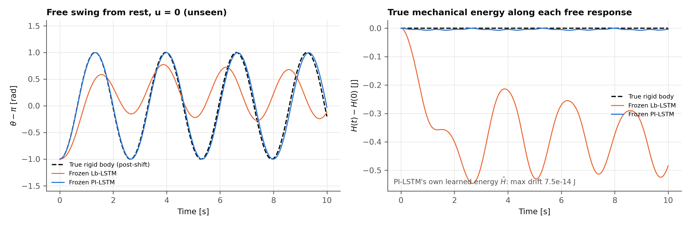

*Figure 11. Left: the frozen models released from rest with no input, against the true rigid
pendulum. Right: the true mechanical energy along each model's response.*

> **What it shows.** The frozen PI-LSTM (blue) swings almost on top of the truth for all 10 s.
> The frozen Lb-LSTM (orange) swings with too small an amplitude, about a shifted centre, at the
> wrong frequency. Its trajectory loses up to 0.55 J of the 0.56 J the swing carries, while B's
> energy stays flat.
>
> **What it means.** B's frozen model is a usable simulator of the rig. A's frozen model would
> predict that the pendulum almost stops by itself, which the real, nearly frictionless pendulum
> never does.

#### 7.8.4 Resilience to the parameter shift

**Velocity estimation.** After the +50 % mass step, the PI-LSTM's $\dot\theta$ error peaks
at 0.047 rad/s, versus 0.106 for A. Its 25–30 s RMSE (0.024) is already at its
steady-state level. There is no transient peaking, because nothing in the structured
model can jump: $\hat M$ is bounded, $\hat G$ is bounded, and the adaptation of each block
is rate-limited by its projection. See Figure 12, where no block's drift steps at 25 s.

**Identification is only partial:**

- **$\hat M_{11}$ (cart + pendulum mass).** It rises steadily, 2.0 → 2.30 kg over 50 s,
  but is still 16 % below the true 2.745 kg at the end. Cart-mass learning is slow at
  $\gamma_M = 5$; $\gamma_M \ge 30$ diverges.
- **$\hat M_{22}$ does not track the step (0.129 → 0.193).** The θ channel constrains the
  ratio $\hat P/\hat M_{22}$ well: $\ddot\theta$ NMSE is 0.001. The absolute scale of
  $M_{22}$ is visible only through the weak $M_{12}$ coupling to $\ddot x$. This is an
  identifiability limit of the open-loop excitation, not of the parametrization: with the
  true pre-shift inertia as prior, $\hat M$ error falls to 4 % (§7.8.6). The learned
  $\hat M_{22}$ also varies spuriously with $\theta$: by up to ±0.05 early on and ±0.015
  at the end, where the truth is constant.
- **$\hat M_{12}(\theta)$.** It has the right shape and sign ($\propto\cos\theta$), with
  about 60 % of the post-shift amplitude.

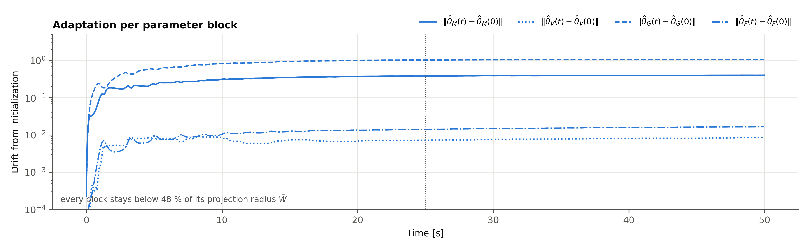

*Figure 12. How far each parameter block has moved from its initial value (log scale): inertia M,
gyroscopic V, gravity G and friction F.*

> **What it shows.** Gravity (dashed) and inertia (solid) move the most, to about 1 and 0.4,
> mostly in the first 10 s. Friction moves about 0.015 and the gyroscopic block less than 0.01.
> No curve jumps at the mass step. Every block stays below 48 % of its projection radius.
>
> **What it means.** The learning goes where the physics is: gravity and inertia dominate the
> pendulum's motion. The gyroscopic block correctly stays near zero, because the rig has no
> gyroscopic forces, and friction barely moves because the simulated friction is tiny. The
> projection bounds are never reached.

#### 7.8.5 Initial peaking

The PI-LSTM does **not** reduce the peak velocity error in the first 2 s: 0.47 rad/s versus
0.44 rad/s, and this holds for every seed. At $t = 0$, $\hat M$, $\hat P$ and $\hat F$ are
still the uninformed prior. Gravity, the dominant $\ddot\theta$ term (up to 6 rad/s²), is
entirely unmodelled. The initial transient is governed by the filter gains $(\alpha, k_r)$
and the zero initial velocity estimate, which both observers share.

The structure bounds the model terms, but it cannot supply knowledge the prior lacks.
Cutting the initial peak needs a better prior (for example a rough $mgl$) or higher filter
gains.

#### 7.8.6 Ablations

Same trajectory, noise seed 42. `--ablations`.

| PI-LSTM variant | Diverged | $\dot x$ steady | $\dot\theta$ steady | $\dot\theta$ post-shift | $\hat M$ rel. err @ 50 s |
|:---|:---|---:|---:|---:|---:|
| **default** (prior diag(2, 0.2)) | no | 0.0026 | 0.0225 | 0.0244 | 0.163 |
| prior diag(1, 0.1) | no | 0.0083 | 0.0233 | 0.0256 | 0.263 |
| prior diag(5, 0.5) | no | 0.0039 | 0.0265 | 0.0300 | 0.302 |
| prior = true $M(\pi/2)$, pre-shift | no | 0.0019 | 0.0226 | 0.0248 | 0.043 |
| inertia frozen at prior ($\gamma_M = 0$) | no | 0.0090 | 0.0266 | 0.0271 | 0.276 |
| **Euclidean-metric gradient** | **at 3.6 s** | – | – | – | – |
| $x$ not cyclic | no | 0.0024 | 0.0226 | 0.0252 | 0.164 |
| random tanh features, no 2nd harmonic | no | 0.0020 | 0.0329 | 0.0564 | 0.054 |
| no friction adaptation | no | 0.0026 | 0.0225 | 0.0244 | 0.163 |
| unconstrained friction $\hat F = W_h^Th$ | no | 0.0026 | 0.0249 | 0.0272 | 0.164 |

- **Metric.** The kinetic-energy metric is what makes the design work at all.
- **Inertia adaptation.** It is what gives the 3.5× better cart-velocity error: compare
  the frozen-inertia row.
- **Prior.** Every prior tried, from diag(1, 0.1) to diag(5, 0.5), is stable and beats
  Approach A on $\dot\theta$.
- **Harmonic features.** They matter for velocity estimation (2.3× on the post-shift error).
  Random features happen to give a better $\hat M$, so capacity and conditioning trade off.
- **Friction.** Adapting it has no measurable effect on accuracy here: the rig's true
  friction is tiny ($b = 0.05$, $d = 0.005$). The dissipative form is justified by physics
  and by the passive twin of §7.3.4, and it is slightly better than the unconstrained form
  on accuracy too.
- **Actuator effects.** `--actuator-effects` adds the PCI-1711 dead-zone and 0.35 N Coulomb
  friction. The dead-zone bias pushes the open-loop cart into a bumper, so the scenario
  becomes non-smooth. In that stress run the PI-LSTM stayed ahead on $\dot\theta$ (steady
  0.025 vs 0.052). Both observers were equally poor on $\dot x$ (about 0.033), because
  neither can see the input dead-zone. The diag(5, 0.5) prior diverged at 16 s in that run.

### 7.9 Structure versus black box

| | Black-box Lb-LSTM (A) | PI-LSTM (B) |
|:---|:---|:---|
| Hypothesis class | any $g(x,u)$ that a 16-cell LSTM can represent | Euler–Lagrange systems |
| Prior knowledge | relative degree | + EL structure, joint types, $B$, cyclic $x$, inertia scale |
| Parameters on the rig | 1440 | 398 |
| Implied inertia | may be indefinite (5.7 % of samples) | $\succeq \epsilon_M I$ always |
| Learned model energy | uncontrolled (frozen twin lost up to 0.55 J of a 0.56 J swing) | passive; conserved exactly with $u = 0$, $F = 0$ |
| Bound on $\hat\Phi$ | global, $\lVert W_h\rVert\sqrt L$ | certified per term, but quadratic in $\hat{\dot q}$ (semi-global) |
| Sensitivity to gain choice | forgiving (tanh saturation) | needs the kinetic metric and dimensionless scaling |
| Transfers to non-EL plants | yes | no |

**Why structure helps against parameter variations.** A +50 % mass step changes $M$, $P$ and the
coupling at once. For the black box it is a change in an arbitrary function of $(x, u, h)$, and
relearning spreads across all 1440 weights. Its implied input gain wanders without constraint,
including through negative values.

For the PI-LSTM, the same step is a change of a few physically meaningful coefficients.
Those coefficients live in a compact set of plausible models
($\epsilon_M \preceq \hat M \preceq \bar M$, conservative $\hat G$, dissipative $\hat F$),
so every intermediate model during re-adaptation is itself a valid mechanical system. That
is why the post-shift error does not peak (§7.8.4).

The limitation is identifiability. The observer adapts toward whatever EL model reproduces
the measured *positions*. When the excitation does not separate $M_{22}$ from $mgl$, the
learned $\hat M_{22}$ stays wrong while the ratio, and hence the velocity estimate, is
right.

### 7.10 Limitations

1. **Incomplete inertia identification** (§7.8.4). $\hat M$ ends with 16 % relative error,
   and $M_{22}$ does not track the shift. The cause was later identified in Approach D (§9.4).
   The pendulum row of the equations of motion has no input, so it is homogeneous. With noisy
   regressors, fitting it shrinks the row's scale towards zero (errors-in-variables attenuation),
   while the ratio $mgl/(I+ml^2)$ survives, which is exactly the "right ratio, wrong scale" seen
   here. Approach D normalizes that row and adds integral concurrent learning, and it identifies
   the inertia to 0.19 %.
2. **No initial-transient improvement** (§7.8.5).
3. **The stability argument is semi-global** because of the quadratic Coriolis term (§7.4).
   Proposition 2's $1/\epsilon_M$ bound does not by itself prevent velocity-estimate
   escape.
4. **The static sub-networks have fixed feature layers.** Only their output layers adapt,
   whereas the friction LSTM adapts fully. Adapting the feature layers would need
   third-order terms in the inertia Jacobian.
5. **Dissipative friction** cannot represent energy-returning pre-sliding hysteresis.
6. **All results are simulation.** The robust gain $k_s$ runs below the RISE bound (UUB
   regime), as in Approach A.
7. **A superseded variant is kept for reference.** `src/observers/physics_informed_lstm_observer.py`
   learns a residual on top of the *known* nominal $M$, $C$, $G$. Its adaptation law is not
   consistent with its stated Lyapunov function, so it is not used for any result.

---

## 8. Approach C: concurrent-learning Lb-LSTM observer

Approach C extends the black-box observer of Approach A with **concurrent learning (CL)**. An
online *history stack* of recorded operating points is selected to maximize the minimum singular
value of its data matrix. The weights then learn from the instantaneous observer error and from
the stored points at the same time. The aim is to keep identifying the model after the excitation
has died out, which the purely instantaneous law of Approach A cannot do without persistence of
excitation (PE).

In C's own benchmark (§8.9), models are trained on one weak-excitation (non-PE) trajectory and
tested open loop on four unseen inputs:

- **C is better in 13 of 16 cells, and in all 8 cells of the two multi-frequency tests.**
  On the chirp and the multisine, its 0.5 s pendulum-angle prediction error is 2.4× and 3.5×
  lower than A's.
- **C loses three cells.** It loses cart acceleration on the step doublet, and both
  pendulum-angle metrics on the slow, small-amplitude 1.2 rad/s sine (§8.9.3). One C win,
  0.5 s x on the step doublet, is a tie in practice (0.0025 vs 0.0026).
- **The rank condition λ_min(Ω) > 0 is reached 2.5 s into training and holds afterwards.**
  Over the same period the sliding-window excitation of the instantaneous regressor falls to
  about 10⁻⁹, so the trajectory is not PE.
- **The benefit comes from the history stack, not from any other change.** The same observer
  with the CL loop switched off ("Std law") is worse than both A and C on θ̈ in every test.

§8.10 then compares A and C on the shared benchmark, where neither was tuned.

### 8.1 The persistence-of-excitation bottleneck

An adaptive observer adapts its weights with a gradient of the output error,
$\dot{\hat\theta} = \Gamma\,\Phi'(t)^T e(t)$. The Lyapunov analysis of §5 makes the
state-estimation errors converge, $\|\tilde x_2\| \to 0$. It does not make the parameter error
$\tilde\theta = \theta^\ast - \hat\theta$ converge. Once $e \to 0$, adaptation stops wherever
$\hat\theta$ happens to be. The parameter error then converges to zero only if the regressor is
**persistently exciting**:

$$\int_t^{t+T}\Phi'(\tau)^T\Phi'(\tau)\,d\tau \;\ge\; \beta I > 0 \qquad \forall t \ge 0.$$

For the output layer of the LSTM, $\Phi'_h = I_n \otimes h^T$, so PE requires the hidden-state
trajectory $h(t) \in \mathbb{R}^{16}$ to keep visiting all 16 directions in every window of
length $T$. Normal operating trajectories do not do this:

- **Decaying commands** $u = A e^{-t/\tau}\sin\omega t$ excite the plant only transiently.
  Afterwards $h(t)$ follows a low-amplitude free swing.
- **Single-frequency commands** drive the plant onto one periodic orbit, which spans only a
  thin subspace of feature space.

The top row of Figure 13 measures this directly. For both commands, the 2 s sliding-window
Gramian $\int_{t-2}^{t}hh^T$ has $\lambda_{\min}$ between 10⁻⁹ and 10⁻⁶ throughout, which in
practice is zero.

### 8.2 Concurrent learning and the rank condition

Concurrent learning (Chowdhary & Johnson [9]; Chowdhary et al. [23]) replaces the
persistence requirement with a condition on **recorded** data. Let
$\{t_j\}_{j=1}^N$ be a stored set of past instants with regressors $\Phi'_j = \Phi'(t_j)$, and
let $\epsilon_j = \ddot x(t_j) - \hat\Phi(t_j)$ be the current model residual at each of them.
The adaptation law becomes

$$\dot{\hat\theta} = \Gamma\,\Phi'(t)^T e(t) \;+\; \Gamma_{CL}\sum_{j=1}^N \Phi'^T_j\big(\ddot x(t_j) - \hat\Phi(t_j)\big).$$

The second term is the negative gradient of the stack loss
$J = \tfrac12\sum_j\|\ddot x(t_j) - \hat\Phi(t_j)\|^2$. It keeps acting after the trajectory has
stopped exciting the plant.

The requirement moves from the trajectory to the stack. The information matrix

$$\Omega = \sum_{j=1}^N \Phi'^T_j\Phi'_j \;\ge\; \underline\lambda\, I > 0 \qquad\text{(rank condition)}$$

must be positive definite at *some* finite time $t_r$. This is an interval-excitation
requirement: it is met once during a transient, not on every window forever.

**Where the rank condition can hold.** $\Omega$ is a sum of $N$ terms of rank at most $n = 2$,
so $\operatorname{rank}\Omega \le 2N$. For the full LSTM parameter vector ($p = 4dL + Ln = 1440$),
the condition would need $N \ge 720$ stored points, each of which must be informative. That is
not achievable.

For the **readout** $\theta_h = \mathrm{vec}(W_h)$, the regressor is $\Phi'_{h,j} = I_n \otimes h_j^T$
and

$$\Omega_h = I_n \otimes \sum_j h_j h_j^T = I_n \otimes (H^TH),\qquad H = [h_1,\dots,h_N]^T \in \mathbb{R}^{N\times L},$$

so that $\lambda_{\min}(\Omega_h) = \sigma_{\min}(H)^2$. This needs only $N \ge L = 16$ points.
The rank condition is therefore imposed and monitored on the readout.

Since $\mathrm{rank}\,\Omega \le nN$, the condition needs $nN \ge p$ at the very least. That makes the
choice of parameter set decisive:

| Design | Parameter set | Required stored points |
|:---|:---|:---|
| C, full LSTM | $p = 1440$ | $N \ge 720$ informative points: not achievable |
| **C, as implemented** | Readout only, $p = 32$ | $N \ge 16$; reached 2.5 s into training (§8.8) |
| D (§9) | All $p = 15$ parameters of a linear Euler–Lagrange model | Gated on 60 windows and $\lambda_{\min} \ge 10^{-4}$; the gate opens after about 3 s |

Approach D was built to close this gap. Its model is linear in its parameters, so the rank condition
covers every parameter and the true plant lies inside the model class. In C, the gate weights also
receive the CL gradient, computed with the full Jacobian $\Phi'_g(t_j)$, but without an
excitation guarantee (§8.6.3).

### 8.3 Architecture

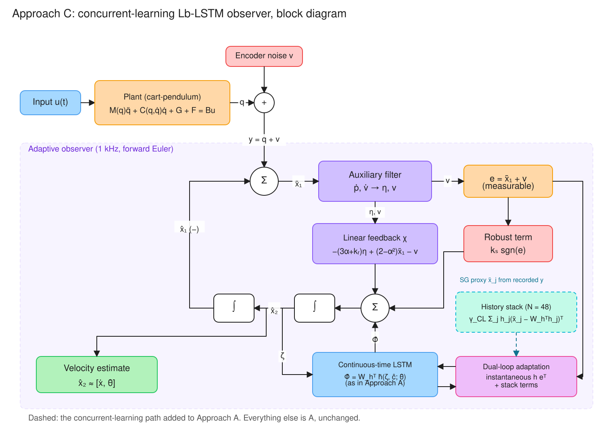

*Diagram 8. Block diagram of the CL-Lb-LSTM observer. Everything outside the dashed path is Approach
A, unchanged: the filter, the feedback $\chi$, the robust term, the LSTM and its instantaneous
law. The dashed path adds the history stack. It records operating points with a Savitzky–Golay
acceleration proxy (§8.5) and feeds the recorded-data terms into the adaptation (§8.6). Diagram 9
(§8.4) details that path.*

**What is inherited from Approach A.** The filter, the observer feedback $\chi$, the robust
term, the LSTM memory ODEs, the analytical Jacobians (`src/adaptation/jacobian_engine.py`) and
the digital-twin extraction are A's code, unchanged. `CLLbLSTMObserver` subclasses
`LbLSTMObserver` and changes only the weight adaptation. `tests/test_cl_lstm_observer.py` checks
that with the CL loop disabled the two observers produce identical states and weights, to 1e-12.

| Weight block | Instantaneous loop | CL loop | Guarantee |
|:---|:---:|:---:|:---|
| Readout $W_h$ (32 params) | $\gamma_h = 300$ | $\gamma_{CL} = 50$, implicit step | Rank condition monitored; convergence proof in §8.7 (for fixed features) |
| Gates $W_{c,i,f,o}$ (1408 params) | $\gamma_g = 0$ (off) | $\gamma_{CL,g} = 5$, explicit step | Descent on the stack loss only; rank(Ω) ≤ 96 < 1408 |

### 8.4 History stack: singular-value-maximizing recording

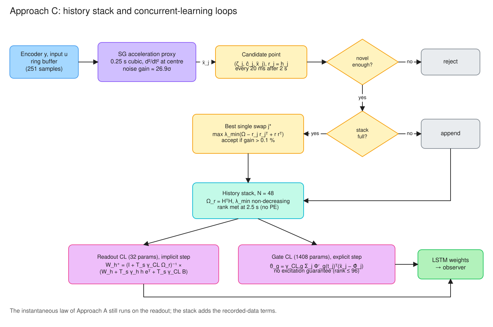

*Diagram 9. The concurrent-learning data path. Encoder samples in a ring buffer give a delayed,
lag-free acceleration proxy. Candidate points pass a novelty gate. When the stack is full, a
candidate replaces the entry whose removal most increases $\lambda_{\min}(\Omega)$. The stack drives
the implicit readout step, which carries the rank guarantee, and the explicit gate step, which has
none.*

`src/concurrent_learning/point_history_stack.py`. Each entry stores what is needed to re-evaluate
the network at the recorded operating point,
$[\zeta(t_j),\ \hat c(t_j),\ u(t_j),\ x_{meas}(t_j),\ \ddot x(t_j)]$, together with its regressor
row $r_j = h_j$. Given $(\zeta_j, \hat c_j)$, the LSTM cell is a static map, so the stored point
can be re-evaluated exactly at the current weights.

**Policy** (Chowdhary & Johnson [10], adapted). For each candidate $r$, arriving at most
every 20 ms after a 2 s warm-up:

1. **Novelty gate.** Reject the candidate if $\|r - r_{last}\| < 0.05\,\|r\|$, where $r_{last}$
   is the last recorded regressor. Near-duplicates from a slowly moving trajectory add no rank.
2. **Stack not full:** append.
3. **Stack full:** evaluate every single swap $j \to r$ in one batched eigen-decomposition,
   $$\lambda_j' = \lambda_{\min}\!\left(\Omega - r_jr_j^T + rr^T\right),\qquad j = 1..N,$$
   and replace $j^\ast = \arg\max_j\lambda'_j$ only if $\lambda'_{j^\ast} > (1 + 10^{-3})\,\lambda_{\min}(\Omega)$.
4. **Rank-deficient phase.** While every swap leaves $\lambda_{\min} = 0$, rank the swaps that
   do not decrease $\lambda_{\min}$ by the D-optimal score $\log\det(\Omega + \delta I)$. This
   drives the stack to full rank.

**Monotonicity lemma.** For fixed regressors, $\lambda_{\min}(\Omega(t))$ is non-decreasing:
every accepted swap increases it, and appends cannot decrease it. Once the rank condition
holds at $t_r$, therefore, $\lambda_{\min}(\Omega(t)) \ge \lambda_{\min}(\Omega(t_r))$ for all
$t \ge t_r$. The switched-system argument in §8.7 uses exactly this.
`test_lambda_min_never_decreases_once_full` checks it. When the gates adapt, the stored
regressors are re-evaluated at the current gates before every decision. The lemma then holds
between gate updates only.

**Why maximize λ_min.** Selecting on $\sigma_{\min}$ keeps the most linearly independent points
and discards clustered, redundant data. On a stream consisting of an informative burst followed
by a collapsed regressor, the stack's $\lambda_{\min}$ is more than 10³× that of the last-$N$
(FIFO) buffer (`test_svm_selection_beats_fifo_on_decaying_excitation`).

### 8.5 Acceleration proxy: causal Savitzky–Golay differentiation

The CL residual needs $\ddot x(t_j)$, which is never measured. `SavitzkyGolayAccelerationProxy`
fits a degree-3 polynomial to the last $W = 251$ encoder samples ($T_w = 0.25$ s) by least
squares [18], then differentiates it twice at the **window centre** $t_c = t - (W-1)/2\cdot T_s$:

$$\hat{\ddot q}(t_c) = c_2^T\,[q(t-(W-1)T_s),\dots,q(t)]^T,\qquad c_2 = 2\,[V^+]_{3,:},\ V_{ki} = \tau_k^{\,i}.$$

- **Causal.** Only past samples are used. The 125 ms delay is harmless because CL learns from
  recorded data anyway. The observer keeps a ring buffer of its own $(\zeta, \hat c, h)$
  snapshots, so each stack entry pairs the proxy with the network input at exactly $t_c$.
- **Unbiased and lag-free.** The centred window is exact for polynomials up to degree 3 and has
  zero phase at $t_c$.
- **Noise.** For i.i.d. encoder noise $\sigma$, the proxy's standard deviation is
  $\sigma\|c_2\| \approx \sigma\sqrt{720\,T_s/T_w^5} = 26.9\,\sigma$ (both values are tested).
  With $\sigma_\theta = 0.5°/\sqrt3$ plus quantization, the proxy's RMS error on the training
  data is 0.14 rad/s² for θ̈ (about 10 % of RMS θ̈) and 0.004 m/s² for ẍ (about 2 %).
  Substituting the true accelerations at the stack points leaves the stack fit essentially
  unchanged, so proxy noise is not the limiting factor.
- **How it can be avoided.** Integral concurrent learning (Parikh et al. [11]) integrates the
  equations of motion over a window, so each stored entry needs only positions, velocities and
  $\int u$. Approach D does this (§9.3). Its velocity smoother has noise gain 8.5, against about
  260 for a second derivative over the same 0.1 s window. For C the proxy was not the binding
  limit; the readout-only rank condition above was. Kamalapurkar et al. [24] estimate the state
  derivative with a dynamic estimator instead.

### 8.6 Adaptation laws

With $\theta = [\theta_g^T, \theta_h^T]^T$, $H$, $A = [\ddot x_1,\dots,\ddot x_N]^T$ and
$E = A - HW_h$ (the $N\times n$ residual matrix):

#### 8.6.1 Readout (dual loop)

$$\dot W_h = \underbrace{\gamma_h\, h(t)\,e(t)^T}_{\text{instantaneous (Approach A)}} \;+\; \underbrace{\gamma_{CL}\,(B - \Omega_r W_h)}_{\gamma_{CL}\sum_j h_j(\ddot x_j - W_h^Th_j)^T},\qquad \Omega_r = H^TH,\ B = H^TA.$$

The CL term is affine in $W_h$ and stiff: $T_s\gamma_{CL}\lambda_{\max}(\Omega_r)$ can exceed 2.
It is therefore integrated **implicitly** (IMEX Euler):

$$W_h^{+} = (I + T_s\gamma_{CL}\Omega_r)^{-1}\big(W_h + T_s\gamma_h h e^T + T_s\gamma_{CL}B\big).$$

This step is unconditionally stable. Its fixed point is the stack least-squares readout
$W_{\mathcal H} = \Omega_r^{-1}B$, the **CL fixed point**. `test_implicit_readout_step_solves_the_implicit_equation`
verifies the step at $T_s\gamma\lambda_{\max} \gg 2$.

#### 8.6.2 Gates (CL loop only)

$$\dot\theta_g = \gamma_{CL,g}\sum_j \Phi'_g(t_j)^T(\ddot x_j - \hat\Phi_j),\qquad \big[\Phi'^T_g w\big]_j = \mathrm{vec}\!\big(\zeta_j\,(\delta_j \odot \mathrm{tile}(W_h w, 4))^T\big),$$

where $\delta_j$ are the gate sensitivities at $(\zeta_j, \hat c_j)$ (§6.2). The stack
sum reduces to a single product, $\mathrm{vec}(Z^T\,\mathrm{BACK})$, computed in one batched LSTM
pass. It matches the explicit Kronecker Jacobian to 1e-16. The norm bound
$\|\theta\| \le \bar W = 80$ is enforced after each step, as in Approach A. Training the
inner feature layers on recorded data while the outer layer adapts online is related to the
asynchronous deep MRAC of Joshi et al. [25].

#### 8.6.3 What the gate loop does and does not guarantee

For a fixed stack, both CL loops are gradient flows of the same stack loss $J$. The readout step
has gain $\gamma_{CL}$ and the gate step $\gamma_{CL,g}$. $J$ is therefore non-increasing under
the CL dynamics alone. There is **no** parameter-convergence guarantee for $\theta_g$. The loop
is a first-order Taylor linearization of a nonlinear-in-parameters model, and rank(Ω) for the
gate block is far below its dimension. Gate learning is kept because it is what makes the model
generalize. With frozen random gates, even the best least-squares readout for those features
predicts the unseen tests worse than Approach A. The price is that the readout keeps tracking a
slowly moving fixed point $W_{\mathcal H}(\theta_g(t))$ instead of settling (§8.8).

### 8.7 Stability and convergence under concurrent learning

The proofs cover the readout with **fixed features** ($\gamma_g = \gamma_{CL,g} = 0$). This is
the "C, frozen gates" configuration of §8.8, available as `gamma_cl_gates=0`.

**Setting.** On the compact set of trajectories, write $g(x,u) = W^{\ast T}h + \varepsilon(t)$,
with $\|\varepsilon\| \le \bar\varepsilon$. Here $\varepsilon$ collects the approximation error
and the effect of evaluating the features at $\hat x$. At the stack points,
$\ddot x_j = W^{\ast T}h_j + \varepsilon_j + \delta_j$, with $\delta_j$ the proxy error. Let
$\tilde W = W^\ast - \hat W_h$ and $z = (\tilde x_1, \eta, \nu, r)$. The filter algebra of §5.3
gives, with $P \ge 0$ the RISE auxiliary function of §5.5 [6],

$$\dot V_0 + \dot P \le -W_0(z) := -\alpha\big(\|\tilde x_1\|^2 + \|\eta\|^2 + \|\nu\|^2\big) - k_r\|r\|^2,$$

valid when $k_s$ satisfies Lemma 1, i.e. dominates the bounds on $N = g - \hat\Phi$ and
$\dot N/\alpha$ in integral, not pointwise. $N$ is bounded because projection keeps
$\|\hat\theta\| \le \bar W$. The observer is discontinuous (sgn), so solutions are taken in the
Filippov sense, and the nonsmooth LaSalle–Yoshizawa corollaries of Fischer, Kamalapurkar & Dixon
[8] apply.

**Theorem 1 (instantaneous law: the state converges, the parameters need not).**
With $\gamma_{CL} = 0$: $W_0(z(t)) \to 0$, so $\tilde x_1, \tilde x_2 \to 0$, and $\hat\theta$
stays bounded. The readout dynamics are $\dot{\tilde W} = -\gamma_h h e^T$, and since $e \to 0$,
$\dot{\tilde W} \to 0$. LaSalle–Yoshizawa gives no information about $\tilde W$, whose limit set
is every $\tilde W_\infty$ compatible with the trajectory. Concluding $\tilde W \to 0$ requires
PE of $h(t)$. The weights **stall**, wherever the transient leaves them.

**Theorem 2 (concurrent learning: the state and parameters converge together).**
Let the rank condition hold from $t_r$ on: $\lambda_{\min}(\Omega_r(t)) \ge \underline\lambda > 0$
for all $t \ge t_r$. The monotonicity lemma of §8.4 guarantees this with
$\underline\lambda = \lambda_{\min}(\Omega_r(t_r))$. In the interior of the projection ball,

$$\dot{\tilde W} = -\gamma_h h e^T - \gamma_{CL}\Omega_r\tilde W - \gamma_{CL}E_{\mathcal H},\qquad E_{\mathcal H} = \textstyle\sum_j h_j(\varepsilon_j + \delta_j)^T.$$

Take $V_W = \frac{1}{2\gamma_{CL}}\|\tilde W\|_F^2$. Using $\|h\| \le \sqrt L$ (because $|h_i| < 1$)
and letting $c = (\gamma_h/\gamma_{CL})\sqrt L$,

$$\dot V_W \le -\underline\lambda\|\tilde W\|^2 + c\,\|\tilde W\|\,\|e\| + \|E_{\mathcal H}\|\,\|\tilde W\|,$$

with the projection only adding non-positive terms. For the composite
$V = V_0 + P + \beta V_W$, use $\|e\| \le \|\tilde x_1\| + \|\nu\|$ and Young's inequality twice:

$$\dot V \le -\tfrac{\alpha}{2}\big(\|\tilde x_1\|^2 + \|\nu\|^2\big) - \alpha\|\eta\|^2 - k_r\|r\|^2 - \tfrac{\beta\underline\lambda}{2}\|\tilde W\|^2 + \frac{\beta}{\underline\lambda}\sup_t\|E_{\mathcal H}\|^2,\qquad 0 < \beta \le \frac{\alpha\underline\lambda}{4c^2}.$$

1. **Ideal case** ($\varepsilon_j = \delta_j = 0$). $\dot V \le -W(z, \tilde W)$ with $W$
   positive definite in *both* $z$ and $\tilde W$. By LaSalle–Yoshizawa,
   $z \to 0$ **and** $\tilde W \to 0$: the parameters converge to the true readout
   without PE. Once $e$ has converged, the $\tilde W$ subsystem is exponentially stable with rate
   at least $\gamma_{CL}\underline\lambda$.
2. **General case.** The system is uniformly ultimately bounded, and
   $$\limsup_{t\to\infty}\|\tilde W(t)\| \le \frac{\bar e_{\mathcal H} + c\,\limsup\|e\|}{\underline\lambda},\qquad \bar e_{\mathcal H} = \sup\|E_{\mathcal H}\| \le \sqrt L\,N(\bar\varepsilon + \bar\delta).$$
   The ball shrinks as the stack becomes more informative ($\underline\lambda\uparrow$) and as the
   model and proxy errors vanish.
3. **Switching.** $\Omega_r(t)$ and $E_{\mathcal H}(t)$ are piecewise constant, changing at stack
   updates. $V$ is a common Lyapunov function for all of the resulting subsystems, and
   $\underline\lambda$ bounds every one of them. No dwell-time condition is needed.

The theorem is checked directly: with realizable targets, no excitation at all
($y = \hat x$, $u = 0$) and the instantaneous law off, $\|\hat W_h - W^\ast\|$ decays at least
as fast as $e^{-\gamma_{CL}\underline\lambda t}$ and falls by more than 10³
(`test_cl_converges_exponentially_to_true_parameters_without_excitation`). The standard law on
the same data does not move (`test_standard_law_does_not_identify_without_excitation`).

In the tuned configuration, $k_s = 0.2$ lies below the RISE bound (§5.5). The observer part is
therefore UUB rather than asymptotic, and case 2 applies.

### 8.8 Validation under non-PE excitation

`experiments/run_cl_validation.py`, stage 1 (seed 0, 60 s, encoder noise and quantization on).
The training commands are $3e^{-t/8}\sin(1.6t)$ and $1.5\sin(2t)$, both near the hanging
equilibrium. The initial cart state is chosen so the cart stays centred on the track.

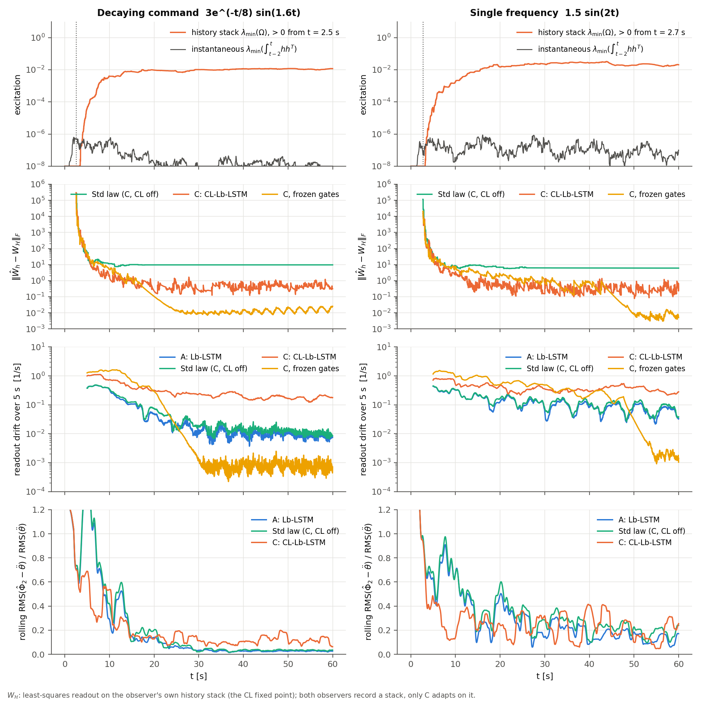

*Figure 13. Left column: the decaying command. Right column: the single-frequency command. Row 1:
history-stack $\lambda_{\min}(\Omega)$ against the sliding-window excitation of the instantaneous
regressor. Row 2: distance of each readout to its own CL fixed point $W_{\mathcal H}$ (every
observer records a stack; only C adapts on it). Row 3: readout drift,
$\|\hat\theta_h(t) - \hat\theta_h(t-5\,\mathrm{s})\|/5$. Row 4: online θ̈ model error.*

> **What it shows.**
> - **Row 1.** After 2.5–2.7 s the stack's information (orange) jumps from zero to about 10⁻²
>   and stays there, while the excitation in any 2 s window of the live data (grey) is 10⁻⁸ to
>   10⁻⁶, effectively zero.
> - **Row 2.** The standard law (green) stops about 10 (left) or 6 (right) away from the best
>   least-squares fit of its own recorded data. C with frozen gates (yellow) converges to within
>   0.01 of it. Deployed C (orange) stays at 0.3–0.6.
> - **Row 3.** The drift shows that the standard law and A slow down to about 0.01/s, frozen-gate
>   C settles almost completely (10⁻³/s), and deployed C keeps moving at 0.2–0.3/s.
> - **Row 4.** C's model error drops faster early on, but late in the decaying run it is higher
>   than A's (about 0.1 against 0.03).
>
> **What it means.** The live data stop teaching anything within seconds, but the stored data
> keep enough information to identify the readout. That is the theory of §8.7 seen in
> simulation. Without the stack, learning simply stalls (Theorem 1). With fixed gates the
> readout converges (Theorem 2). With learning gates it keeps chasing a moving target. That
> trade buys better generalization (§8.9).

| | Decaying command | Single frequency |
|:---|:---:|:---:|
| Rank condition met at | 2.53 s | 2.73 s |
| Stack λ_min(Ω) / λ_max(Ω) at 60 s (C) | 0.0117 / 19.2 | 0.0205 / 31.0 |
| Instantaneous 2 s-window λ_min at 60 s | 4.1e-9 | 9.9e-8 |
| Stack decisions (C): appended / replaced / rejected (novelty, no gain) | 48 / 591 / 974, 1281 | 48 / 905 / 958, 983 |
| ‖Ŵ_h − W_H‖ at 60 s: Std law / C / C frozen gates | 9.63 / 0.313 / 0.025 | 6.05 / 0.62 / 0.0051 |
| Median readout drift, t ≥ 40 s [1/s]: Std / C / C frozen gates | 0.012 / 0.172 / 0.00074 | 0.081 / 0.352 / 0.030 |

In detail:

- **The rank condition holds without PE.** The stack reaches full rank within 3 s, and
  $\lambda_{\min}(\Omega)$ keeps growing to about 10⁻². The instantaneous excitation over the
  same period is 4–7 orders of magnitude smaller.
- **The standard law stalls.** Its drift falls to 0.012/s while it sits 9.6 away from the
  least-squares readout of the data it has itself recorded. This is Theorem 1: the state error
  has converged, so adaptation has stopped.
- **CL with frozen gates converges to a constant.** This is Theorem 2. The readout reaches the
  CL fixed point to within 0.025 (decaying command) and then stops moving (drift 7×10⁻⁴/s).
  Under the single-frequency command, it settles once the stack stops improving, at about 55 s.
- **The deployed configuration (gate CL on) is not constant.** Its readout stays within
  0.3–0.6 of the fixed point, but that fixed point keeps moving as the gates descend the stack
  loss, so the drift is 0.17–0.35/s. This is the trade-off stated in §8.6.3.
- **CL trades local accuracy for a global model.** In row 4, C's late-phase θ̈ error on the
  training trajectory is higher than A's (0.12 vs 0.03, decaying command). CL fits the diverse
  stored transient; the instantaneous law tracks whatever small-amplitude motion is current.
  §8.9 shows which of the two generalizes.

### 8.9 Open-loop predictor benchmark

`src/identification/benchmark_predictor.py`, driven by `experiments/run_cl_validation.py` stage 2.
This is C's own benchmark; §8.10 repeats the comparison on the shared benchmark.

#### 8.9.1 Protocol

1. **Training data.** All observers see the same decaying non-PE trajectory, with the same
   input normalization, $L = 16$ and the same random gate initialization (per seed). The only
   difference between them is the adaptation law.
2. **Models.**
   - **A**: Approach A, the instantaneous law on all 1440 weights, using its validated gains.
   - **C**: C's defaults (§8.11).
   - **Std law**: C with the CL loop disabled (ablation).
3. **Freezing.** Each model is frozen at 60 s. The LSTM is decoupled from the observer feedback
   using A's `LbLSTMDigitalTwin` (§6.5), unchanged.
4. **Test inputs.** Four unseen inputs from the hanging equilibrium: A's step doublet and chirp
   (from rest), a multisine, and a 1.2 rad/s sine. The last two start from a drift-cancelling
   cart state so the true cart never reaches the bumpers, which no twin models.
5. **Seeds.** 3 seeds; each changes the gate initialization and the encoder-noise realization.

#### 8.9.2 Metrics

The **primary** metrics are both normalized as NMSE = MSE / Var(truth). A score of 1 equals
predicting the mean.

- **One-step NMSE of ẍ and θ̈.** $\hat\Phi$ is evaluated on the *true* states, with the LSTM
  memory integrated along them. It measures model error alone.
- **Short-horizon NMSE of x and θ.** Every 0.5 s the twin restarts from the true state (and the
  teacher-forced memory), then runs open loop until the next restart. Errors are scored over all
  windows. This measures multi-step prediction over the horizon a model-based estimator or
  controller would actually use. The θ values are the informative ones: cart displacement over
  0.5 s is small compared with the variance of x over the whole test, so every x score is about
  10⁻³.

**Why full-length free runs are not used as the headline metric.** All the tests run near the
**hanging** equilibrium; the upright one cannot be held by a prescribed open-loop input. There
the linearized plant has poles
$\{0,\ -0.019,\ -0.020 \pm 2.537j\}$. Two things follow:

- **Cart.** The cart is a free double integrator with a very slow damping pole, so any constant
  error in the modelled force integrates twice into position drift.
- **Pendulum.** The pendulum is a lightly damped oscillator ($\zeta \approx 0.008$), so any error
  in its natural frequency accumulates as phase error and is never damped out.

Neither error is removed without output feedback. Over 8–15 s free runs every model's error
grows without bound, and the free-run score depends more on how the errors accumulate than on
how good the model is. There is no positive real pole in this regime. The upright
configuration, with its pole at $+2.52$ s⁻¹, would diverge exponentially, but it is not what is
tested. Full-length free-run NMSE is still recorded in `predictor_benchmark.csv` as a secondary
diagnostic (§8.9.4). The shared benchmark adopts the same two primary metrics (§11.1).

#### 8.9.3 Results

Medians over 3 seeds; lower is better; the better of A and C is in bold.

| Test | Model | one-step NMSE θ̈ | one-step NMSE ẍ | 0.5 s NMSE θ | 0.5 s NMSE x |
|:---|:---|---:|---:|---:|---:|
| Chirp 0.3–1.2 Hz | A | 0.863 | 0.772 | 0.118 | 0.0086 |
| | **C** | **0.538** | **0.240** | **0.050** | **0.0021** |
| | Std law | 1.597 | 0.759 | 0.215 | 0.0083 |
| Multisine | A | 1.070 | 0.346 | 0.145 | 0.0023 |
| | **C** | **0.432** | **0.276** | **0.042** | **0.0017** |
| | Std law | 2.011 | 0.373 | 0.270 | 0.0024 |
| Step doublet | A | 0.453 | **0.372** | 0.048 | 0.0026 |
| | **C** | **0.406** | 0.420 | **0.037** | **0.0025** |
| | Std law | 1.016 | 0.386 | 0.110 | 0.0026 |
| Sine 1.2 rad/s | A | **10.87** | 0.311 | **0.349** | 0.0016 |
| | **C** | 14.26 | **0.213** | 0.364 | **0.0010** |
| | Std law | 22.40 | 0.289 | 0.716 | 0.0015 |

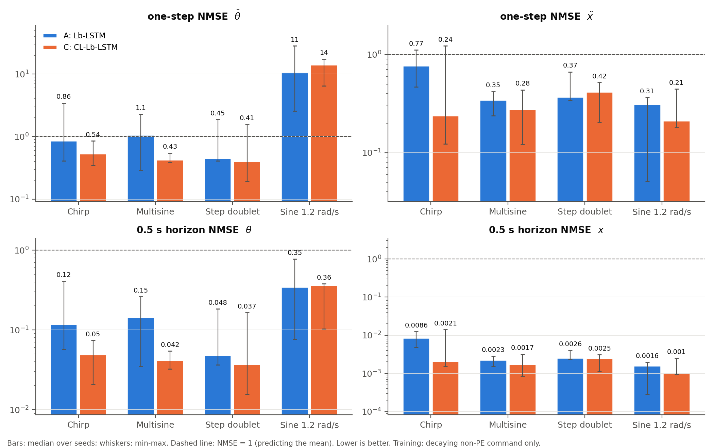

*Figure 14. The frozen A (blue) and C (orange) models on the four unseen test inputs. Top: one-step
acceleration error. Bottom: 0.5 s position-prediction error. Bars are medians over 3 seeds;
whiskers span min to max; the dashed line is NMSE = 1.*

> **What it shows.** On the chirp and multisine, C's bars are lower in every panel, by up to
> 3.5×. On the step doublet the two are close, with A ahead only on cart acceleration. On the
> slow 1.2 rad/s sine both models score above 1 on pendulum acceleration (11 and 14), meaning
> both are worse than predicting the average there. The whiskers are long, often spanning a
> factor of 10.
>
> **What it means.** C's memory of the early, rich part of the training run lets it predict
> inputs that mix several frequencies much better than A. Neither black box handles the slow,
> small-amplitude sine. With only 3 seeds and wide spreads, the smaller differences are not
> conclusive.

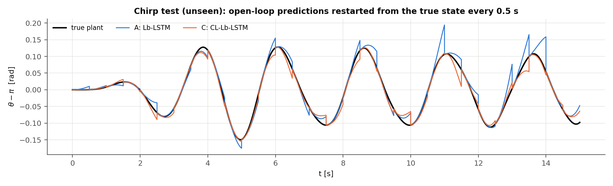

*Figure 15. Chirp test, seed 0. Each model predicts the pendulum angle 0.5 s ahead, and is
restarted from the true state every 0.5 s. Black: truth. Blue: A. Orange: C.*

> **What it shows.** The vertical jumps every 0.5 s are the restarts, where each prediction is
> reset to the truth. Between restarts, A's predictions often run away from the truth, for
> example to 0.19 rad at 11 s and 0.16 rad at 14 s where the truth peaks near 0.11 rad. C's
> predictions mostly stay on the black curve.
>
> **What it means.** The size of those jumps is exactly what the 0.5 s NMSE scores. C's model
> drifts less over the half-second a model-based controller would actually look ahead.

**Strength: multi-frequency tracking.** On the chirp and the multisine, C wins every metric. Its
one-step θ̈ error is 1.6× (chirp) and 2.5× (multisine) lower than A's, and its 0.5 s θ error is
2.4× and 3.5× lower. These inputs sweep or mix frequencies that the training trajectory visited
only during its transient. The history stack retains that transient; A's instantaneous law used
it only while it lasted.

**Trade-offs.**

- **Step doublet, cart acceleration.** A predicts ẍ better (0.372 vs 0.420). C is still better
  on θ̈ and on the 0.5 s θ prediction for this input.
- **Slow 1.2 rad/s sine, pendulum channel.** A is better on θ̈ (10.9 vs 14.3) and on 0.5 s θ
  (0.349 vs 0.364). This test drives the pendulum far below resonance, with small θ̈
  (RMS 0.13 rad/s²), so every model's θ̈ NMSE is far above 1. It resembles the low-amplitude
  late phase of the training run that the instantaneous law tracks (Figure 13, row 4). The stack,
  selected for diversity, gives that regime little weight.
- **Seed spread.** The spread across seeds is wide for both methods (Figure 14 whiskers). With
  3 seeds, the step-doublet θ̈ and 0.5 s x differences are within the spread.

**Ablation.** With the CL loop off, the same observer is worse than A on θ̈ in every test
(1.9–2.2× A's one-step θ̈ NMSE). The gain comes from the history stack and the gate loop it
drives, not from freezing the gates or from any other change to the observer.

#### 8.9.4 Secondary diagnostic: full-length free runs

Medians over 3 seeds, full test horizon of 8–15 s:

| Free-run NMSE (x / θ) | Step doublet | Chirp | Multisine | Sine 1.2 rad/s |
|:---|:---:|:---:|:---:|:---:|
| A | 0.33 / 1.77 | 3.95 / 1.53 | 6.98 / 5.10 | 5.73 / 83.9 |
| C | 2.14 / 11.7 | 5.27 / 0.78 | 436 / 2095 | 175 / 8564 |
| Std law | 0.60 / 1.56 | 2.97 / 1.72 | 6.14 / 4.78 | 4.21 / 41.8 |

Almost every entry exceeds 1: long open-loop runs of this marginally stable plant are not
predictive for any model (§8.9.2). C's twin is nonetheless **less robust in long free runs** on the
multisine and sine tests, where its errors grow by orders of magnitude. The gate loop fits the
stored points well, but it does not constrain the twin's own closed-loop dynamics away from them.
The only free-run win for C is θ on the chirp. The frozen C model is therefore not suitable as
a long-horizon simulator.

### 8.10 Approach A vs Approach C on the shared benchmark

§8.9 compares A and C on C's own protocol, which C's defaults were chosen on (§8.11). This section
repeats the comparison on the shared benchmark (§11), where neither approach was tuned:

- **Scenarios.** S1 (A's home: hanging, two-tone input), S2 (B's home: swing-through with a +50 %
  mass step) and S3 (C's home: weak, fading, non-PE input). See §11.1.
- **Seeds and normalization.** 5 seeds per scenario, the same data-driven input normalization
  for both, cold start.
- **Prediction tests.** The four held-out inputs H1–H4, fixed before any result existed.
- **Variants.** A-x and C-x are the same observers with the cart position removed from the
  network input (§11.5).

`python scripts/compare_a_c.py` reads the shared-benchmark CSVs and produces the table and
figure below.

**Medians over 5 seeds** (prediction: also over the 4 held-out inputs); lower is better; the
better of A and C is in bold, and the best of all four is marked †.

| Metric | Scenario | A | C | A-x | C-x |
|:---|:---|---:|---:|---:|---:|
| Steady $\dot\theta$ RMSE [rad/s] | S1 | 0.0149 | **0.0135** † | 0.0143 | 0.0162 |
| | S2 | **0.0359** † | 0.0662 | 0.0389 | 0.0691 |
| | S3 | 0.0100 | **0.0094** † | 0.0100 | 0.0094 |
| $\dot\theta$ RMSE, 0.1–5 s [rad/s] | S1 | 0.0594 | **0.0578** | 0.0584 | 0.0573 † |
| | S2 | 0.166 | **0.157** † | 0.174 | 0.160 |
| | S3 | 0.0516 | **0.0437** † | 0.0523 | 0.0442 |
| Held-out one-step $\ddot\theta$ NMSE | S1 | **2.33** | 2.41 | 1.67 | 0.884 † |
| | S2 | **80.7** | 108.7 | 20.4 | 14.4 † |
| | S3 | 1.84 | **1.80** | 0.917 | 0.326 † |
| Held-out 0.5 s $\theta$ NMSE | S1 | 0.161 | **0.159** | 0.129 | 0.0854 † |
| | S2 | **6.49** | 9.44 | 1.11 | 0.887 † |
| | S3 | 0.170 | **0.0964** | 0.0566 | 0.0294 † |

On S3 the steady $\dot\theta$ RMSE of C and C-x is equal to the shown precision.

**Seeds where C beats A** (out of 5; for prediction, comparing each seed's median over the four
held-out inputs):

| Metric | S1 | S2 | S3 |
|:---|:---:|:---:|:---:|
| Steady $\dot\theta$ RMSE | 3 | **0** | **5** |
| Held-out one-step $\ddot\theta$ NMSE | 4 | 2 | 3 |
| Held-out 0.5 s $\theta$ NMSE | 3 | 3 | 2 |

**Seed ranges of the steady $\dot\theta$ RMSE** [min, max]: S1: A [0.0137, 0.0156],
C [0.0126, 0.0188]. S2: A [0.0317, 0.0430], C [0.0458, 0.0850]. S3: A [0.0083, 0.0103],
C [0.0081, 0.0100].

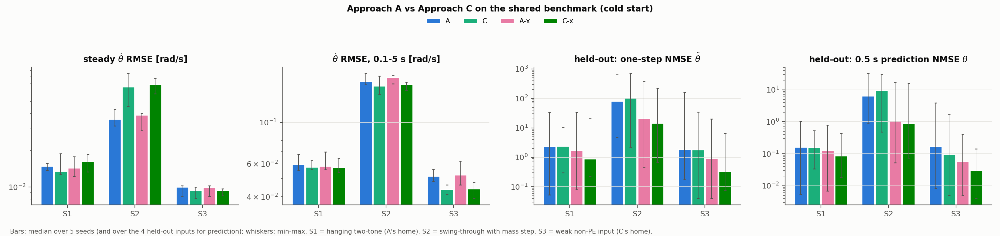

*Figure 16. Approach A against Approach C on the shared benchmark, with their x-free variants.
Panels from left: steady-state pendulum-velocity error, pendulum-velocity error during start-up
(0.1–5 s), held-out one-step acceleration error, held-out 0.5 s angle-prediction error. Bars are
medians; whiskers span min to max over seeds (and held-out inputs). All axes are logarithmic.*

> **What it shows.** In the two velocity panels, A (blue) and C (light green) are close on S1
> and S3, with C slightly lower, but C is almost twice as high as A on S2 in steady state. In the
> two prediction panels, A and C are similar on S1 and S2, and C is lower on S3 for the 0.5 s
> prediction. The x-free variants (pink A-x, dark green C-x) are lower than their originals in
> every prediction bar, and C-x is the lowest of the four everywhere. The prediction whiskers
> span two to three orders of magnitude.
>
> **What it means.** C's memory helps where it was designed to: weak excitation and a plant that
> does not change. It hurts after a sudden plant change, because the memory still holds data from
> the old plant. Removing the cart position from the inputs helps both black boxes, and helps C
> most. Even so, the best black box (C-x) predicts held-out inputs 100–7000× worse than the
> physics-structured hybrid E (§11.4).

**Findings.**

1. **On C's home scenario S3 (weak, non-PE input), C is the better observer and the better
   predictor.** Its steady $\dot\theta$ error is lower in all 5 seeds, its start-up error is
   15 % lower (0.0437 vs 0.0516), and its 0.5 s angle prediction is 1.8× better (0.096 vs 0.170).
   One-step $\ddot\theta$ is a tie (1.80 vs 1.84). This confirms the finding of §8.9 on held-out
   inputs that were not used to choose C's settings.
2. **On A's home scenario S1, the two are tied.** C's median steady error is 9 % lower, but its
   seed range is wider ([0.0126, 0.0188] against [0.0137, 0.0156]) and it wins only 3 of 5 seeds.
   Held-out prediction is the same within the spread.
3. **On S2 (swing-through with a +50 % mass step), C is clearly worse.** Its steady $\dot\theta$
   error is 1.8× A's, in every seed, and the seed ranges do not overlap. Its held-out prediction is
   also worse (one-step 108.7 against 80.7). The cause is the stack: it fills with pre-step data
   and C has no change detector, so concurrent learning keeps pulling the model back to the old
   plant (post-step $\dot\theta$ RMSE 0.079 against A's 0.046, §11.3). D's detector (§9.5) could
   be added to C.
4. **C benefits most from removing the cart position.** C-x is the best black box on held-out
   prediction in every scenario: its one-step $\ddot\theta$ NMSE is 2.6× (S1), 5.6× (S2) and
   5.6× (S3) lower than A's, and its 0.5 s $\theta$ NMSE 1.9×, 7.3× and 5.8× lower. The stack
   stores informative points, and without $x$ those points are not tied to cart positions the
   tests never revisit. The x-free change leaves online velocity estimation unchanged.
5. **Neither replaces a structured model as a predictor.** C-x's held-out one-step
   $\ddot\theta$ NMSE (0.33–14) is still two to four orders of magnitude above E's (0.002–0.003).

**Verdict.** Among the black boxes, C (preferably C-x) is the right choice when the excitation is
weak and the plant does not change. A is the safer choice when the plant can change abruptly.
For a model that has to predict, the physics-structured approaches (B, D, E) are far ahead of
both.

### 8.11 Configuration

Defaults of `CLLbLSTMObserverConfig`:

| Parameter | Default | Role |
|:---|:---:|:---|
| `alpha, k_r, k_s, b_c, b_h, gamma_out` | 4, 8, 0.2, 5, 5, 300 | Approach A observer gains, unchanged |
| `gamma_gates` | 0 | Instantaneous gate law (A uses 30); off in C |
| `gamma_cl` | 50 | Readout CL gain (implicit step) |
| `gamma_cl_gates` | 5 | Gate CL gain (explicit step); 0 gives the frozen-gate configuration of Theorem 2 |
| `cl_normalize_outputs` | False | Optional weighting $\Lambda = \mathrm{diag}(1/\mathrm{Var}\,\ddot x_i)$ of the CL residuals. It performed worse on the benchmark and is off. |
| `stack_capacity` | 48 | $N \ge L$ is required for the rank condition |
| `record_start, record_interval` | 2 s, 20 ms | Warm-up (observer transient) and candidate spacing |
| `novelty_tol, min_rel_improvement` | 0.05, 1e-3 | Recording-policy thresholds (§8.4) |
| `sg_window, sg_order` | 0.25 s, 3 | Acceleration proxy (§8.5) |
| `w_bar` | 80 | $\|\theta\|$ bound; about 19 of it is the random gate initialization |

These defaults were chosen with the 3-seed benchmark of §8.9 itself, among a small set of variants
(frozen or CL-driven gates, gate gain 1–20, output weighting on or off, capacity 48–160). The
test inputs were fixed before that choice and were not changed afterwards. That benchmark is
therefore a validation set, not an untouched hold-out, and its margins should be read that way.
The shared benchmark's held-out inputs (§8.10) are the independent test.

The validation script sets `OMP_NUM_THREADS=1` itself. Parallel runs without it oversubscribe
BLAS threads and run many times slower.

### 8.12 Limitations

- **Scope of the proof.** The convergence proof (§8.7) covers the readout with fixed features. The
  deployed configuration adapts the gates through the CL loop, which improves generalization but
  has no parameter-convergence guarantee and keeps the readout moving.
- **Evidence base.** C's own benchmark uses three seeds and a single training trajectory, in
  simulation only (the dead-zone/stiction model is off, as in Approach A's identification study).
  §8.10 adds five seeds on three scenarios.
- **No change detection.** After a plant change the stack keeps old data (§8.10, finding 3).
- **Free-run robustness.** C's frozen twin is less robust than A's in long free runs (§8.9.4).
- **Stack conditioning.** $\lambda_{\max}/\lambda_{\min}$ of the stack is about 10³. Weak
  feature directions stay poorly identified, which caps how closely $W_{\mathcal H}$ can match
  the ideal readout.

---

## 9. Approach D: physics-structured observer with integral concurrent learning

Approach D (PI-ICL) combines the two ideas that worked best in Approaches B and C:

- **From B**, the Euler–Lagrange structure of the model. The inertia is symmetric and positive
  definite, the Coriolis term comes from the Christoffel symbols, gravity is the gradient of a
  potential, friction is dissipative, and the cart position is cyclic.
- **From C**, concurrent learning. A history stack of recorded data identifies the model after
  the excitation that produced that data is gone.

To make the two fit, every sub-model is written **linearly** in its parameters. The rank
condition then applies to the *whole* parameter vector, and the true rig is representable
exactly. The stack stores *integration windows*, not points, so no acceleration estimate is ever
needed (integral CL [11]).


*Diagram 10. Block diagram of the PI-ICL observer. The filter, the feedback $\chi$ and the robust
term are those of §5. The model is a linear-in-parameters Euler–Lagrange model (§9.2). The dashed
path is integral concurrent learning, detailed in Diagram 11 (§9.5).*

B's main open problem was incomplete inertia identification: 16 % error, and $\hat M_{22}$ does
not follow a change of the pendulum (§7.10). Approach D identifies all four rigid-body
parameters and re-identifies them after the plant changes.

### 9.1 Results at a glance

B's extreme-condition scenario and metrics (§7.8.1): a 50 s run starting 0.5 rad from upright,
±1° encoder noise, and pendulum mass and inertia +50 % at 25 s. Medians over 5 seeds.

| | A: Lb-LSTM | B: PI-LSTM | **D: PI-ICL** | D, CL off |
|:---|---:|---:|---:|---:|
| θ̇ RMSE, pre-shift 15–25 s [rad/s] | 0.060 | 0.030 | **0.019** | 0.106 |
| θ̇ RMSE, post-shift 25–30 s | 0.046 | 0.022 | **0.018** | 0.093 |
| θ̇ RMSE, steady 35–50 s | 0.036 | 0.020 | **0.019** | 0.061 |
| ẋ RMSE, steady 35–50 s [m/s] | 0.0057 | 0.0025 | **0.0018** | 0.0055 |
| Peak θ̇ error after the step, 25–27 s | 0.110 | 0.054 | **0.045** | 0.196 |
| Peak θ̇ error, initial transient 0–2 s | **0.440** | 0.459 | 0.533 | 0.533 |
| Inertia error $\lVert\hat M - M\rVert/\lVert M\rVert$ @ 50 s | — | 16.3 % | **0.19 %** | 21.9 % |
| Online θ̈ model NMSE, steady | 0.0062 | 0.0010 | **0.0005** | 0.0216 |

- **Velocity estimation.** D is the best of the four in every steady and post-shift window. The
  seed ranges do not overlap: D's worst steady θ̇ RMSE (0.0196) is below B's best (0.0199).
- **Identification.** The inertia matrix is identified to 0.2–0.3 % instead of 16 %.
  - **Mass and coupling.** M+m and ml are within 1 % before and after the step.
  - **Pendulum inertia and gravity.** I+ml² and mgl are within 4–8 % (median). These two are
    identifiable only through the weak cart–pendulum coupling (§9.6).
- **Plant change.** The change is detected 0.45–0.50 s after the step in every seed, with no
  false alarms, and the parameters are re-identified about 4 s later.
- **The price.** The initial transient is worse (peak 0.53 vs 0.46 rad/s): D's
  instantaneous gain is small, and the stack needs about 3 s of windows before CL acts.
- **The history stack does the work.** With CL off, the same observer is worse than A.

### 9.2 Model: linear-in-parameters Euler–Lagrange structure

`src/observers/el_linear_model.py`. For $q = [x, \theta]$ and $B = [1, 0]^T$:

$$M(q)\ddot q + C(q,\dot q)\dot q + G(q) + F(\dot q) = Bu$$

$$M(q) = \sum_{e=(i\le j)}\sum_k \theta_{e,k}\,\rho_k(q)\,E_e,\qquad C\dot q = \dot M\dot q - \tfrac12\partial_q(\dot q^TM\dot q),\qquad G = \partial_q P,\ P = \sum_{k\ge1} w_{G,k}\rho_k(q),$$

$$F = \mathrm{diag}(d_v)\,\dot q + \mathrm{diag}(d_c)\tanh(\dot q / v_c),\qquad d_v, d_c \ge 0.$$

The features $\rho(q) = [1, \cos\theta, \sin\theta]$ are B's feature layer (§7.2.3), with $x$
cyclic, so it is not embedded. With first harmonics ($K = 1$) there are $p = 15$ parameters. The
constant feature is left out of the potential, because it has zero gradient and would be
unidentifiable.

| Invariant | How it holds |
|:---|:---|
| $M = M^T$ | By construction: the parameters are its unique entries |
| $\dot M - 2C$ skew-symmetric | By construction: Christoffel symbols of $M$ |
| $G$ conservative | By construction: $G = \nabla P$ |
| Power balance $\frac{d}{dt}(T + P) = \dot q^T(Bu - F)$ | Follows from the three rows above |
| $\dot q^TF \ge 0$ (passive friction) | Projection onto $d_v, d_c \ge 0$ (exact, a clip) |
| $M(q) \succeq \epsilon_M I$ | Projection onto a convex set (§9.5) |
| $M$, $P$ independent of $x$ | By construction (cyclic coordinate) |

Positive-definiteness moves from B's Cholesky parametrization (valid for every $\theta$) to a
projection. This is the price of linearity. The set
$\{\theta : M(q_g;\theta) \succeq \epsilon_M I\}$ over a grid of angles $q_g$ is an intersection
of LMIs, each linear in $\theta$, so it is convex.

**Exactness.** The true rig is one point of this family:
$\theta^\ast = \{m_{11} = M+m,\ m_{12} = ml\cos\theta,\ m_{22} = I + ml^2,\ P = mgl\cos\theta,\ d_v = (b, d)\}$.
It reproduces the plant's accelerations to $10^{-15}$ (`test_true_parameters_reproduce_the_plant`).
*True parameter convergence* therefore has a concrete meaning here, which it cannot have for the
LSTM models of Approaches A–C. A linear-in-parameters robot model of this kind goes back to
Slotine & Li [20].

### 9.3 Integral concurrent learning: no acceleration needed

Every term of the model has an analytic regressor that is linear in $\theta$:

| Regressor | Equals |
|:---|:---|
| Torque $Y(q,\dot q,a)\,\theta$ | $Ma + C\dot q + G + F$ |
| Momentum $Y_{mom}\,\theta$ | $M\dot q$ |
| Integrand $Y_{int}\,\theta$ | $-\tfrac12\partial_q(\dot q^TM\dot q) + G + F$ |

Because $\frac{d}{dt}(M\dot q) - \frac12\partial_q(\dot q^TM\dot q) = M\ddot q + C\dot q$,
integrating the equations of motion over a window $[t-\Delta, t]$ gives the **ICL identity**
(Parikh, Kamalapurkar & Dixon [11]):

$$\underbrace{[Y_{mom}]_{t-\Delta}^{t} + \int_{t-\Delta}^{t}Y_{int}\,d\tau}_{\mathcal Y_j}\ \theta^\ast = \underbrace{\int_{t-\Delta}^{t}Bu\,d\tau}_{b_j}.$$

It needs positions and velocities only. They come from a causal, delayed-centre Savitzky–Golay
smoother [18]: 0.1 s cubic fit, evaluated 50 ms back (`src/concurrent_learning/savitzky_golay.py`).
For velocity its noise gain is 8.5, against about 260 for the second derivative over the same
window, which Approach C needed. The smoother is **model-free**, so windows are valid from the
first 0.35 s, before the observer itself has converged.

The integral uses the trapezoid rule. The input is exact because the plant holds $u$ over each
sample. On the true trajectory the identity holds to $5\times10^{-5}$
(`test_icl_identity_holds_on_a_trajectory`).

Windows of $\Delta = 0.25$ s are offered every 50 ms to history stacks of 300 windows, using
C's recording policy (§8.4): a novelty gate, then a swap only if it increases $\lambda_{\min}$
(`src/concurrent_learning/history_stack.py`, generalized to block regressors).

### 9.4 Why the pendulum row needs a different regression

Plain least squares on all rows recovers the cart row exactly, but the pendulum-row scale
collapses: $I + ml^2$ comes out as 0.02 instead of 0.129 with the 0.1 s smoother, and 0.003 with a
0.05 s one. Batch fits separate the causes:

| Windows built from | $I+ml^2$ | $mgl$ | $mgl/(I+ml^2)$ |
|:---|---:|---:|---:|
| True states | 0.1288 | 0.812 | 6.31 (exact) |
| Smoothed, noise-free encoder | 0.1288 | 0.812 | 6.31 |
| Smoothed, noisy encoder, plain LS | 0.0197 | 0.118 | 6.0 |
| Smoothed, noisy encoder, **row-normalized** (fix below) | 0.1299 | 0.788 | 6.07 |

Smoothing is not the problem; noise is. The pendulum row has no input ($B_2 = 0$), so its
equation is **homogeneous**: $\mathcal Y_{2}\theta^\ast = 0$. Least squares with noisy
regressors then shrinks the row towards $\theta = 0$ (errors-in-variables attenuation [19]). Only
the small cart–pendulum coupling term $ml\cos\theta\,\ddot x$ resists, because $ml$ is pinned by
the cart row. The ratio $mgl/(I+ml^2) = \omega^2$ survives; the absolute scale does not. B
showed the same limit: "the learned $\hat M_{22}$ stays wrong while the ratio is right" (§7.9).

**Why noise shrinks the row.** Write the noisy regressors as $\hat{\mathcal Y} = \mathcal Y + E$,
with $E$ zero-mean and covariance $\Sigma_E$. Least squares on the homogeneous row minimizes

$$\textstyle\sum_j\lVert\hat{\mathcal Y}_{2,j}\theta\rVert^2 \approx \theta^T\big(\mathcal Y_2^T\mathcal Y_2 + N\Sigma_E\big)\theta,$$

so the noise acts as a Tikhonov penalty that pulls the row's parameters towards $\theta = 0$.
Actuated rows escape this because their target $\int Bu$ is non-zero and noise-free. This failure
cannot occur on the fully actuated two-link manipulators used by the published observers this
project builds on ([1], [4], [5]). It is specific to underactuated systems.

**Fix: normalize the homogeneous row so the noisy term becomes the target.** Divide the pendulum
row by its leading coefficient $J = [M_{22}]_{const}$. Take the columns it shares with the cart
row (the coupling inertia) from the cart-row estimate $\phi_A$. That leaves

$$\kappa\,z + \sum_{c\ \text{own}}\mathcal Y_{2c}\,\psi_c = -\mathcal Y_{2J},\qquad z = \sum_{c\ \text{shared}}\mathcal Y_{2c}\,\phi_{A,c},\quad \kappa = 1/\phi_J,\quad \psi_c = \phi_c/\phi_J.$$

The noisy momentum term $\mathcal Y_{2J} = \Delta\dot\theta$ is now the **target**, and noise in
the target causes no bias. The regressors are built from positions and from $\dot x$. On this rig
the smoothed $\dot x$ has about 70× less noise (0.001 m/s) than $\dot\theta$ (0.09 rad/s). On the
same noisy data this gives $I+ml^2 = 0.1299$ (true 0.1288) and $mgl = 0.788$ (true 0.812).

The CL target $\phi_H$ has three parts:

- **Cart row:** $\phi_A$, from actuated-row least squares on stack A. The target $\int Bu$ carries
  no noise.
- **Pendulum inertia:** $\phi_J = 1/\kappa$.
- **Remaining pendulum-row columns:** $\phi_J\psi$, from the normalized regression on stack U.

This construction generalizes to any system: actuated rows use ordinary least squares, and each
unactuated row is normalized by its own diagonal inertia and anchored through its coupling with
the actuated rows. If an unactuated row shares no parameter with the actuated rows, its scale is
unobservable, and the constructor refuses it.

### 9.5 Adaptation law

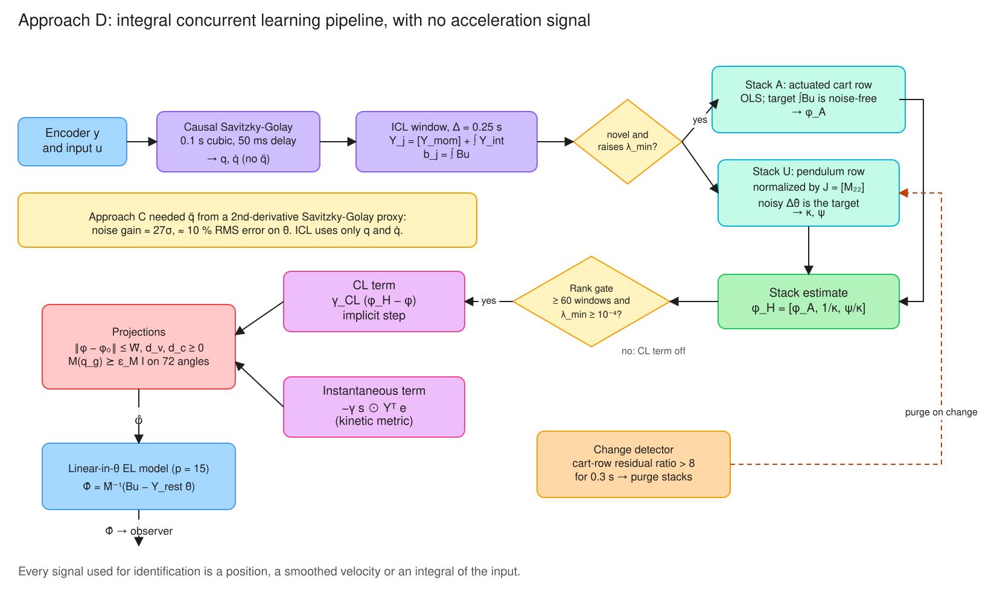

*Diagram 11. The identification pipeline. Encoder data are smoothed to positions and velocities only
(no $\ddot q$) and integrated over 0.25 s windows into the ICL identity (§9.3). Windows enter two
history stacks through a novelty and minimum-singular-value test. The actuated row is solved by
ordinary least squares with a noise-free target, and the unactuated row in the normalized form of
§9.4. The combined estimate $\phi_H$ drives the CL term once the rank gate opens. Projections keep the
inertia positive definite and the friction dissipative. A residual-based detector purges the stacks
after a plant change.*

In scaled parameters $\phi = \theta / s$, where $s$ holds unit scales derived from the inertia
prior:

$$\dot\phi = \underbrace{-\gamma\, s\odot Y(\hat q, \hat{\dot q}, \hat\Phi)^T e}_{\text{instantaneous (B's kinetic metric)}} + \underbrace{\gamma_{CL}\,(\phi_H - \phi)}_{\text{integral CL}},\qquad \hat\Phi = \hat M^{-1}(Bu - Y_{rest}\,\theta).$$

- **Instantaneous term.** Since $\partial\hat\Phi/\partial\theta = -\hat M^{-1}Y(\hat q,\hat{\dot q},\hat\Phi)$,
  this term is the gradient of $\tfrac12 e^T\hat M e$. That is B's kinetic metric (§7.5), with
  no Jacobian engine needed.
- **CL term.** This is the Newton (information-normalized) form of the classical CL term:
  $\Gamma_{CL}\sum_j\mathcal Y_j^T(b_j - \mathcal Y_j\phi) = \Gamma_{CL}\Omega(\phi_{LS} - \phi)$
  with $\Omega$ normalized away. It is integrated implicitly.
- **Projections**, applied after every step:
  1. $\lVert\phi - \phi_0\rVert \le \bar W$.
  2. $d_v, d_c \ge 0$.
  3. $M(q_g) \succeq \epsilon_M I$ on a 72-point angle grid. Each iteration projects onto the
     supporting half-space $v^TM(q_g)v \ge \epsilon_M$ of the most violated constraint.

  All three are Euclidean in $\phi$. Each is onto a convex set containing $\phi^\ast$, so none of
  them can increase $\lVert\phi - \phi^\ast\rVert$.
- **Rank gate.** $\phi_H$ is used only when every stack holds at least 60 windows and satisfies
  $\lambda_{\min} \ge \bar\lambda = 10^{-4}$: the rank condition with a margin.

**Change detection.** The detector tests how well the cart-row stack model predicts fresh
windows. It compares an EMA (0.5 s) of the new windows' residuals under $\phi_A$ with the stack's
in-sample residual. If the ratio stays above 8 for 0.3 s (outside a 3 s refractory period), all
stacks are purged and refill with post-change data. The cart row is used because its target is
noise-free, and because a change that scales $m$ and $I$ together leaves the normalized pendulum
row *invariant* ($\omega^2$ and $ml/J$ unchanged). Observed ratios: at most 4.9 without a change,
13–22 after the step.

**Stability and convergence (sketch).** Let $\tilde\phi = \phi^\ast - \phi$, and let $V_0 + P$ be
the filter Lyapunov function of §5 with its RISE term (§5.5, and §7.4 for the kinetic metric).
Between stack updates $\phi_H$ is constant, and

$$\dot{\tilde\phi} = -\gamma_{CL}\tilde\phi + \gamma_{CL}(\phi^\ast - \phi_H) + \gamma\, s\odot Y^Te.$$

Take $V = V_0 + P + \tfrac{\beta}{2}\lVert\tilde\phi\rVert^2$. The regressors are bounded on
the compact set kept invariant by the projections, so $\lVert s\odot Y^Te\rVert \le c\lVert e\rVert$
with $\lVert e\rVert \le \lVert\tilde x_1\rVert + \lVert\nu\rVert$. Young's inequality then gives

$$\dot V \le -\tfrac{\alpha}{2}(\lVert\tilde x_1\rVert^2 + \lVert\nu\rVert^2) - \alpha\lVert\eta\rVert^2 - k_r\lVert r\rVert^2 - \tfrac{\beta\gamma_{CL}}{2}\lVert\tilde\phi\rVert^2 + \beta\gamma_{CL}\lVert\phi^\ast - \phi_H\rVert^2,\qquad \beta \le \frac{\alpha\gamma_{CL}}{2\gamma^2c^2}.$$

1. **Ideal case** ($\phi_H = \phi^\ast$: noise-free windows and a gated, full-rank stack). $\dot V$
   is negative definite in the state and parameter errors together, so by LaSalle–Yoshizawa both
   converge to zero, with no persistence of excitation. $V$ is common to all stack contents, so
   no dwell-time argument is needed. With a noise-free encoder, the test
   `test_identifies_physical_parameters_without_noise_and_detects_a_change` recovers all four
   rigid-body parameters to within 5 % before and after a +50 % step.
2. **Noisy case.** The system is uniformly ultimately bounded, and
   $\limsup\lVert\tilde\phi\rVert \lesssim \lVert\phi^\ast - \phi_H\rVert$. So the parameter
   error ends up about as large as the error of the stack estimate itself. That error is small
   because the normalized regression puts the noise in the target (§9.4), and the rank gate
   $\bar\lambda$ bounds how much noise it can amplify.

What the sketch does not cover:

- Projection is applied at discrete steps, and the stack estimate $\phi_H$ changes
  discontinuously when windows are swapped. Both are handled as in Approach C, by the argument
  in item 1 applied at each stack configuration.
- The small errors-in-variables bias that remains on the cart row (ml is attenuated by about 1 %).

### 9.6 Model order: why K = 1

Approach B uses two harmonics. With $K = 2$, D's batch fit is exact before the step, when the
pendulum falls from upright and sweeps most of the circle. After the step, the pendulum only
swings over $\theta \in [1.66, 4.57]$. Over that range the second harmonics are almost
collinear with the first, and noise wrecks the fit:

| Post-step windows (26–50 s), noisy | $I+ml^2$ (true 0.193) | $mgl$ (true 1.218) |
|:---|---:|---:|
| $K = 2$ | 0.936 | 3.15 |
| $K = 1$ | 0.203 | 1.229 |
| $K = 1$, with Coulomb terms | 0.204 | 1.231 |

$K = 1$ is exactly what a rigid pendulum needs, so it is the default. The Coulomb terms are kept
(`coulomb=True`): the simulation has no Coulomb friction, but a lab rig does, and they cost only
conditioning. **Identifiability, not capacity, limits structured models under partial excitation.**
Extra harmonics make sense only when the data sweep the configuration space.

### 9.7 Validation

`experiments/run_d_validation.py`. The scenario, trajectory, normalization, B and A runs, and all
metric definitions are imported unchanged from `experiments/run_pilstm_validation.py` (§7.8).

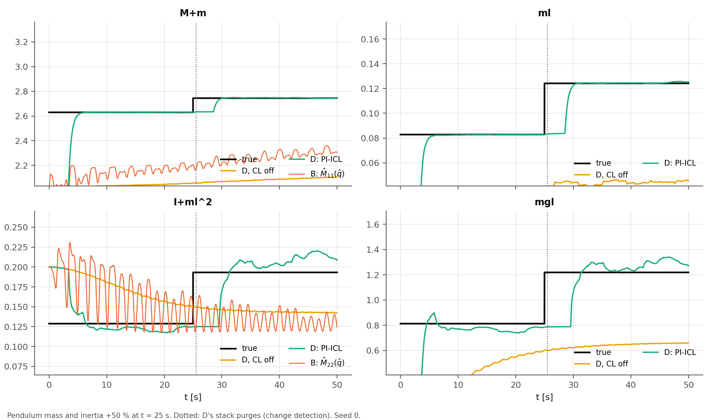

*Figure 17. Seed 0. D's physical reading of its parameters (green) against the truth (black), for
the four rigid-body quantities $M+m$, $ml$, $I+ml^2$ and $mgl$. For comparison: B's $\hat M_{11}$
and $\hat M_{22}$ at $\hat q$ (red), and D with concurrent learning off (yellow). The dotted line
marks the purge 0.4 s after the step.*

> **What it shows.** For the first 3 s D stays at its prior. Once its rank gate opens it jumps
> almost onto the truth: $M+m$ and $ml$ exactly, $I+ml^2$ near 0.12 against 0.129, and $mgl$
> near 0.78 against 0.81. After the mass step at 25 s, the detector purges the stack. About 4 s
> later D jumps to the new values: $M+m$ and $ml$ exactly again, $I+ml^2$ and $mgl$ within
> 5–15 %. B's inertia entries oscillate with the swing and never approach the truth, and D with
> CL off creeps slowly in the wrong place.
>
> **What it means.** D actually *identifies* the rig: its parameters become the physical masses
> and lengths, and it re-identifies them after the plant changes. The cart-side quantities come
> out almost exactly. The pendulum-side ones are looser, because they are seen only through the
> weak coupling with the cart.

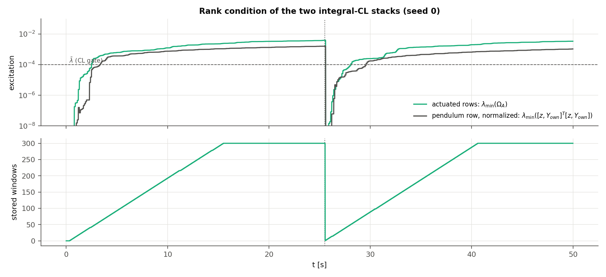

*Figure 18. Seed 0. Top: the information ($\lambda_{\min}$) in the actuated stack and in the
normalized pendulum-row regression, against the CL gate $\bar\lambda$ (dashed). Bottom: number of
windows stored.*

> **What it shows.** Both curves cross the gate about 3 s after the start, keep rising to about
> 10⁻³, collapse to zero at the purge just after 25 s, and cross the gate again about 3 s later.
> The stack fills linearly to its 300-window capacity by about 15 s, empties at the purge, and
> refills by about 41 s.
>
> **What it means.** D waits until its stored data are rich enough before trusting them. That
> takes about 3 s, after the start and after every detected change, which is why D's start-up
> is slower than B's.

**Identification (5 seeds, median [min, max] relative error of D's physical parameters):**

| | M+m | ml | I+ml² | mgl |
|:---|:---:|:---:|:---:|:---:|
| @ 25 s (before the step) | 0.0 % [0.0, 0.2] | 0.3 % [0.1, 0.7] | 6.3 % [2.2, 8.6] | 6.7 % [2.5, 8.5] |
| @ 50 s (after the step) | 0.2 % [0.0, 0.5] | 0.9 % [0.6, 1.7] | 8.0 % [6.2, 27.3] | 4.3 % [2.5, 23.4] |
| D with CL off, @ 50 s | 23 % | 63 % | 26 % | 46 % |

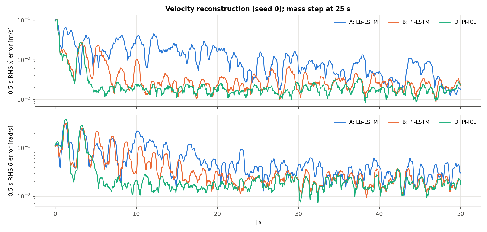

*Figure 19. Seed 0. 0.5 s RMS velocity error of A, B and D over the whole run. Top: cart. Bottom:
pendulum. Log scale; the mass step is at 25 s.*

> **What it shows.** From about 5 s on, D (green) has the lowest error in both channels: about
> 0.002 m/s on the cart and 0.015 rad/s on the pendulum. B reaches the same level only after 12–20
> s, and A stays higher until the end. In the first 5 s D's pendulum error peaks highest. After
> the step all three are close on the pendulum, with D and B lowest.
>
> **What it means.** Once its gate opens, D's exact model gives the best velocity estimate. The
> cost is the start-up, before any stored data can be trusted.

**Frozen models released from rest** (u = 0, true post-shift rigid body, seed 0; B's protocol of
§7.8.3):

| | θ RMSE over 10 s | True-energy drift | Learned-energy drift |
|:---|---:|---:|---:|
| A | 0.613 rad | 0.546 J | — |
| B | 0.070 rad | 0.008 J | 0 (structural) |
| **D** | **0.070 rad** | 0.017 J | 0 (structural) |

The swing carries about 0.56 J. D's twin is as accurate as B's. Its slightly larger drift in
true energy reflects its 4–8 % error in $I+ml^2$ and $mgl$.

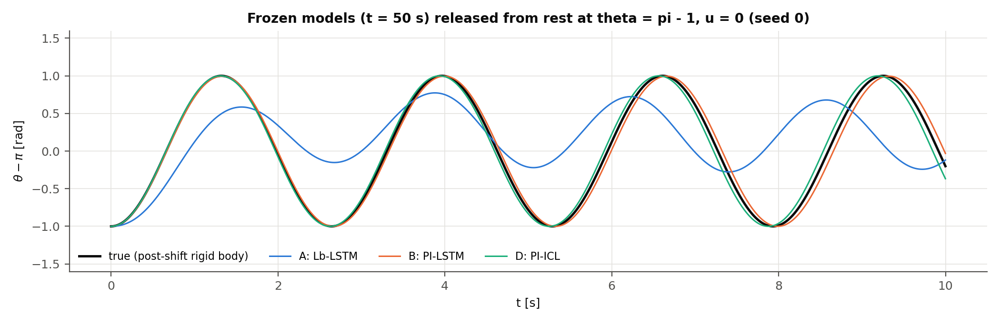

*Figure 20. Seed 0. The models frozen at 50 s, released from rest at $\theta = \pi - 1$ with no
input, against the true post-shift pendulum.*

> **What it shows.** B (red) and D (green) both swing with the right amplitude and nearly the
> right frequency for 10 s; by the end D runs slightly ahead of the truth and B slightly behind.
> A (blue) swings with the wrong amplitude and frequency from the first cycle.
>
> **What it means.** D's identified model is as good a simulator as B's. The small phase drift
> comes from the few-percent error in $mgl/(I+ml^2)$, which sets the swing frequency.

### 9.8 What D does not do better

- **The initial transient.** The peak θ̇ error in 0–2 s is 0.53 rad/s, against 0.46 for B and
  0.44 for A. D starts from B's prior with a small instantaneous gain ($\gamma = 2$), and its
  stacks need about 3 s of windows before the gate opens. Larger instantaneous gains made the
  instantaneous law fight the CL target (at $\gamma = 20$ the pre-shift θ̇ RMSE rose to 0.5 rad/s),
  so the transient is the trade-off made. Approach E removes this conflict (§10.3).
- **Re-identification delay.** After a detected change, CL waits about 3 s for new data. During
  that time the old parameters stay active, and the velocity estimate is still good (post-shift
  RMSE 0.018).
- **Small swings.** When the pendulum only swings near the hanging position (scenarios S1 and S3
  of §11), D's pendulum-row scale runs away and its velocity error is the worst of B, D and E.
  The cause and the fix are in §10.2.
- **Structure assumptions.** D assumes more structure than B: a linear-in-parameters
  Euler–Lagrange model with known joint types and input matrix. It cannot learn effects outside
  that family. B's friction LSTM, for example, is replaced by viscous plus Coulomb terms.
- **Non-smooth events.** Bumper impacts are not Euler–Lagrange dynamics. In a test variant where
  the cart hits the track end, the detector flags the impact as a change, and the estimates made
  from impact data are wrong until the next purge. Real use should gate windows on track contact.

### 9.9 Configuration

Defaults of `PIICLObserverConfig`:

| Parameter | Default | Role |
|:---|:---:|:---|
| `harmonics`, `coulomb` | 1, True | Model order (§9.6) |
| `inertia_init`, `eps_M` | (2, 0.2), 0.05 | Prior $M = \mathrm{diag}$ (as B); positive-definiteness margin |
| `alpha, k_r, k_s` | 4, 8, 0.2 | Filter gains of §5, unchanged |
| `gamma_inst` | 2 | Instantaneous gain (scaled parameters) |
| `gamma_cl` | 2 1/s | Rate of the pull towards $\phi_H$ (implicit step) |
| `icl_window`, `record_interval` | 0.25 s, 50 ms | ICL window $\Delta$; candidate spacing |
| `stack_capacity`, `cl_min_windows`, `lambda_bar` | 300, 60, 1e-4 | Stack size; rank gate |
| `sg_window`, `sg_order` | 0.1 s, 3 | Model-free smoother |
| `detect_ratio`, `detect_tau`, `detect_hold`, `detect_refractory` | 8, 0.5 s, 0.3 s, 3 s | Change detector |

**How these were chosen.** The defaults came from a handful of design runs on seed 0 of this
scenario: stack size 60/150/300, instantaneous gain 0/2/5/20, detector ratio 3/8/10, harmonics
1/2. The 5-seed results above use noise seeds 42–46, so seed 0 (noise seed 42) was also used for
design.

### 9.10 What D resolves

D removes the two limitations that stopped B and C from identifying the rig:

1. **B's scale collapse**, removed by normalizing the homogeneous pendulum row (§9.4).
2. **C's rank deficit and acceleration proxy.**
   - C's rank condition could only be imposed on 32 of 1440 parameters. D's linear
     parametrization makes it attainable on all 15.
   - C's second-derivative proxy had noise gain ≈ 26.9σ and about 10 % RMS error on θ̈. The ICL
     identity (§9.3) needs no acceleration at all.

The costs are listed in §9.8: a larger initial transient; loose pendulum parameters when the
excitation stays near the hanging equilibrium; and a model class that cannot represent effects
outside the linear Euler–Lagrange family.

---

## 10. Approach E: hybrid of B and D

The first round of the shared benchmark (§11) left two approaches ahead of the rest, each with a
gap:

- **Approach B** (physics-informed LSTM) was the most reliable velocity estimator, but it never
  identified the true inertia: 16 % error.
- **Approach D** (linear Euler–Lagrange model with integral concurrent learning) identified the
  rig almost exactly when the data were rich. It was the worst on $\dot\theta$ when the pendulum
  only made small swings, and it had the largest start-up error.

Approach E combines them. It keeps D's model and D's integral concurrent learning, and it learns
the way B does wherever the recorded data are too weak to identify a parameter. Three changes to D
make this work:

1. **Own-coordinate inertia freeze** (§10.2). A joint's diagonal inertia does not depend on its own
   angle. Fixing those coefficients at zero removes a degenerate solution that made D's
   pendulum-row scale run away on small swings.
2. **Information-weighted blend** (§10.3). Each direction of parameter space goes to integral
   concurrent learning in proportion to the information the stacks hold about it, and to B's
   instantaneous kinetic-metric law for the rest.
3. **No all-or-nothing rank gate.** The blend replaces D's eigenvalue threshold.

Results on the three benchmark scenarios, medians over 5 seeds (§10.6, §11):

- **Velocity estimation.** E has the lowest steady-state error in all three scenarios. The margin
  over B is 6–13 %; over D it is 7 % on the swing-through and 40–70 % on the other two.
- **Identification.** E identifies the inertia matrix to 0.2–0.3 % in every scenario, including
  the hanging ones where D was off by 4–10 %.
- **Start-up.** On the swing-through, the peak error falls from 0.53 (D) and 0.46 (B) to 0.38 rad/s.
- **Where E is not best.** In the first 5 s of the two hanging scenarios, B is still ahead
  (0.053 vs 0.070 and 0.043 vs 0.058 rad/s). See §10.7.

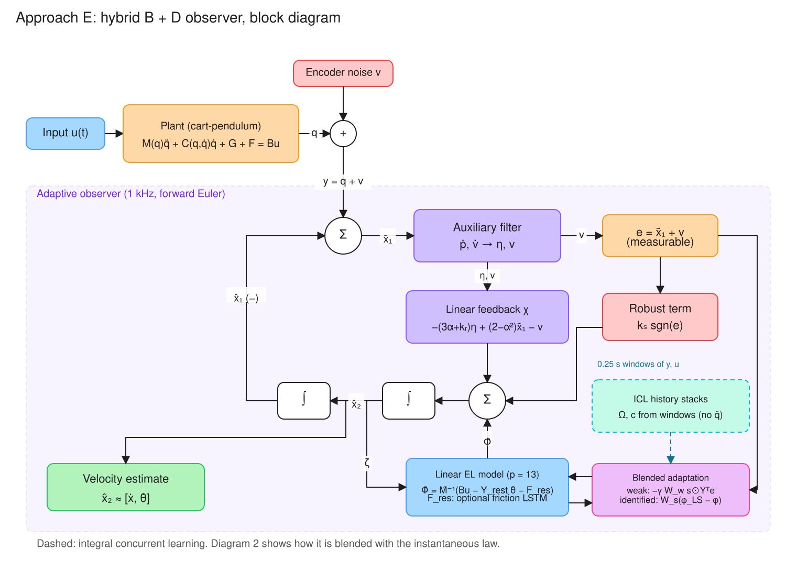

*Diagram 12. Block diagram of the hybrid observer. The filter, the feedback $\chi$ and the robust
term are those of §5. The model is D's linear-in-parameters Euler–Lagrange model. The adaptation
block blends the two laws (Diagram 13, §10.3).*

### 10.1 What comes from each parent

| Ingredient | From | Role in E |
|:---|:---:|:---|
| Auxiliary filter, feedback $\chi$, robust term | A | Unchanged (§5) |
| Linear-in-parameters Euler–Lagrange model | D | The acceleration model; the true rig is one parameter point |
| Integral concurrent learning: windows, two stacks, row normalization, change detector | D | Identifies every direction the recorded data excite |
| Instantaneous law in the kinetic-energy metric | B | Learns the remaining directions from the current error, at B-like gain |
| Dissipative friction LSTM | B | Optional residual, off by default (§10.4) |
| Own-coordinate inertia freeze, information-weighted blend | new | §10.2, §10.3 |

The model is D's (`src/observers/el_linear_model.py`):

$$M(q)\ddot q + C(q,\dot q)\dot q + G(q) + F(\dot q) = Bu,\qquad \hat\Phi = \hat M^{-1}\big(Bu - Y_{rest}(\hat q,\hat{\dot q})\,\hat\theta - F_{res}\big),$$

with features $\rho(q) = [1, \cos\theta, \sin\theta]$, 15 parameters of which 13 are free (§10.2), and
$F_{res} = 0$ unless the residual is enabled.

### 10.2 Why D fails on small swings, and the own-coordinate inertia freeze

D normalizes the unactuated pendulum row by its leading inertia coefficient $J$, the constant
part of $M_{22}$, to stop noise from shrinking the row (§9.4). That normalization
assumes the other terms of the row cannot imitate $J$. With the feature $\cos\theta$ in $M_{22}$,
they can. When the pendulum stays near $\theta = \pi$,

$$M_{22}(\theta) = J + c_1\cos\theta \approx J - c_1,$$

so the choice $c_1 \approx J$ makes the pendulum's inertia vanish along the whole trajectory. The
homogeneous row is then satisfied trivially, and $J$ is free to take any value. The regression
finds exactly this solution:

| Hanging scenario, 50 s (seed 0) | $J$ (reported as $I + ml^2$; true 0.129) | $mgl$ (true 0.812) |
|:---|---:|---:|
| D | 2.97 | 0.62 |
| E | 0.124 | 0.771 |

This is the scale collapse of §9.4 again, entering through the features instead of the noise.
The data do not excite the direction that separates $J$ from $c_1$, yet the direction is not
"weak" in the eigenvalue sense, because it is aligned with the regression target. A rank gate
cannot catch it.

**The fix is a physical fact.** The diagonal inertia $M_{ii}$ of a joint in a serial chain is the
inertia of everything outboard of that joint about its axis. It depends on the outboard joint
coordinates, never on $q_i$ itself. For the rig, $M_{22} = I + ml^2$ is a constant. E therefore
fixes at zero every feature coefficient of $M_{ii}$ that depends on $q_i$:

- on the rig these are the $\cos\theta$ and $\sin\theta$ coefficients of $M_{22}$, leaving 13 free
  parameters;
- the frozen parameters enter no stack and receive no gradient;
- the true rig is still inside the model class (`test_own_coordinate_inertia_is_frozen`).

The freeze applies to any serial chain. It would be wrong for a mechanism whose joint inertia
does depend on its own coordinate, such as a closed kinematic loop.

### 10.3 Information-weighted blend of the two adaptation laws

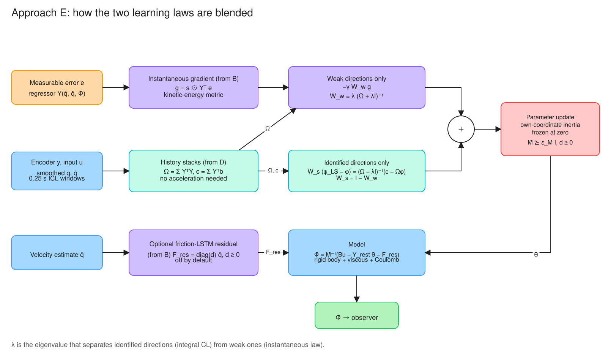

*Diagram 13. How one adaptation step is formed. The stacks supply the information matrix $\Omega$.
It splits parameter space into identified directions, which integral concurrent learning moves
towards the stack solution, and weak directions, which the instantaneous law moves along the
current error. The two shares always add up to the identity.*

**The two laws.** For a stack with information matrix $\Omega = \sum_j \mathcal Y_j^T\mathcal Y_j$
and cross term $c = \sum_j \mathcal Y_j^T b_j$ (so that $\Omega\phi^\ast = c$ for exact windows):

- D pulls $\phi$ to the least-squares solution at the same rate in every direction:
  $\dot\phi = \gamma_{CL}(\phi_{LS} - \phi)$. This Newton form divides by the eigenvalues of
  $\Omega$, so it amplifies noise in weakly excited directions, and it must sit behind a rank gate.
- B descends the instantaneous error: $\dot\phi = -\gamma\, g$, with $g = s\odot Y^Te$ the gradient
  of the kinetic metric $\tfrac12 e^T\hat Me$. It needs no identifiability, but it only makes the
  model right along the current trajectory.

**The blend.** With a damping constant $\lambda > 0$, define

$$W_s = \Omega(\Omega + \lambda I)^{-1},\qquad W_w = \lambda(\Omega + \lambda I)^{-1} = I - W_s.$$

$W_s$ and $W_w$ share the eigenvectors of $\Omega$. In a direction with eigenvalue $\mu$ their
gains are $\mu/(\mu+\lambda)$ and $\lambda/(\mu+\lambda)$. The adaptation law is

$$\dot\phi = \underbrace{-\gamma\,W_w\,g}_{\text{instantaneous (B), weak directions}} + \underbrace{\gamma_{CL}\,W_s(\phi_{LS} - \phi)}_{\text{integral CL (D), identified directions}},\qquad W_s(\phi_{LS} - \phi) = (\Omega + \lambda I)^{-1}(c - \Omega\phi).$$

- **Identified directions** ($\mu \gg \lambda$) follow D. The instantaneous law is switched off
  there, so it cannot fight the stack estimate.
- **Weak directions** ($\mu \ll \lambda$) follow B. Integral CL does not move them, so noise in
  the stack is not amplified.
- **No gate is needed.** The right-hand form is defined for a singular $\Omega$, and it has no
  component along its null space (`test_damped_step_leaves_unexcited_directions_to_the_instantaneous_law`).
- **The instantaneous gain can be large.** D had to keep $\gamma = 2$, because a larger gain fought
  the stack target. With the two laws acting on complementary directions, E runs $\gamma = 20$.
  Before the stacks hold enough windows, $W_w = I$ and E is a pure instantaneous learner. That is
  what shortens the start-up transient.

**Unactuated rows.** The pendulum row is solved in D's normalized coordinates
$(\kappa, \psi) = (1/\phi_J,\ \phi_c/\phi_J)$. E applies the same damped step there, with the
coupling columns taken from the current $\phi$, and maps the weak-direction projector back to
$\phi$ through the Jacobian of $(\kappa,\psi)\mapsto\phi$.

**Choice of $\lambda$.** On the rig the stack eigenvalues separate into two groups. On small
swings, three directions per stack sit at $10^{-2}$ or below and the rest at $10^{-1}$ or above.
On the swing-through, nearly all are above $10^{-1}$. The default $\lambda = 0.01$ sits at the
boundary. Values from 0.005 to 0.03 give the same steady-state error to within 1 %.

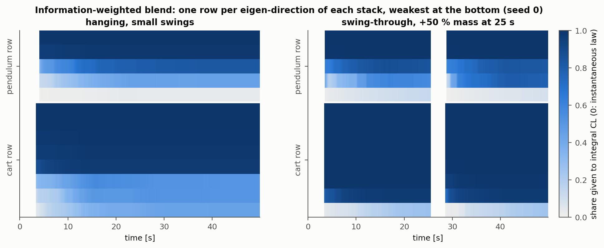

*Figure 21. Seed 0. Each horizontal band is one eigen-direction of a stack (pendulum row above,
cart row below, weakest at the bottom of each). The colour is the share $\mu/(\mu+\lambda)$ of
that direction given to integral concurrent learning: dark blue = identified from stored data,
light grey = left to the instantaneous law. Left: hanging (small swings). Right: swing-through
with the mass step.*

> **What it shows.** Nothing is drawn for the first 3–4 s, before the stacks hold enough windows:
> E is then a pure instantaneous learner. On small swings (left), the top bands turn dark, but the
> two weakest pendulum directions and the three weakest cart directions stay light or mid-blue for
> the whole run. On the swing-through (right), almost every band turns dark within seconds, and only
> the single weakest direction of each stack stays light. The white gap after 25 s is the stack
> purge after the detected mass change; the bands refill a few seconds later.
>
> **What it means.** E decides, direction by direction, how much to trust its stored data. With
> rich data it behaves like D; with poor data it falls back on B's learning law for exactly the
> directions the data cannot resolve. No hand-set threshold is involved.

### 10.4 Optional residual: B's dissipative friction LSTM

`residual=True` adds B's friction block (§7.3.3) to the model:

$$F_{res} = \mathrm{diag}(d)\,\hat{\dot q},\qquad d_i = d^0_i\,\mathrm{softplus}(\phi_{F,i} - 3) \ge 0,$$

where $\phi_F$ is the readout of an 8-cell continuous-time LSTM on the estimated velocities. It is
adapted by the instantaneous law in the kinetic metric. It can only dissipate
(`test_frozen_parameters_stay_zero_and_residual_dissipates`), so the model stays passive.

It is **off by default**. In every scenario tested, its effect is within the seed-to-seed spread
(§10.6.2). The simulated rig has only viscous friction, which the linear model already represents
exactly, so the residual has nothing to learn. It is kept for hardware, where friction depends on
history. Two limits should be kept in mind when it is enabled:

- the integral-CL windows do not include $F_{res}$, so the stack estimate treats it as unmodelled;
- it starts as a small extra damping, $0.049\,d^0_i$.

### 10.5 Stability and convergence (sketch)

Let $V_0 + P$ be the filter Lyapunov function of §5 with its RISE term, and
$\tilde\phi = \phi^\ast - \phi$. For exact windows, $c = \Omega\phi^\ast$, and between stack
updates

$$\dot{\tilde\phi} = -\gamma_{CL}\,W_s\,\tilde\phi + \gamma\,W_w\,g.$$

$W_s$ is symmetric positive semidefinite, with smallest eigenvalue
$\underline\mu/(\underline\mu + \lambda)$ on the span of the identified directions, and
$\lVert W_w\rVert \le 1$. With $V = V_0 + P + \tfrac{\beta}{2}\lVert\tilde\phi\rVert^2$,
$\lVert g\rVert \le c_g\lVert e\rVert$ on the compact set kept invariant by the projections, and
Young's inequality:

$$\dot V \le -\tfrac{\alpha}{2}\big(\lVert\tilde x_1\rVert^2 + \lVert\nu\rVert^2\big) - \alpha\lVert\eta\rVert^2 - k_r\lVert r\rVert^2 - \beta\gamma_{CL}\,\tilde\phi^TW_s\tilde\phi + \beta\gamma c_g\lVert\tilde\phi\rVert\lVert e\rVert.$$

- **State errors.** They behave as in Approaches A–D: asymptotic convergence if $k_s$ meets the
  RISE bound, uniform ultimate boundedness at the tuned $k_s = 0.2$.
- **Identified directions.** The component of $\tilde\phi$ in the range of $W_s$ converges, to
  zero for exact windows and to a neighbourhood set by the stack error under noise. This is D's
  result, restricted to the directions the data support.
- **Weak directions.** No convergence is claimed. $\tilde\phi$ stays bounded by the projection, as
  in B.

What the sketch does not cover:

- the blend in the normalized coordinates $(\kappa,\psi)$ of the unactuated rows, where the
  projector is mapped through a state-dependent Jacobian;
- the jumps of $\Omega$ when windows are swapped or purged;
- the discrete-time projection.

### 10.6 Validation

`python experiments/run_e_validation.py --seeds 5` (about 20 min). The three scenarios are the
home scenarios of A, B and C, so E is tested where each parent is strong and where it is weak.
They are the shared benchmark's S1, S2 and S3 (§11.1), called here *hanging*, *swing-through*
and *weak*. Each seed changes the noise realization and the initialization. B and D run with their
defaults. No run diverged, and the cart never reached a bumper.

#### 10.6.1 Velocity estimation

Steady-state $\dot\theta$ RMSE [rad/s], median [min, max] over 5 seeds:

| Scenario | B | D | **E** |
|:---|:---|:---|:---|
| hanging (S1) | 0.0094 [0.0093, 0.0105] | 0.0295 [0.0289, 0.0312] | **0.0088** [0.0085, 0.0094] |
| swing-through (S2) | 0.0202 [0.0199, 0.0225] | 0.0187 [0.0174, 0.0196] | **0.0175** [0.0168, 0.0187] |
| weak (S3) | 0.0094 [0.0085, 0.0103] | 0.0148 [0.0142, 0.0232] | **0.0088** [0.0081, 0.0096] |

Steady $\dot x$ RMSE and online $\ddot\theta$ model NMSE in steady state, median over 5 seeds:

| Median over 5 seeds | Scenario | B | D | **E** |
|:---|:---|---:|---:|---:|
| Steady $\dot x$ RMSE [m/s] | hanging (S1) | 0.00180 | 0.00187 | **0.00178** |
| | swing-through (S2) | 0.00253 | 0.00179 | **0.00173** |
| | weak (S3) | 0.00183 | 0.00181 | **0.00175** |
| Online $\ddot\theta$ model NMSE | hanging (S1) | 0.0026 | 0.168 | **0.0005** |
| | swing-through (S2) | 0.0010 | 0.0005 | **0.00002** |
| | weak (S3) | **0.0004** | 0.271 | 0.0017 |

The start-up errors (RMSE over 0.1–5 s, peak over 0.1–2 s) and the post-step RMSE of B, D and E
are in §11.3, next to the other approaches.

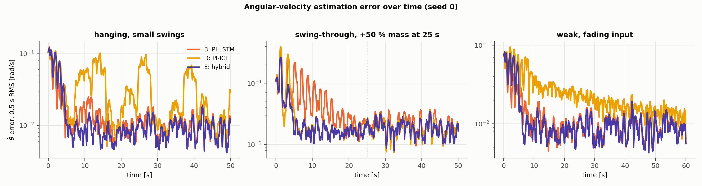

*Figure 22. Seed 0. 0.5 s RMS pendulum-velocity error of B, D and E on the three scenarios (log
scale).*

> **What it shows.** On the hanging scenario (left), D's error (yellow) returns in bursts of
> 0.05–0.1 rad/s around 8–15 s, 25–28 s and 37–40 s, while B and E stay near 0.01. On the
> swing-through (middle), E (purple) reaches about 0.02 within 5 s; B oscillates above 0.05 until
> about 15 s. On the weak input (right), D decays slowly from 0.03 to 0.01, while B and E are near
> 0.01 from 10 s on.
>
> **What it means.** E combines the best of both parents: it does not suffer D's bursts on small
> swings, where D's mis-scaled model fits only part of the swing, and it settles faster than B
> on the large swing. On small swings B and E end up at the same level.

- **Steady state.** E has the lowest median in every scenario. Its seed range overlaps that of the
  next-best approach each time, so the margin over B, and over D on the swing-through, is small.
  The margin over D on the two small-swing scenarios is not: the ranges are far apart.
- **Plant change.** E detects the mass step in every seed (one stack purge each) and recovers as
  D does.
- **Start-up.** E improves on D everywhere, and on B where the motion is large. On the two
  small-swing scenarios B remains better in the first 5 s (§10.7).

#### 10.6.2 Identification and ablations

Relative error of the physical parameters read from the model at the end of the run, median
[min, max] over 5 seeds.

| | Scenario | D | **E** |
|:---|:---|:---|:---|
| $I + ml^2$ | hanging | 2200 % | **4.0 %** [0.6, 8.9] |
| | swing-through | 7.9 % [6.2, 27.3] | **4.4 %** [0.9, 16.4] |
| | weak | 2260 % | **1.8 %** [0.4, 6.5] |
| $mgl$ | hanging | 19 % | **3.6 %** [0.4, 8.8] |
| | swing-through | 4.2 % | 4.3 % [1.0, 16.3] |
| | weak | 15 % | **3.1 %** [1.0, 6.6] |
| $M + m$ | hanging | 8.6 % | **2.1 %** |
| | swing-through | 0.2 % | 0.2 % |
| | weak | 0.7 % | 0.7 % |
| Inertia matrix $\lVert\hat M(q) - M(q)\rVert/\lVert M(q)\rVert$, steady | hanging | 10.4 % | **0.23 %** |
| | swing-through | 0.59 % | **0.26 %** |
| | weak | 3.8 % | **0.23 %** |

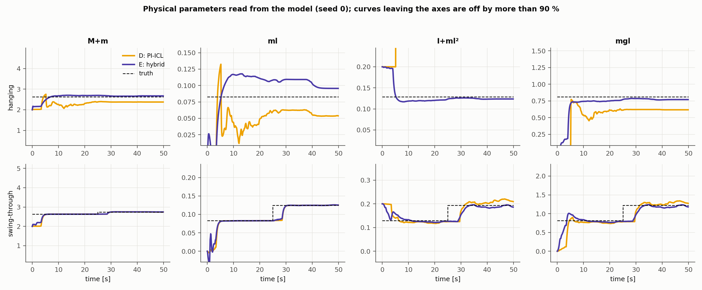

*Figure 23. Seed 0. The four physical parameters read from D (yellow) and E (purple) against the
truth (dashed). Top row: hanging scenario. Bottom row: swing-through with the mass step at 25 s.*

> **What it shows.** On the hanging scenario, D's $I+ml^2$ shoots off the top of the axes at
> about 5 s and never returns, and its $mgl$ settles near 0.62 against 0.81. E's $M+m$,
> $I+ml^2$ and $mgl$ settle close to the truth within about 10 s. Both read $ml$ wrongly
> on the hanging scenario (E about 0.10, D about 0.05, truth 0.083). On the swing-through both
> follow the mass step after the stack purge, and E sits closer to the new $I+ml^2$.
>
> **What it means.** The own-coordinate freeze stops the runaway that broke D on small swings,
> so E identifies the rig from small swings too. The $ml$ reading cannot be identified from small
> swings at all (explained below), but the inertia matrix as a whole is still right to 0.2 %.

**The coupling inertia $ml$ on small swings.** $M_{12} = c_0 + ml\cos\theta$, and near
$\theta = \pi$ the data fix only $c_0 - ml$. The reading "$ml$" is then off by 31–36 % for both D
and E, while $M_{12}$ itself, and with it the whole inertia matrix, is right to 0.2 %. This split
is not identifiable from small swings. On the swing-through, $ml$ is within 1 %.

**Ablations.** Median over 5 seeds.

| Variant | Steady $\dot\theta$: hanging | swing | weak | $\dot\theta$ RMSE 0.1–5 s, swing | Peak, swing | $I + ml^2$ error, hanging |
|:---|---:|---:|---:|---:|---:|---:|
| **E** | 0.0088 | 0.0175 | 0.0088 | 0.105 | 0.381 | 4.0 % |
| E, no freeze | 0.0452 | 0.0192 | 0.0111 | 0.120 | 0.251 | 2200 % |
| E, no blend (D's law and gate) | 0.0089 | 0.0174 | 0.0088 | 0.189 | 0.553 | 4.0 % |
| E + residual | 0.0088 | 0.0166 | 0.0088 | 0.104 | 0.379 | 4.0 % |

- **The freeze is what fixes small swings.** Without it the hanging error is five times larger and
  the inertia scale runs away, as in D.
- **The blend is what fixes the start-up.** Without it the steady state is unchanged, and the
  swing-through transient returns to D's level.
- **The freeze raises the start-up peak on the swing-through** (0.38 against 0.25 without it).
  The frozen model has less freedom to follow the first fall of the pendulum. The steady-state
  and identification gains outweigh this, but it is a real cost.
- **The residual does not matter here.** Its largest effect, 0.0166 against 0.0175 on the
  swing-through, is inside the seed ranges ([0.0158, 0.0178] against [0.0168, 0.0187]).

### 10.7 What E does not do better

- **Start-up on small swings.** B's $\dot\theta$ error over the first 5 s is lower on the hanging
  and weak scenarios (0.053 vs 0.070, 0.043 vs 0.058 rad/s). E's instantaneous gain is limited by
  the swing-through, and the peak in the first 2 s is set by the unlearned gravity term for every
  approach.
- **Gain margin.** $\gamma = 20$ is the default. On the swing-through, $\gamma = 30$ is slightly
  better, $\gamma = 60$ doubles the start-up peak, and $\gamma = 120$ diverges at 2 s. The margin
  to instability is about a factor of 3.
- **Tuning data.** $\gamma$ and $\lambda$ were chosen on seed 0 of these three scenarios, which is
  also one of the five evaluation seeds. The numbers above are a validation result. The held-out
  inputs of the shared benchmark (§11.4) are the independent test.
- **Unmodelled friction.** The residual could not be shown to help. A clean test of cart-side
  friction outside the viscous family could not be built in open loop either: any such friction
  cancels the drift-compensating start velocity, and the cart reaches a bumper.
- **Structure assumptions.** As in D, the model is a linear-in-parameters Euler–Lagrange system
  with known joint types and input matrix. The freeze adds the serial-chain assumption of §10.2.
- **Simulation only**, with the actuator dead-zone and stiction off, as in every approach.

### 10.8 Configuration

Defaults of `HybridObserverConfig`. Fields not listed are D's (`PIICLObserverConfig`, §9.9),
unchanged.

| Parameter | Default | Role |
|:---|:---:|:---|
| `gamma_inst` | 20 | Instantaneous gain $\gamma$; acts on weak directions only (D: 2) |
| `lambda_damp` | 0.01 | $\lambda$: eigenvalue separating identified from weak directions |
| `blend` | True | False restores D's Newton CL behind its rank gate |
| `freeze_own_inertia` | True | $M_{ii}$ independent of $q_i$ (§10.2) |
| `gamma_cl` | 2 1/s | Rate of the integral-CL pull (as D) |
| `cl_min_windows` | 60 | Windows a stack needs before it is used (as D) |
| `residual` | False | B's friction LSTM as a dissipative residual (§10.4) |
| `residual_hidden`, `residual_offset` | 8, −3 | Residual LSTM width; softplus offset (as B) |
| `gamma_res_gates`, `gamma_res_out`, `w_bar_res` | 5, 20, 20 | Residual adaptation gains and bound (as B) |

With `blend=False` and `freeze_own_inertia=False` the observer reproduces Approach D exactly
(`test_no_blend_no_freeze_reduces_to_approach_d`).

---

## 11. Shared benchmark: all approaches side by side

Each approach was first validated on its own scenario (§6.7, §7.8, §8.8–§8.9, §9.7, §10.6), so
those numbers cannot be compared directly. The shared benchmark runs all five approaches on every
approach's home scenario, with the same seeds and the same metrics, plus a held-out test set that
no approach was tuned on. It also evaluates two improvements that apply across approaches:

- **Improvement 1**, the harness itself.
- **Improvement 2**, removing the cart position from the black-box inputs (§11.5).
- **Improvement 3**, a model-free warm start (§11.6).

The five approaches run unchanged, with their own defaults:

| | Approach | Code |
|:---|:---|:---|
| A | Black-box Lb-LSTM | `src/observers/blackbox_lstm.py` |
| B | Physics-informed PI-LSTM | `src/observers/pilstm_*.py` |
| C | Concurrent-learning Lb-LSTM | `src/observers/cl_lstm_observer.py` |
| D | Physics-structured integral CL (PI-ICL) | `src/observers/pi_icl_observer.py`, `el_linear_model.py` |
| E | Hybrid of B and D | `src/observers/hybrid_observer.py` |

**Headline result.** Approach E, built after the first round of this benchmark, has the lowest
steady-state θ̇ error in every scenario and the best held-out prediction in every scenario
(§11.2, §11.4). It was built from two findings of that first round: B was the most reliable
estimator, and D had the best model when the data were rich. §10 explains what it changes.

### 11.1 Protocol

The common observer structure is Diagram 3 (§5).

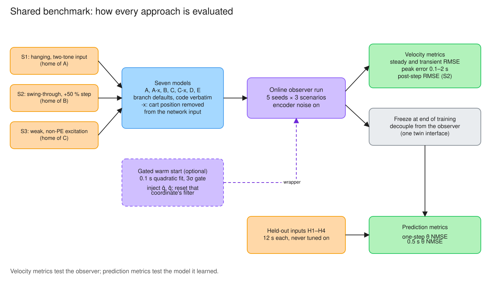

*Diagram 14. How every approach is evaluated. The seven models run online on the three training
scenarios, which gives the velocity metrics. Each is then frozen, decoupled from its observer and
driven by held-out inputs, which gives the prediction metrics. The gated warm start (§11.6) is an
optional wrapper around the online run.*

**Training scenarios.** Each is the validation scenario of one approach, reproduced exactly
(`src/benchmark/scenarios.py`):

| | Home of | Setting | Noise |
|:---|:---|:---|:---|
| S1 | A | Hanging pendulum, $u = 2\sin 1.5t + 1.2\cos 3t$, $\theta_0 = \pi - 0.4$, 50 s | U(±0.5°) |
| S2 | B | Swing-through from 0.5 rad off upright, $u = 2\sin 3t + 1.2\cos 6t$, pendulum mass and inertia +50 % at 25 s, 50 s | U(±1°) |
| S3 | C | Weak excitation (non-PE) $u = 3e^{-t/8}\sin 1.6t$, hanging, 60 s | U(±0.5°) |

**Held-out test inputs.** These four inputs were defined for this benchmark before any result
existed, and no approach was tuned on them:

- H1: a filtered square wave.
- H2: a random-phase multisine on frequencies absent from every training input.
- H3: a slow chirp from 0.1 to 0.6 Hz.
- H4: a pulse train.

Each runs for 12 s from the hanging equilibrium, starting at the drift-cancelling cart state
(the cart never reaches a bumper), on the plant each model ended its training on. For S2 that
is the post-step plant.

**Normalization.** A and C receive the data-driven input normalization that B's validation gave
A: offsets and scales from the first 5 s of encoder data. B, D and E need none.

**Metrics.** 5 seeds per scenario; each seed changes the noise realization and the
initialization.

- **Velocity reconstruction:**
  - RMSE of $\dot x$ and $\dot\theta$ over the transient (0.1–5 s) and the steady window (last 15 s).
  - Peak $\dot\theta$ error over 0.1–2 s.
  - Post-step RMSE (S2 only).
- **Held-out prediction.** Each model is frozen at the end of training and decoupled from its
  observer (`src/benchmark/models.py`, one twin interface for all of them).
  - One-step NMSE of $\ddot x$ and $\ddot\theta$ on the true states.
  - 0.5 s short-horizon NMSE of $x$ and $\theta$, restarting from the true state every 0.5 s.
  - Long free runs are not scored: the plant is marginally stable near the hanging
    equilibrium, so they diverge for every model (§8.9.2).

### 11.2 Velocity reconstruction (cold start)

Median over 5 seeds of the steady-window RMSE (last 15 s). No run diverged.

| | S1 θ̇ [rad/s] | S2 θ̇ | S3 θ̇ | S1 ẋ [m/s] | S2 ẋ | S3 ẋ | S2 post-step θ̇ |
|:---|---:|---:|---:|---:|---:|---:|---:|
| A | 0.0149 | 0.0359 | 0.0100 | 0.0021 | 0.0057 | 0.0019 | 0.0462 |
| B | 0.0094 | 0.0202 | 0.0094 | 0.0018 | 0.0025 | 0.0018 | 0.0218 |
| C | 0.0135 | 0.0662 | 0.0094 | 0.0018 | 0.0043 | **0.0017** | 0.0787 |
| D | 0.0295 | 0.0187 | 0.0148 | 0.0019 | 0.0018 | 0.0018 | 0.0179 |
| **E** | **0.0088** | **0.0175** | **0.0088** | **0.0018** | **0.0017** | 0.0017 | **0.0176** |

Bold marks the best in each column, judged on the unrounded values. On ẋ in S3 every model is at
the encoder limit: C (0.001745) and E (0.001747) are tied. The x-free variants A-x and C-x are
compared with A and C in §8.10.

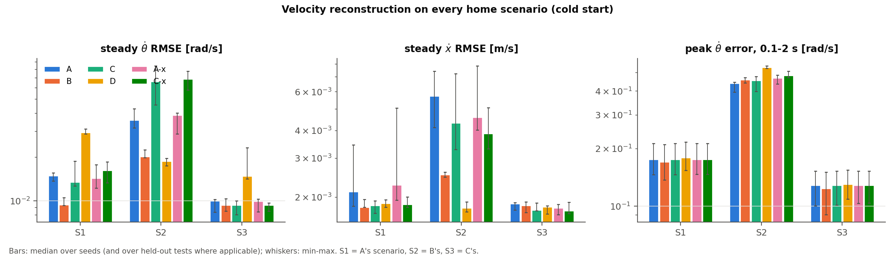

*Figure 24. All seven models on the three scenarios. Left: steady-state pendulum-velocity error.
Middle: steady-state cart-velocity error. Right: peak pendulum-velocity error during start-up
(0.1–2 s). Bars are medians over 5 seeds; whiskers span min to max; log scale.*

> **What it shows.** In the left panel, E (purple) has the shortest bar in all three scenarios.
> D (yellow) is tall on S1, and C and C-x (greens) are the tallest on S2. In the middle panel,
> the black boxes A, A-x and C are clearly worse on S2, while B, D and E are near the encoder
> limit everywhere. In the right panel, all models have about the same start-up peak on S1 and
> S3; on S2, E's peak is the lowest and D's the highest.
>
> **What it means.** The hybrid E is the most accurate velocity observer in steady state
> wherever it runs. The start-up peak is almost the same for every approach, because at the start
> nobody's model knows gravity yet; only on the large swing does E's faster learning help.

- **E has the lowest θ̇ error in every scenario.** Its margin over the previous best is 6 % on S1
  and S3 (over B) and 7 % on S2 (over D). The seed ranges of E and the runner-up overlap
  each time, so the gain in steady state is consistent but small.
- **Among A–D, B is the most reliable.** It is best or tied on the two hanging scenarios and a
  close second on S2.
- **D is strong on S2 but worst on θ̇ in S1.** S2 is its design scenario, where the whole
  configuration space is swept. On the hanging scenarios, with swings of ±0.4 rad, D's normalized
  pendulum regression has a degenerate solution and its inertia scale runs away (§10.2). The
  effect is visible on S1, where D's θ̇ RMSE is 3× B's.
- **C's history stack hurts on S2.** Its stored windows predate the mass step and C has no change
  detector, so it clings to the old plant (post-step θ̇ RMSE 0.079 vs A's 0.046).

### 11.3 Transient behaviour and recovery from the plant change

Median over 5 seeds. Post-step RMSE is over 25–30 s of S2, right after the +50 % mass and inertia
step.

| | θ̇ RMSE 0.1–5 s, S1 | S2 | S3 | Peak θ̇ error 0.1–2 s, S1 | S2 | S3 | Post-step θ̇ RMSE, S2 |
|:---|---:|---:|---:|---:|---:|---:|---:|
| A | 0.059 | 0.166 | 0.052 | 0.176 | 0.439 | 0.129 | 0.0462 |
| A-x | 0.058 | 0.174 | 0.052 | 0.176 | 0.469 | 0.129 | 0.0516 |
| B | **0.053** | 0.148 | **0.043** | **0.170** | 0.459 | **0.124** | 0.0218 |
| C | 0.058 | 0.157 | 0.044 | 0.176 | 0.456 | 0.129 | 0.0787 |
| C-x | 0.057 | 0.160 | 0.044 | 0.176 | 0.483 | 0.129 | 0.0890 |
| D | 0.073 | 0.174 | 0.068 | 0.180 | 0.533 | 0.130 | 0.0179 |
| E | 0.070 | **0.105** | 0.058 | 0.175 | **0.381** | 0.128 | **0.0176** |

- **Every learned observer has a start-up transient.** The peak error is 0.12–0.53 rad/s, against
  steady RMSE of 0.009–0.07 rad/s.
  - E shortens it where the motion is large: on S2 its transient RMSE is 0.105 (B 0.148, D 0.174)
    and its peak 0.381 (B 0.459, D 0.533).
  - On the small-swing scenarios S1 and S3, B still has the lowest transient error.
  - It is not high-gain peaking: no gain is scaled up.
  - It is a *model-learning* transient, lasting until $\hat\Phi$ has adapted.
  - Weight projection bounds the weights, not this transient.
  - The warm start of §11.6 removes the cart part of it, but not the pendulum part.
- **Recovery after the step ranks by structure.**
  - D and E are best: they detect the change and re-identify.
  - B is next.
  - C is worst, because its stack still holds pre-step windows.

  In D's own run of S2 (§9.1), the peak θ̇ error in 25–27 s is 0.110 (A), 0.054 (B) and
  0.045 rad/s (D).
- **D pays for identification with the largest initial transient** (0.533 rad/s on S2). It starts
  from a weak prior with a small instantaneous gain, and concurrent learning switches on only once
  the rank gate opens, about 3 s in.

### 11.4 Held-out prediction

Median over the 4 held-out inputs × 5 seeds.

| | One-step θ̈ NMSE S1 | S2 | S3 | 0.5 s θ NMSE S1 | S2 | S3 |
|:---|---:|---:|---:|---:|---:|---:|
| A | 2.33 | 80.7 | 1.84 | 0.161 | 6.49 | 0.170 |
| B | 0.046 | 0.061 | 0.179 | 0.0055 | 0.0058 | 0.012 |
| C | 2.41 | 108.7 | 1.80 | 0.159 | 9.44 | 0.096 |
| D | 0.268 | 0.0039 | 0.301 | 0.026 | 0.0002 | 0.031 |
| A-x | 1.67 | 20.4 | 0.917 | 0.129 | 1.11 | 0.057 |
| C-x | 0.884 | 14.4 | 0.326 | 0.085 | 0.887 | 0.029 |
| **E** | **0.0016** | **0.0020** | **0.0032** | **0.00014** | **0.00015** | **0.00025** |

Bold marks the best of all seven models. Among A–D alone, B is best after S1 and S3 and D after S2.

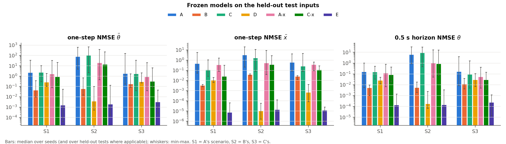

*Figure 25. All seven models, frozen after training on each scenario, predicting the four held-out
inputs. Left: one-step pendulum-acceleration error. Middle: one-step cart-acceleration error.
Right: 0.5 s pendulum-angle prediction error. Bars are medians; whiskers span min to max; log
scale over nine decades.*

> **What it shows.** The bars split into two groups. The black boxes (A, C, A-x, C-x) sit mostly
> between 0.1 and 100, often around or above 1, i.e. no better than predicting the average. The
> physics-structured models sit far lower. B is near 0.005–0.2, D drops to about 0.004 after the
> swing-through S2 but not after S1 and S3, and E is near 0.001 on pendulum acceleration and
> 0.00001 on cart acceleration in every scenario.
>
> **What it means.** Building physics into the model is what lets it predict situations it has
> not seen. E's model is effectively the true rig, whichever training data it learned from.

- **E is the best model in every scenario, by a wide margin after hanging-only data.** After S1
  and S3 its one-step θ̈ NMSE is 29× and 56× lower than B's, and 170× and 93× lower than D's.
  After S2 it is 2× lower than D's. Its 0.5 s θ NMSE is about 0.0002 whatever the training
  scenario: the model it identifies from small swings is as good as the one from the swing-through.
  - These inputs were fixed before E existed and E was not tuned on them, so this is the
    independent test of the hybrid.
  - The spread over seeds and tests is wide (θ̈ NMSE from 0.00004 to 0.13), as for every model.
- **Structure generalizes; black boxes do not.**
  - The physics-structured models (B, D, E) are 1–4 orders of magnitude better than A and C on
    inputs they never saw.
  - After S2, A's and C's θ̈ NMSE runs to 80–110, worse than predicting the mean. They learned
    whatever the swing-through visited, including the cart position (§11.5), and extrapolate badly
    near the hanging equilibrium.
- **D needs rich data; E does not.** After S2, D's θ̈ NMSE is 0.004 and its 0.5 s θ NMSE 0.0002:
  effectively the true rigid-body model. After hanging-only data (S1, S3), B's model generalizes
  better than D's. E removes that dependence (§10.2).
- **Among the black boxes, C-x generalizes best.** It combines concurrent learning with
  improvement 2 and beats both A variants on every scenario (§8.10).

### 11.5 Improvement 2: remove the cart position from the black-box inputs

The dynamics do not depend on the cart position $x$: it is a cyclic coordinate. B, D and E build
this in (§7.2.5). A and C see $x$ as an input, so a test that visits cart positions the training
did not forces them to extrapolate in a direction the true dynamics ignore. The fix is to set
$x$'s input scale to 0 (the A-x and C-x variants).

**Why it matters.** The rig's Lagrangian does not depend on $x$: $\partial\mathcal L/\partial x = 0$.
So $M$, $C$, $G$, and the acceleration field $g$ are invariant under translations of the cart, but
nothing makes an unconstrained network invariant too. Setting $s_x = 0$ imposes the translation
symmetry exactly. The observer still uses $\hat x$ in its error signals; only the *model input*
loses it.

**Ratio of original to x-free median NMSE** (above 1 means the x-free model is better):

| | S1 | S2 | S3 |
|:---|---:|---:|---:|
| A / A-x, one-step θ̈ NMSE | 1.40× | 3.96× | 2.01× |
| C / C-x, one-step θ̈ NMSE | 2.73× | 7.53× | 5.51× |
| A / A-x, 0.5 s θ NMSE | 1.25× | 5.86× | 3.01× |
| C / C-x, 0.5 s θ NMSE | 1.87× | 10.65× | 3.28× |

Per-seed differences:

| Change (x-free minus original), median over seeds | S1 | S2 | S3 |
|:---|:---:|:---:|:---:|
| A-x vs A: one-step θ̈ NMSE | −1.79 (better in 3/5 seeds) | −131 (5/5) | −3.99 (4/5) |
| C-x vs C: one-step θ̈ NMSE | −1.65 (4/5) | −94.6 (5/5) | −3.11 (5/5) |
| A-x vs A: 0.5 s θ NMSE | −0.023 | −3.68 | −0.027 |
| C-x vs C: 0.5 s θ NMSE | −0.093 | −6.59 | −0.119 |
| A-x / C-x vs original: steady θ̇ RMSE | −0.0005 / +0.0003 | −0.0023 / −0.0022 | +0.0001 / +0.0001 |

- **Held-out prediction improves in 26 of 30 (model, scenario, seed) cases.** The median
  one-step θ̈ NMSE falls by 1.4–7.5×. The largest gain is after S2, where the swing-through's
  cart positions were furthest from the tests'.
- **Online velocity estimation is unchanged.** The observer's feedback compensates for the model
  either way; the input change matters when the model runs on its own.
- **One line, no downside observed.** The change is a single input scale, and it should be the
  default for any black-box model of a system with cyclic coordinates.

### 11.6 Improvement 3: model-free warm start

Every observer starts from $\hat q = y(0)$ and $\hat{\dot q} = 0$. In all three scenarios the
cart starts moving, at the drift-cancelling velocity, while the pendulum starts at rest.
`src/benchmark/warm_start.py` wraps any observer:

1. **Run the observer normally from the first sample**, and buffer the first 0.1 s of encoder data.
2. **Fit.** Fit a quadratic and differentiate it at the last sample (a causal Savitzky–Golay
   end-point estimate).
3. **Gate.** For each coordinate, test whether the fitted velocity is significant:
   $|\dot q_{fit}| > 3\sigma_v$, with $\sigma_v$ taken from the fit residual.
4. **Inject.** For significant coordinates only, overwrite the position and velocity estimates
   with the fit, and re-initialize that coordinate's auxiliary filter exactly as at start-up
   ($p = (\alpha + k_r)\tilde q$, $\nu = 0$).

Nothing else is touched: not the other coordinate, not the LSTM memories, not the weights. The
wrapper amounts to a new initial condition for part of the observer state, so every stability
argument still applies.

**Why position, velocity and filter are reset together.**

- **Velocity only:** injecting only the velocity leaves the position estimate and the filter
  states inconsistent with it, and the cart error re-grows to about 0.2 m/s.
- **Whole observer:** resetting the whole observer at 0.1 s discards the adaptation done so far and
  restarts the filter transient. The pendulum channel then gets worse (θ̇ RMSE up to +16 %, peak up
  to +27 %).
- **This design:** resetting one coordinate's position, velocity and filter keeps the cart error
  below 0.02 m/s after injection.

**Result.** Warm / cold ratio of the median over 5 seeds (below 1 = warm start is
better):

| | ẋ RMSE 0.1–5 s | Peak ẋ error 0.1–2 s | θ̇ RMSE 0.1–5 s | Peak θ̇ error 0.1–2 s | Steady θ̇ RMSE |
|:---|:---:|:---:|:---:|:---:|:---:|
| S1 (all 7 models) | 0.06–0.37 | 0.04–0.21 | 1.03–1.08 | 1.12–1.14 | 0.90–1.07 |
| S2 | 0.56–0.83 | 0.27–0.65 | 1.00–1.02 | 0.98–1.00 | 0.95–1.00 |
| S3 | 0.07–0.18 | 0.05–0.11 | 1.00–1.05 | 1.00 | 0.99–1.01 |

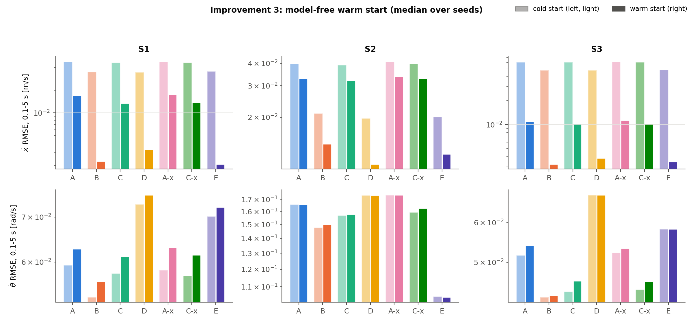

*Figure 26. Start-up error (RMSE over 0.1–5 s) with cold start (light, left bar of each pair) and
warm start (solid, right bar), per model and scenario. Top: cart velocity. Bottom: pendulum
velocity.*

> **What it shows.** In the top row, every solid bar is shorter than its light partner, often
> several times shorter: B, D and E drop the most, to about a quarter or less of their
> cold-start error on S1 and S3. In the bottom row, the pairs are almost equal on S2 and S3, and on S1 the
> warm-start bar is slightly taller for every model.
>
> **What it means.** Starting the cart's velocity estimate at a sensible value removes most of
> the cart's start-up error at no cost. It cannot fix the pendulum's start-up error, which comes
> from the model not yet knowing gravity, and on S1 it even makes the pendulum learn slightly
> more slowly.

- **Cart channel: large, consistent gains.** The transient error falls 1.2–15× and the peak
  1.5–27×. B, D and E gain most, because once their state is right their models hold it.
- **Pendulum channel: neutral on S2 and S3, slightly worse on S1.** On S1 it is 3–8 % worse
  (peak 12–14 %). The pendulum is not reset there, so the loss is indirect. The likely cause is
  that the large initial cart error acts as early excitation for the adaptation laws, and removing
  it slows the first second of model learning. This is a real trade-off.
- **What the warm start cannot fix.** The pendulum's early transient (peaks 0.12–0.53 rad/s)
  comes from the *unlearned model*. Only faster model learning reduces it, and no approach here
  does that within the first 2 s.
- **Steady state is unaffected.** The largest difference is 10 %, in C-x on S1; everything else
  is within ±8 %.

### 11.7 Caveats

- **Simulation only.** The actuator dead-zone and stiction are off, as in every approach's own
  validation. The held-out inputs are near the hanging equilibrium.
- **Each approach runs its own defaults.** A–D were each tuned on one of S1–S3, so each has
  a home advantage there. E was tuned on seed 0 of all three, after this benchmark's first round,
  so its S1–S3 velocity numbers are a validation result. The held-out inputs are the unbiased part
  of the comparison for every approach, E included.
- **C has no change detector.** Its S2 numbers reflect that. D's detector could be added to C.
- **Seed spread is wide for the black boxes.** The figure whiskers span up to two orders of
  magnitude on S2. Report medians together with their ranges.

---

## 12. Evaluating on recorded rig data

Everything above is simulation. `experiments/run_rig_evaluation.py` replays recordings from the
real Feedback 33-936S rig through the same models. The observers use only the encoder readings and
the commanded input, and they are causal, so a replayed recording gives the estimates they would
have produced live. No closed-loop controller is needed.

### 12.1 Recording folder

```
data/rig/
├── metadata.txt
├── run1_rest_trial1.csv
├── run2_freeswing_trial1.csv ... trial3.csv
├── run3_deadzone_trial1.csv
├── run4_twotone_trial1.csv ... trial3.csv
├── run5_fading_trial1.csv ... trial3.csv
├── run6_heldout_square.csv, run6_heldout_multisine.csv, run6_heldout_chirp.csv, run6_heldout_pulse.csv
└── run7_mass_step_twotone.csv
```

The run type is read from a keyword in the file name; the run number and trial suffix are free.

| Keyword | Run | Used for |
|:---|:---|:---|
| `rest` | Zero input, pendulum at rest, 20 s | Noise, encoder resolution, noise floor of the velocity reference |
| `freeswing` | Pendulum lifted 20–30° and released, zero input | Identification run |
| `deadzone` | Command ramped slowly through both directions | Command at which the cart starts to move |
| `twotone` | $u = 2\sin1.5t + 1.2\cos3t$ N, 50 s (scaled down if the cart drifts) | Identification run |
| `fading` | $u = 3e^{-t/8}\sin1.6t$ N, 60 s | Identification run |
| `heldout` | Square wave, multisine, slow chirp, pulse train, about 12 s each | Test runs: predicted, never learned from |
| `mass_step` | The two-tone run with a different rod or added mass | Identification run on a changed plant |

**CSV format.** One file per run, sampled at 1 kHz, with a header row and four columns:
`time_s, cart_pos, pend_angle, command_v`. Raw encoder counts and amplifier volts can be logged as
they are.

**`metadata.txt`.** One `key = value` line per field; `data/rig/metadata.txt` is a template to fill
in. It declares the units (counts, metres, radians, degrees, volts or newtons), the encoder
resolutions, the amplifier gain, which angle reads zero (hanging or upright), and the two sign
conventions. The evaluation checks the signs against the physics and says which one to flip.

### 12.2 Running it

The commands are in [Real-rig data commands](#real-rig-data-commands). In short:
`--template` writes the metadata template, `--make-demo` writes simulated runs in the rig format
for a rehearsal, and `--data <folder>` evaluates a folder (models B, D and E by default; `--models
A B C D E` for every approach). The output files are listed there too.

### 12.3 What is reported, and what it can show

The rig has no velocity sensor, so there is no true velocity to score against.

1. **Run report.** Duration, cart travel, sample-time jitter, and whether the cart came near an end
   stop. Runs with an impact should be shortened or repeated: impacts are not modelled.
2. **Velocity estimate against a zero-phase reference.** The reference is a centred 0.3 s
   Savitzky–Golay fit of the recorded positions. It uses future samples, so it is far more accurate
   than any causal estimate, but it is itself an estimate. Its own noise, measured on the rest run,
   is printed as the floor: differences between models below that floor mean nothing.
3. **Held-out prediction.** Each model is frozen after each identification run and predicts the
   measured positions of the `heldout` runs 0.5 s ahead. This needs no velocity truth and is the
   most trustworthy comparison.
4. **Identified parameters.** $M+m$, $ml$, $I+ml^2$ and $mgl$ from Approaches D and E, next to the
   datasheet values of §2.3.

On the simulated rehearsal recording (one trial per run, rest-run floor 0.008 rad/s), the pipeline
reproduces the benchmark ranking: θ̇ error against the reference 0.0139 (E), 0.0145 (B),
0.0364 (D), and E identifies $I+ml^2$ as 0.131 against 0.129. These numbers validate the pipeline
only; they are not rig results.

---

## 13. Literature review and result cross-verification

This section reviews the published results the project builds on (§3). It checks their theory
and their claims against our own derivations and simulations, and points to the section where
each point is worked out in full.

### 13.1 Theory: points that need care

| Topic | Pitfall | Correct treatment |
|:---|:---|:---|
| Adaptation law in an observer | A law driven by $r = \dot e + \alpha e$, as in the tracking controllers [3], [5], cannot be implemented in an observer: there $r$ contains the unmeasured velocity error | Adapt on the measurable $e = \tilde x_1 + \nu$, as in [4]. The weight error is then dominated, not cancelled (§5.4) |
| Robust term | The observer injects $\mathrm{sgn}(e)$, so domination cannot be argued pointwise as if it were $\mathrm{sgn}(r)$ | RISE integral lemma [6] with an auxiliary $P(t) \ge 0$ (§5.5) |
| Feedback coefficients | The feedback $\chi$ must match the Lyapunov function it is derived from | With the filter of [4] and an unweighted Lyapunov function, exact cancellation needs the coefficient $(2-\alpha^2)$; [4] prints $(\alpha^2+2)$, which leaves a bounded residual (§5.2–§5.3) |
| LSTM Jacobians | The output-gate Jacobian needs the factor $(z^T\otimes I_{l_2})$ to have the right dimension | §6.2, checked against finite differences |
| Jacobian meaning | The Jacobian of the static map, with the memories held fixed, is an approximation of the true sensitivity | §6.2, caveat |
| EKF prediction | The covariance update needs the discrete transition, not the continuous Jacobian | $F_k \approx I + T_s\,\partial f/\partial x\rvert_{\hat x_k}$, or integrate the Riccati equation between samples, as the continuous–discrete EKF of §4 does |
| High-gain observer noise | The noise gain depends on which state is estimated | For an $N$-th order HGO, the $i$-th state estimate carries noise gain $O(\epsilon^{-(i-1)})$ [12], [22], so the velocity estimate is $O(1/\epsilon)$. Peaking of the $i$-th state is also $O(\epsilon^{-(i-1)})$ |
| Pendulum inertia | $(I + ml^2)\ddot\theta$ means $I$ is taken about the centre of mass | The plant's $I = 0.099$ kg m² is the centroidal inertia (§2.3) |
| Benchmarks | [1], [4] and [5] all use a fully actuated two-link manipulator | The underactuated cart–pendulum raises issues those papers do not face: identifiability of unactuated rows (§9.4), rank attainability (§8.2), discretization (§6.4), input design (§11.5) |

### 13.2 Published claims, checked against our results

| Claim | What we measured, or what the sources show | Supported statement |
|:---|:---|:---|
| Weight projection eliminates peaking | Peak $\dot\theta$ error of 0.12–0.53 rad/s in 0.1–2 s for every learned observer, against steady RMSE of 0.009–0.07 rad/s (§11.3) | No *high-gain* peaking, since no gain is scaled up. A model-learning transient remains until the weights adapt. |
| Lyapunov analysis gives asymptotic (or exponential) convergence | Asymptotic only above the RISE gain bound, and every tuned configuration runs below it. No exponential rate follows from the analysis | Asymptotic under the gain condition; uniformly ultimately bounded as tuned (§5.5). |
| Persistent excitation gives exact identification | LSTM ideal weights are neither unique nor exact. Approach C's readout reaches only a neighbourhood of its least-squares fixed point (§8.8). Approach D identifies $M+m$ and $ml$ to within 1 % (§9.7) | Parameter errors converge to a neighbourhood that scales with the approximation error. Exact identification needs a realizable model and an attainable rank condition. |
| Recurrent memory learns and cancels friction | Not tested: dead-zone and stiction are off in every run | Expected, not demonstrated. |
| Improvement over baselines | [4] reports 41.13 % lower RMS velocity error than a shallow RNN observer; [5] reports 33.76 % lower tracking error than a physics-informed DNN. Neither compares with a classical estimator. Here, a shallow RNN with the *exact* nominal model beats the black-box Lb-LSTM (§6.7.2) | The ranking depends on how much model knowledge the baseline has. |

---

## 14. Repository layout

### 14.1 Directory tree

```
├── README.md                     # this file
├── requirements.txt, pyproject.toml, pyrefly.toml, pyrightconfig.json
├── Adaptive Neural Network Observers Review.pdf
├── src/
│   ├── plant/                    # Feedback 33-936S plant, Jacobians, PCI-1711 sensor and actuator model
│   ├── baselines/                # dirty derivative, Butterworth, continuous-discrete EKF, shallow RNN
│   ├── utils/                    # RMSE, steady-state norm, peak, THD, chattering metrics
│   ├── simulation/               # LQR closed-loop testbed runner; open-loop rollout
│   ├── observers/                # the five observers (A-E) and their models
│   ├── adaptation/               # Jacobian engines and adaptation laws (A, B)
│   ├── concurrent_learning/      # history stacks, Savitzky-Golay smoother, non-PE scenarios (C, D, E)
│   ├── identification/           # frozen-model extraction, digital twin, A-vs-C predictor benchmark
│   ├── benchmark/                # shared-benchmark scenarios, model registry, warm start
│   └── rig/                      # loading and converting recordings from the real rig
├── experiments/                  # one validation script per approach, the shared benchmark, the rig evaluation
├── scripts/                      # baseline benchmark and plots, three-scenario plot, A-vs-C comparison
├── tests/                        # 126 tests
├── data/rig/metadata.txt         # template for real-rig recordings (§12)
├── figures/
│   ├── baseline_estimation_comparison.png
│   ├── approach_a/ … approach_e/ # figures of each approach's validation
│   ├── shared_benchmark/         # figures of §11
│   ├── comparisons/a_vs_c.png    # figure of §8.10
│   └── diagrams/                 # Diagrams 1-14: .svg, editable .excalidraw, sources in src/*.json
└── results/                      # CSVs written by the experiments (not stored in the repository)
```

### 14.2 File map

**Testbed**

| File | Contents |
|:---|:---|
| `src/plant/pendulum_plant.py` | Feedback 33-936S nonlinear ODE plant and analytic Jacobians (§2) |
| `src/plant/sensor_noise.py` | PCI-1711 encoder noise, quantization, dead-zone and stiction (§2.1) |
| `src/baselines/classical_estimators.py` | Dirty derivative, Butterworth differentiator, continuous–discrete EKF, shallow dynamic RNN (§4) |
| `src/utils/metrics.py` | RMSE, steady-state norm, peak overshoot, THD, chattering ratio |
| `src/simulation/benchmark_runner.py` | LQR closed-loop testbed and excitation runner; `run_benchmark_comparison(custom_observers=...)` accepts any observer |
| `src/simulation/open_loop.py` | Open-loop plant rollout recording the commanded and net force and the true accelerations |
| `scripts/run_benchmarks.py`, `scripts/visualize_baselines.py` | Baseline benchmark table and Figure 1 |
| `tests/test_plant.py`, `test_sensor_noise.py`, `test_baselines.py`, `test_metrics.py` | 19 tests: dynamics, Jacobians against finite differences, energy, noise bounds, quantization, dead-band, estimator convergence, metric definitions |

**Approach A (§6)**

| File | Contents |
|:---|:---|
| `src/observers/blackbox_lstm.py` | `LbLSTMObserver`, `LbLSTMObserverConfig`: LSTM memory, auxiliary filter, feedback $\chi$, Euler integration |
| `src/adaptation/jacobian_engine.py` | Weight layout, LSTM forward pass, explicit $\Phi'$, fast $\Phi'^Te$, smooth projection, `LyapunovAdaptationLaw` |
| `src/identification/extract_model.py` | `freeze_observer`, `FrozenLbLSTM` (save/load), `LbLSTMDigitalTwin`, unseen test signals, MSE/NMSE scoring, CLI |
| `experiments/run_blackbox_validation.py` | Velocity validation, digital twin, seed robustness, Figures 2 and 4–6 |
| `scripts/generate_three_scenario_comparison.py` | Dirty derivative vs shallow RNN vs Lb-LSTM on S1–S3, Figure 3 |
| `tests/test_blackbox_lstm.py`, `test_jacobian_engine.py`, `test_extract_model.py` | 18 tests: filter identities and exact Lyapunov cancellation on the implemented vector field; $\Phi'$ against finite differences; projection invariance; freezing, save/load, twin consistency |

**Approach B (§7)**

| File | Contents |
|:---|:---|
| `src/observers/pilstm_network.py` | Harmonic/random feature layer with analytic $\partial\rho/\partial q$; Cholesky inertia; Christoffel $\hat C$ and gyroscopic $S$; potential gravity; dissipative recurrent friction; `PILSTMNetwork`; `PILSTMLayout` |
| `src/adaptation/pilstm_jacobian_engine.py` | Adjoint Jacobian-transpose products per block, including the second-order Christoffel term; explicit $\Phi'$ for tests; Euclidean and kinetic metrics; `PILSTMAdaptationLaw` |
| `src/observers/pilstm_observer.py` | `PILSTMObserver`, `PILSTMObserverConfig`: same interface as `LbLSTMObserver`, plus physics diagnostics |
| `src/observers/physics_informed_lstm_observer.py` | Superseded residual-learning variant using the known nominal model; kept for reference only (§7.10) |
| `experiments/run_pilstm_validation.py` | Extreme-condition benchmark, plausibility audit, free swing, seeds, ablations, Figures 7–12 |
| `tests/test_pilstm.py`, `test_physics_informed_lstm.py` | 22 tests: finite-difference checks of features, $\partial\hat M/\partial q$ and all four blocks; SPD and skew-symmetry for random parameters; brute-force Christoffel; cyclic invariance; energy conservation; dissipativity; projection |

**Approach C (§8)**

| File | Contents |
|:---|:---|
| `src/observers/cl_lstm_observer.py` | `CLLbLSTMObserver`: dual-loop law, IMEX readout step, batched LSTM and Jacobian, Savitzky–Golay acceleration proxy |
| `src/concurrent_learning/point_history_stack.py` | C's point-regressor history stack with singular-value-maximizing recording. Kept separate from D's block-regressor stack because the interfaces differ |
| `src/concurrent_learning/scenarios.py` | Non-PE training commands, drift-cancelling initial states, unseen test suite of §8.9 |
| `src/identification/benchmark_predictor.py` | A vs C training, twin extraction, one-step and short-horizon metrics |
| `experiments/run_cl_validation.py` | Non-PE convergence study and predictor benchmark, Figures 13–15 |
| `scripts/compare_a_c.py` | A vs C on the shared benchmark, Figure 16 |
| `tests/test_cl_lstm_observer.py`, `test_point_history_stack.py` | 23 tests: reduction to A with CL off, implicit step, convergence without excitation, monotone $\lambda_{\min}$, selection against FIFO |

**Approach D (§9)**

| File | Contents |
|:---|:---|
| `src/observers/el_linear_model.py` | Linear Euler–Lagrange model, all regressors, physical mapping, positive-definiteness projection |
| `src/observers/pi_icl_observer.py` | `PIICLObserver`: two-part stack estimate, rank gate, Newton-form CL, change detection |
| `src/concurrent_learning/history_stack.py` | Block-regressor history stack with singular-value-maximizing recording (also used by E) |
| `src/concurrent_learning/savitzky_golay.py` | Causal Savitzky–Golay smoother and differentiator |
| `experiments/run_d_validation.py` | 5-seed benchmark against A and B, identification, free swing, Figures 17–20 |
| `tests/test_pi_icl.py`, `test_history_stack.py` | 23 tests: true parameters reproduce the plant, ICL identity, identification and change detection, stack policy |

**Approach E (§10)**

| File | Contents |
|:---|:---|
| `src/observers/hybrid_observer.py` | `HybridObserver`, `HybridObserverConfig`: damped blend step, own-coordinate freeze, optional residual, frozen twin |
| `experiments/run_e_validation.py` | Three scenarios, B / D / E and the ablations, Figures 21–23 |
| `tests/test_hybrid.py` | 7 tests: blend algebra, frozen structure, dissipative residual, reduction to D, identification on small swings |

**Shared benchmark (§11) and rig data (§12)**

| File | Contents |
|:---|:---|
| `src/benchmark/scenarios.py` | S1–S3 and the held-out inputs H1–H4 |
| `src/benchmark/models.py` | Model registry (A, A-x, B, C, C-x, D, E), shared normalization, twin adapters, prediction metrics |
| `src/benchmark/warm_start.py` | Significance-gated state injection (improvement 3) |
| `experiments/run_shared_benchmark.py` | The benchmark; CSVs in `results/shared_benchmark/`, Figures 24–26 |
| `tests/test_shared_benchmark.py` | 8 tests: twin exactness with true parameters, x-free inputs, warm-start injection and gate |
| `src/rig/rig_data.py` | Metadata template and parser, run-type keywords, unit conversion, resampling to 1 kHz, zero-phase reference derivatives |
| `experiments/run_rig_evaluation.py` | Sign checks, rest-run noise floor, dead-zone thresholds, velocity and prediction scoring, rehearsal data, summary figure |
| `tests/test_rig_data.py` | 6 tests: unit and sign conventions round trip, file checks, accuracy of the reference velocity, detection of a flipped sign convention, rest-run and dead-zone statistics, a full replay scored end to end |
| `data/rig/metadata.txt` | Metadata template to fill in for the real rig |

**Diagrams**

| File | Contents |
|:---|:---|
| `figures/diagrams/*.svg` | Diagrams 1–14 as embedded in this README |
| `figures/diagrams/*.excalidraw` | The same diagrams as editable Excalidraw scenes |
| `figures/diagrams/src/*.json`, `render_diagrams.py` | Excalidraw element lists and the script that renders both formats from them |

### 14.3 Branch history

The project was developed on one branch per approach and then merged here, with full history, so
no commit or file was lost. The original branches still exist on GitHub unchanged:

| Branch | What it held |
|:---|:---|
| `main` | The testbed: plant, sensor model, classical baselines, metrics |
| `feature/approach-a-blackbox-lstm` | Approach A |
| `feature/approach-b-physics-informed` | Approach B (with A as its baseline) |
| `feature/approach-c-concurrent-learning` | Approach C (with A's engine) |
| `feature/approach-d-physics-icl` | Approach D (with A and B as baselines) |
| `feature/approach-e-hybrid` | Approach E (with B and D) |
| `feature/shared-benchmark` | All five side by side, and the rig-data tool |

`git checkout <branch>` shows any of them exactly as it was. Each branch's diagrams are kept here
under a prefixed name (for example `approach_b_observer_block_diagram.svg`), and each branch's
README text is merged into the sections above.

---

## 15. References

Each entry was checked against the publisher record, IEEE Xplore, or the paper itself. DOIs are
given where confirmed.

1. H. T. Dinh, R. Kamalapurkar, S. Bhasin, and W. E. Dixon, "Dynamic neural network-based robust observers for uncertain nonlinear systems," *Neural Networks*, vol. 60, pp. 44–52, 2014.
2. E. J. Griffis, O. S. Patil, W. A. Makumi, and W. E. Dixon, "Deep recurrent neural network-based observer for uncertain nonlinear systems," *IFAC-PapersOnLine*, vol. 56, no. 2, pp. 6851–6856, 2023.
3. E. J. Griffis, O. S. Patil, Z. I. Bell, and W. E. Dixon, "Lyapunov-based long short-term memory (Lb-LSTM) neural network-based control," *IEEE Control Systems Letters*, vol. 7, pp. 2976–2981, 2023, doi:10.1109/LCSYS.2023.3291328.
4. E. J. Griffis, O. S. Patil, R. G. Hart, and W. E. Dixon, "Lyapunov-based long short-term memory (Lb-LSTM) neural network-based adaptive observer," *IEEE Control Systems Letters*, vol. 8, pp. 97–102, 2024, doi:10.1109/LCSYS.2023.3348706.
5. R. G. Hart, E. J. Griffis, O. S. Patil, and W. E. Dixon, "Lyapunov-based physics-informed long short-term memory (LSTM) neural network-based adaptive control," *IEEE Control Systems Letters*, vol. 8, pp. 13–18, 2024, doi:10.1109/LCSYS.2023.3347485.
6. B. Xian, D. M. Dawson, M. S. de Queiroz, and J. Chen, "A continuous asymptotic tracking control strategy for uncertain nonlinear systems," *IEEE Transactions on Automatic Control*, vol. 49, no. 7, pp. 1206–1211, 2004, doi:10.1109/TAC.2004.831148.
7. O. S. Patil, A. Isaly, B. Xian, and W. E. Dixon, "Exponential stability with RISE controllers," *IEEE Control Systems Letters*, vol. 6, pp. 1592–1597, 2022.
8. N. Fischer, R. Kamalapurkar, and W. E. Dixon, "LaSalle–Yoshizawa corollaries for nonsmooth systems," *IEEE Transactions on Automatic Control*, vol. 58, no. 9, pp. 2333–2338, 2013.
9. G. Chowdhary and E. Johnson, "Concurrent learning for convergence in adaptive control without persistency of excitation," in *Proc. 49th IEEE Conference on Decision and Control*, pp. 3674–3679, 2010.
10. G. Chowdhary and E. Johnson, "A singular value maximizing data recording algorithm for concurrent learning," in *Proc. American Control Conference*, pp. 3547–3552, 2011.
11. A. Parikh, R. Kamalapurkar, and W. E. Dixon, "Integral concurrent learning: Adaptive control with parameter convergence using finite excitation," *International Journal of Adaptive Control and Signal Processing*, vol. 33, no. 12, pp. 1775–1787, 2019, doi:10.1002/acs.2945.
12. H. K. Khalil, *High-Gain Observers in Nonlinear Feedback Control*, Advances in Design and Control. Philadelphia, PA: SIAM, 2017, ISBN 978-1-61197-485-0.
13. J.-B. Pomet and L. Praly, "Adaptive nonlinear regulation: Estimation from the Lyapunov equation," *IEEE Transactions on Automatic Control*, vol. 37, no. 6, pp. 729–740, 1992.
14. E. Lavretsky and K. A. Wise, *Robust and Adaptive Control with Aerospace Applications*. London: Springer, 2013.
15. B. E. Paden and S. S. Sastry, "A calculus for computing Filippov's differential inclusion with application to the variable structure control of robot manipulators," *IEEE Transactions on Circuits and Systems*, vol. 34, no. 1, pp. 73–82, 1987.
16. D. Shevitz and B. Paden, "Lyapunov stability theory of nonsmooth systems," *IEEE Transactions on Automatic Control*, vol. 39, no. 9, pp. 1910–1914, 1994.
17. S. Hochreiter and J. Schmidhuber, "Long short-term memory," *Neural Computation*, vol. 9, no. 8, pp. 1735–1780, 1997.
18. A. Savitzky and M. J. E. Golay, "Smoothing and differentiation of data by simplified least squares procedures," *Analytical Chemistry*, vol. 36, no. 8, pp. 1627–1639, 1964.
19. S. Van Huffel and J. Vandewalle, *The Total Least Squares Problem: Computational Aspects and Analysis*. Philadelphia, PA: SIAM, 1991.
20. J.-J. E. Slotine and W. Li, "On the adaptive control of robot manipulators," *International Journal of Robotics Research*, vol. 6, no. 3, pp. 49–59, 1987.
21. Feedback Instruments Ltd., *Digital Pendulum Control Experiments (33-936S)*, Crowborough, UK.
22. H. K. Khalil, *Nonlinear Systems*, 3rd ed. Upper Saddle River, NJ: Prentice Hall, 2002.
23. G. Chowdhary, T. Yucelen, M. Mühlegg, and E. Johnson, "Concurrent learning adaptive control of linear systems with exponentially convergent bounds," *International Journal of Adaptive Control and Signal Processing*, 2013.
24. R. Kamalapurkar, B. Reish, G. Chowdhary, and W. E. Dixon, "Concurrent learning for parameter estimation using dynamic state-derivative estimators," *IEEE Transactions on Automatic Control*, 2017.
25. G. Joshi, J. Virdi, and G. Chowdhary, "Asynchronous deep model reference adaptive control," in *Proc. Conference on Robot Learning (CoRL)*, 2020.
